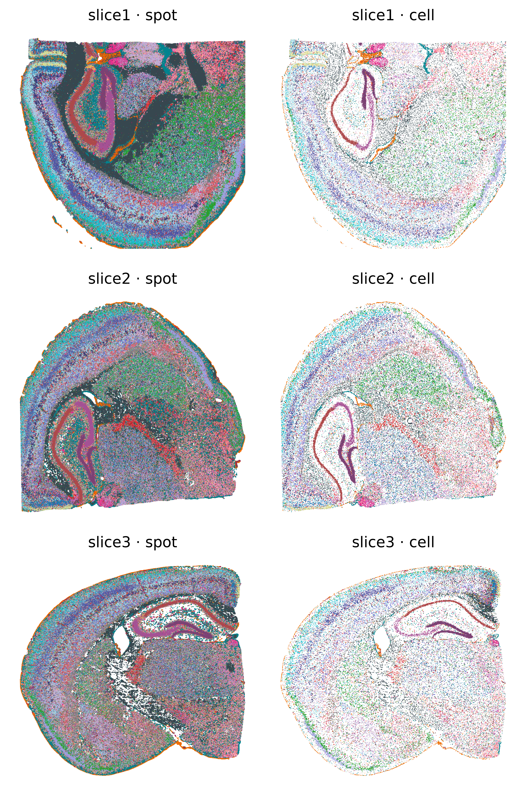
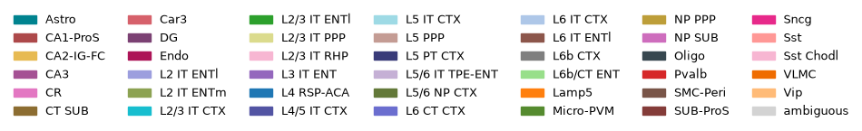
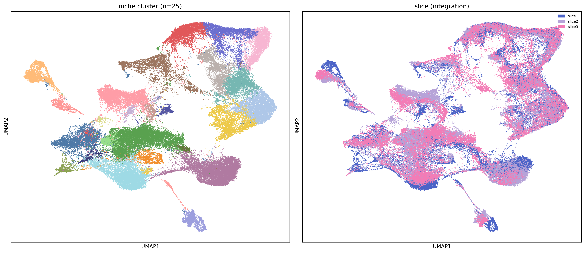
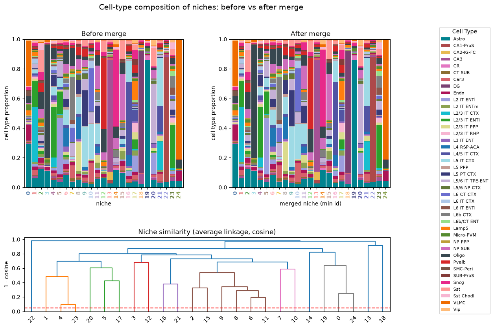
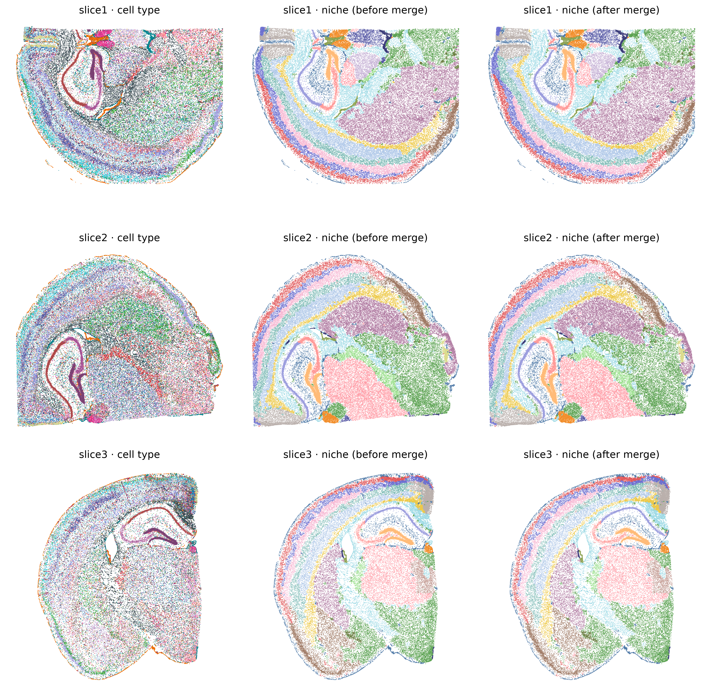
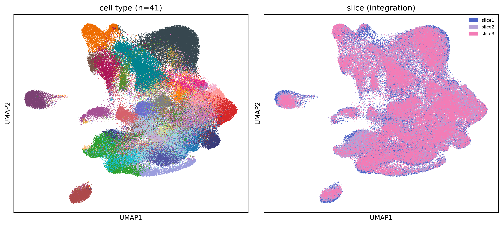
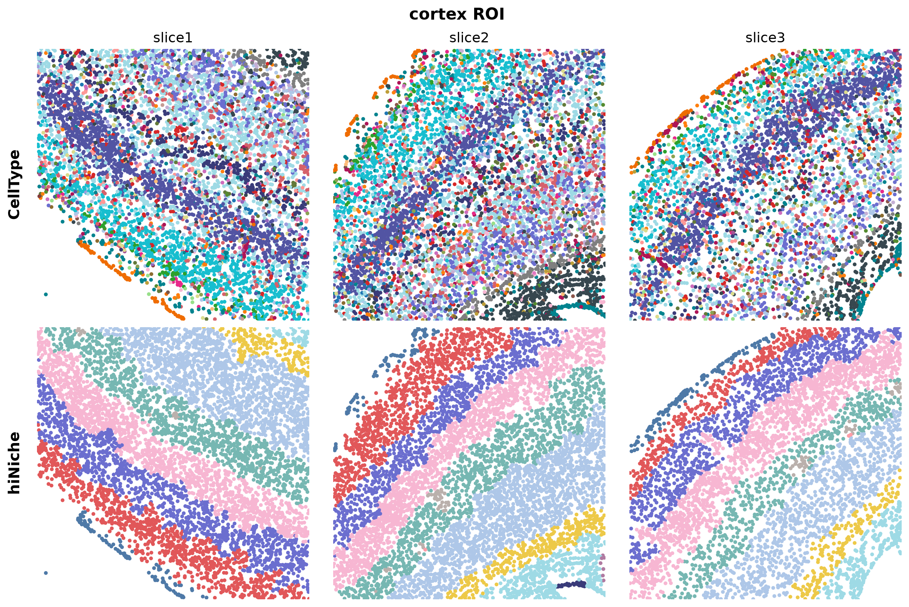
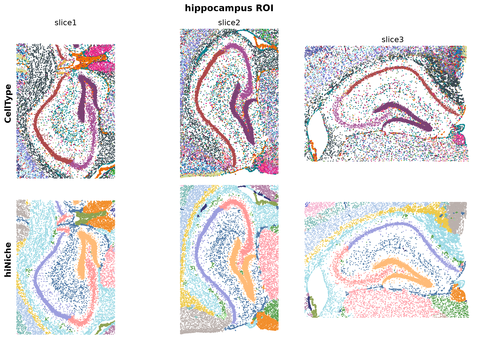

Mouse brain
================================================================================

:download:`Download original notebook <examples/HDST_mousebrain_run_hiNiche_multi.ipynb>`

Code and saved outputs are reproduced from this notebook. No cells are executed during documentation builds.

These source notebooks expect preprocessed files produced by preprocess_multislice.py (including meta.pkl and per-slice AnnData files). That script is not present in the supplied project directory; obtain it and prepare these inputs before running this notebook.

.. rubric:: hiNiche: multi-slice mouse brain Visium HD analysis

.. raw:: html

   
Joint multi-scale (spot / cell / niche) cell-type deconvolution and niche discovery across several Visium HD slices.

.. raw:: html

   
<strong>Environment:</strong> run this notebook in the main <strong><code>hiNiche</code></strong> environment (<code>environment.yml</code>).

.. raw:: html

   
<strong>Workflow.</strong> Preprocessing is done slice by slice with <code>preprocess_multislice.py</code> (all preprocessing parameters are set at the top of that script), so the slices are never loaded together:

.. code-block:: bash

   python preprocess_multislice.py --mode genes                  # shared genes + reference
   python preprocess_multislice.py --mode slice --slice-idx 0    # one job per slice
   python preprocess_multislice.py --mode slice --slice-idx 1
   python preprocess_multislice.py --mode slice --slice-idx 2
   python preprocess_multislice.py --mode collect                # meta.pkl for training

.. raw:: html

   
This notebook then trains all slices jointly and analyzes the results.

1. Setup and imports
--------------------------------------------------------------------------------

.. code-block:: python
   :linenos:

   import os
   import sys
   # cupy (used by rapids_singlecell) compiles GPU kernels at runtime and needs the CUDA headers shipped inside the conda environment
   os.environ.setdefault("CUDA_PATH", os.path.join(sys.prefix, "targets", "x86_64-linux"))
   
   # --- Project modules ---
   import config
   import utils
   from train import run_train_seq
   
   # --- Standard library ---
   import pickle
   import warnings
   
   # --- Data handling ---
   import numpy as np
   import pandas as pd
   import anndata as ad
   
   # --- Deep learning ---
   import torch
   import torch.nn.functional as F
   
   # --- Clustering ---
   import rapids_singlecell as rsc     # GPU-accelerated neighbors / Leiden / UMAP
   from scipy.cluster.hierarchy import linkage, fcluster, dendrogram
   
   # --- Plotting ---
   import matplotlib.pyplot as plt
   import matplotlib.patches as mpatches
   from matplotlib.colors import LinearSegmentedColormap
   from matplotlib.lines import Line2D
   
   %load_ext autoreload
   %autoreload 2
   
   warnings.filterwarnings("ignore")

.. container:: cell-output

   .. code-block:: text

      /hpc/home/wz220/miniconda3/envs/hiNiche/lib/python3.12/site-packages/tqdm/auto.py:21: TqdmWarning: IProgress not found. Please update jupyter and ipywidgets. See https://ipywidgets.readthedocs.io/en/stable/user_install.html
        from .autonotebook import tqdm as notebook_tqdm

2. Parameter configuration
--------------------------------------------------------------------------------

.. raw:: html

   
Preprocessing parameters are set in <code>preprocess_multislice.py</code> and stored in <code>meta.pkl</code>; the model path, training hyperparameters and analysis settings are set here.

.. code-block:: python
   :linenos:

   SAMPLE = "Mousebrain_HD_multi_slices"
   
   # Output directory of preprocess_multislice.py (OUT_DIR): meta.pkl, adata_slice{i}.h5ad
   PREPROCESS_DIR = f"DATA/{SAMPLE}/preprocessed"
   
   #Model save path (if the file exists, the model is loaded and training is skipped)
   MODEL_SAVE_DIR = f"DATA/{SAMPLE}/checkpoint.pt"
   
   # Cell-type color map defined in config.py
   celltype_color = getattr(config, "colormap_mouse_brain_41")
   umap_color = getattr(config, "umap_100")
   # Slice / batch colors: blue -> pink (with 3 slices: 0.12 / 0.5 / 0.88 of the gradient)
   bluepink = LinearSegmentedColormap.from_list(
       "bluepink", ["#2b3fb0", "#6f8be0", "#b6a3d8", "#e58bbf", "#ff6fae"])
   
   # Model / training hyperparameters
   lr          = 0.005
   num_epochs  = 30
   edge_drop   = 0.5
   member_drop = 0.5
   neg_samples = 5
   tau         = 1
   alpha       = 1
   beta        = 1  
   seed        = 42
   
   # Niche clustering / merging
   emb_k        = 50      # neighbors of the KNN graph on embeddings (Leiden / UMAP)
   resolution   = 0.5     # Leiden resolution; higher -> more clusters
   merge_thresh = 0.05    # cosine distance below which niche clusters with similar composition are merged
   
   device = "cuda:0"

3. Load preprocessed slices
--------------------------------------------------------------------------------

.. raw:: html

   
<code>meta.pkl</code> holds the training inputs (unit numbers and patch directory of each slice, reference matrix) and the preprocessing parameters. For each slice only the spot coordinates and the spot → cell matrix are loaded from <code>adata_slice{i}.h5ad</code>; the expression matrix stays on disk (<code>backed=&quot;r&quot;</code>).

.. code-block:: python
   :linenos:

   with open(os.path.join(PREPROCESS_DIR, "meta.pkl"), "rb") as f:
       meta = pickle.load(f)
   
   SLICES     = meta["slice_names"]          # training slice index i <-> SLICES[i]
   n_slice    = len(SLICES)
   slice_colors = [bluepink(v) for v in np.linspace(0.12, 0.88, n_slice)]   # one color per slice (all slice / batch plots)
   P          = meta["params"]               # preprocessing parameters (for reference)
   celltypes  = meta["celltypes"]
   ref_matrix = meta["ref_matrix"]
   active_niche_indices_list = meta["active_niche_indices_list"]
   
   print(f"{n_slice} slices: {SLICES} | input genes {meta['in_dim']} | cell types {meta['hidden_dim']}")
   for k, v in P.items():
       print(f"  {k:20s} = {v}")
   
   # Per-slice spot coordinates and spot -> cell matrices
   spatial_grid_list, spatial_pixel_list, S_s2c_list = [], [], []
   for i, s in enumerate(SLICES):
       a = ad.read_h5ad(os.path.join(PREPROCESS_DIR, f"adata_slice{i}.h5ad"), backed="r")
       spatial_grid_list.append(np.asarray(a.obsm["spatial_grid"]))
       spatial_pixel_list.append(np.asarray(a.obsm["spatial_pixel"]))
       S_s2c_list.append(utils.sp_to_torch_sparse(a.obsm["S_s2c"]))
       a.file.close()
   
       # Consistency check with the cached mini-batches
       n = meta["sample_number_list"][i]
       assert S_s2c_list[i].shape == (n["spot"], n["cell"]), f"{s}: adata_slice{i}.h5ad does not match meta.pkl"
       print(f"[Log] {s}: {n['spot']} spots, {n['cell']} cells, {n['niche']} niches")

.. container:: cell-output

   .. code-block:: text

      3 slices: ['slice1', 'slice2', 'slice3'] | input genes 4813 | cell types 41
        bg_threshold         = 50
        bg_rings             = 4
        max_spots_per_cell   = 100
        min_spots_per_cell   = 3
        Patch_size           = 512
        halo                 = 32
        graph_knn            = 12
        niche_knn            = 15
      [Log] slice1: 7224615 spots, 71380 cells, 71380 niches
      [Log] slice2: 6618476 spots, 73323 cells, 73323 niches
      [Log] slice3: 5402710 spots, 51395 cells, 51395 niches

4. Joint multi-slice training
--------------------------------------------------------------------------------

.. code-block:: python
   :linenos:

   emb_all, slice_id = run_train_seq(meta["sample_number_list"],
                                     PATCH_LOC = meta["PATCH_LOC"],
                                     MODEL_SAVE_DIR = MODEL_SAVE_DIR,
                                     ref_matrix = ref_matrix,
                                     lr = lr,
                                     in_dim = meta["in_dim"],
                                     hidden_dim = meta["hidden_dim"],
                                     num_epochs = num_epochs,
                                     edge_drop = edge_drop,
                                     member_drop = member_drop,
                                     neg_samples = neg_samples,
                                     tau = tau,
                                     alpha = alpha,
                                     beta = beta,
                                     seed = seed,
                                     device = device)
   # emb_all[level]: embeddings of all slices concatenated; slice_id[level]: slice index of each row

.. container:: cell-output

   .. code-block:: text

      Epoch 1: 100%|██████████| 101/101 [00:20<00:00,  4.84it/s, cl=5.5360, nll=448.2026, entp=-5.9446]
      Epoch 2: 100%|██████████| 101/101 [00:20<00:00,  4.90it/s, cl=5.2135, nll=441.5322, entp=-5.5652]
      Epoch 3: 100%|██████████| 101/101 [00:20<00:00,  4.88it/s, cl=5.1642, nll=439.1027, entp=-5.6430]
      Epoch 4: 100%|██████████| 101/101 [00:20<00:00,  4.88it/s, cl=5.1562, nll=438.4471, entp=-5.5753]
      Epoch 5: 100%|██████████| 101/101 [00:20<00:00,  4.90it/s, cl=5.1465, nll=438.0702, entp=-5.6338]
      Epoch 6: 100%|██████████| 101/101 [00:20<00:00,  4.88it/s, cl=5.1134, nll=437.9050, entp=-5.6767]
      Epoch 7: 100%|██████████| 101/101 [00:20<00:00,  4.88it/s, cl=5.0871, nll=437.7139, entp=-5.7552]
      Epoch 8: 100%|██████████| 101/101 [00:20<00:00,  4.84it/s, cl=5.0791, nll=437.5897, entp=-5.7822]
      Epoch 9: 100%|██████████| 101/101 [00:20<00:00,  4.85it/s, cl=5.0732, nll=437.4645, entp=-5.7986]
      Epoch 10: 100%|██████████| 101/101 [00:20<00:00,  4.85it/s, cl=5.0615, nll=437.3799, entp=-5.8268]
      Epoch 11: 100%|██████████| 101/101 [00:20<00:00,  4.87it/s, cl=5.0650, nll=437.2816, entp=-5.8672]
      Epoch 12: 100%|██████████| 101/101 [00:20<00:00,  4.88it/s, cl=5.0689, nll=437.2040, entp=-5.8475]
      Epoch 13: 100%|██████████| 101/101 [00:20<00:00,  4.86it/s, cl=5.0536, nll=437.1039, entp=-5.9060]
      Epoch 14: 100%|██████████| 101/101 [00:20<00:00,  4.87it/s, cl=5.0501, nll=437.0828, entp=-5.9169]
      Epoch 15: 100%|██████████| 101/101 [00:21<00:00,  4.81it/s, cl=5.0572, nll=436.9994, entp=-5.9019]
      Epoch 16: 100%|██████████| 101/101 [00:20<00:00,  4.87it/s, cl=5.0433, nll=436.9701, entp=-5.9201]
      Epoch 17: 100%|██████████| 101/101 [00:20<00:00,  4.88it/s, cl=5.0493, nll=436.9424, entp=-5.9086]
      Epoch 18: 100%|██████████| 101/101 [00:20<00:00,  4.84it/s, cl=5.0417, nll=436.9210, entp=-5.9242]
      Epoch 19: 100%|██████████| 101/101 [00:20<00:00,  4.86it/s, cl=5.0351, nll=436.8607, entp=-5.9519]
      Epoch 20: 100%|██████████| 101/101 [00:20<00:00,  4.88it/s, cl=5.0313, nll=436.8424, entp=-5.9707]
      Epoch 21: 100%|██████████| 101/101 [00:20<00:00,  4.83it/s, cl=5.0338, nll=436.8188, entp=-5.9465]
      Epoch 22: 100%|██████████| 101/101 [00:20<00:00,  4.89it/s, cl=5.0385, nll=436.8202, entp=-5.9600]
      Epoch 23: 100%|██████████| 101/101 [00:20<00:00,  4.88it/s, cl=5.0406, nll=436.7821, entp=-5.9508]
      Epoch 24: 100%|██████████| 101/101 [00:20<00:00,  4.86it/s, cl=5.0305, nll=436.7564, entp=-5.9593]
      Epoch 25: 100%|██████████| 101/101 [00:20<00:00,  4.84it/s, cl=5.0266, nll=436.7289, entp=-5.9844]
      Epoch 26: 100%|██████████| 101/101 [00:20<00:00,  4.83it/s, cl=5.0229, nll=436.6871, entp=-5.9986]
      Epoch 27: 100%|██████████| 101/101 [00:20<00:00,  4.87it/s, cl=5.0215, nll=436.6848, entp=-5.9983]
      Epoch 28: 100%|██████████| 101/101 [00:20<00:00,  4.85it/s, cl=5.0235, nll=436.6463, entp=-6.0078]
      Epoch 29: 100%|██████████| 101/101 [00:20<00:00,  4.85it/s, cl=5.0209, nll=436.6606, entp=-6.0086]
      Epoch 30: 100%|██████████| 101/101 [00:20<00:00,  4.85it/s, cl=5.0238, nll=436.6078, entp=-6.0018]

.. container:: cell-output

   .. code-block:: text

      Training finished!
      Model saved to DATA/Mousebrain_HD_multi_slices/checkpoint.pt

.. container:: cell-output

   .. code-block:: text

      generating embeddings (slice 0)...: 100%|██████████| 34/34 [00:08<00:00,  3.87it/s]
      generating embeddings (slice 1)...: 100%|██████████| 36/36 [00:07<00:00,  4.95it/s]
      generating embeddings (slice 2)...: 100%|██████████| 31/31 [00:05<00:00,  5.56it/s]

5. Re-assign unmapped spots
--------------------------------------------------------------------------------

.. code-block:: python
   :linenos:

   # Re-assign unmapped (background) spots to nearby cells using spot embeddings, slice by slice
   S_s2c_updated_list = []
   for b, s in enumerate(SLICES):
       spot_embs = emb_all["spot"][slice_id["spot"] == b].detach().cpu().numpy()
       new_assignments = utils.reassign_unmapped_spots(
           S_s2c_list[b],
           spatial_grid_list[b],                # grid coordinates of this slice, 1 unit = 1 spot
           spot_embs,
           algorithm="fixed_boundary",
           fixed_distance=2,
       )
       print(f"[Log] {s}: {len(new_assignments)} background spots re-assigned")
       S_s2c_updated_list.append(utils.update_S(S_s2c_list[b], new_assignments))

.. container:: cell-output

   .. code-block:: text

      Total unassigned spots: 6616482

.. container:: cell-output

   .. code-block:: text

      Assigning spots (boundary): 100%|██████████| 6616482/6616482 [01:35<00:00, 69479.98it/s]

.. container:: cell-output

   .. code-block:: text

      [Log] slice1: 1521112 background spots re-assigned
      Total unassigned spots: 5724089

.. container:: cell-output

   .. code-block:: text

      Assigning spots (boundary): 100%|██████████| 5724089/5724089 [01:28<00:00, 64612.07it/s]

.. container:: cell-output

   .. code-block:: text

      [Log] slice2: 1687786 background spots re-assigned
      Total unassigned spots: 4775101

.. container:: cell-output

   .. code-block:: text

      Assigning spots (boundary): 100%|██████████| 4775101/4775101 [01:07<00:00, 70640.55it/s]

.. container:: cell-output

   .. code-block:: text

      [Log] slice3: 1185632 background spots re-assigned

6. Visualization
--------------------------------------------------------------------------------

6.1 Spot- and cell-level cell-type maps
~~~~~~~~~~~~~~~~~~~~~~~~~~~~~~~~~~~~~~~~~~~~~~~~~~~~~~~~~~~~~~~~~~~~~~~~~~~~~~~~

.. code-block:: python
   :linenos:

   def type_labels(prob_max, prob_idx):
       """Cell-type label per row: "filtered" (no cell), "ambiguous" (max prob < 0.1) or the argmax type."""
       labels = []
       for p_, i_ in zip(prob_max, prob_idx):
           if i_ == -1:
               labels.append("filtered")
           elif p_ < 0.1:
               labels.append("ambiguous")
           else:
               labels.append(celltypes[i_])
       return labels
   
   keys = ["spot", "cell"]
   fig, axes = plt.subplots(n_slice, 2, figsize=(6, 3 * n_slice), dpi=600, squeeze=False)
   labels_all_list = []
   for b, s in enumerate(SLICES):
       x_raw, y_raw = spatial_pixel_list[b][:, 0], spatial_pixel_list[b][:, 1]
       S = S_s2c_updated_list[b].coalesce()
   
       labels_all = {}
       for ci, check in enumerate(keys):
           prob = F.softmax(emb_all[check][slice_id[check] == b], dim=1)   # embeddings of this slice
           max_prob_raw, max_idx_raw = torch.max(prob, dim=1)
   
           if check == "cell":
               # Broadcast each cell's prediction to its spots (spot -> cell mapping)
               rows, cols = S.indices()[0], S.indices()[1]
               spot2target = torch.full((S.size(0),), -1, dtype=torch.long, device=S.device)
               spot2target[rows] = cols
               max_idx  = torch.where(spot2target >= 0, max_idx_raw[spot2target],  torch.tensor(-1, device=S.device))
               max_prob = torch.where(spot2target >= 0, max_prob_raw[spot2target], torch.tensor(0.0, device=S.device))
           else:
               max_prob, max_idx = max_prob_raw, max_idx_raw
   
           labels_all[check] = type_labels(max_prob.cpu().numpy(), max_idx.cpu().numpy())
           ax = axes[b][ci]
           ax.scatter(x_raw, y_raw, c=[celltype_color[n] for n in labels_all[check]], s=0.5, marker='.', linewidths=0)
           ax.set_title(f"{s} · {check}")
           ax.invert_yaxis(); ax.axis("off")
       labels_all_list.append(labels_all)
   
   plt.tight_layout()
   plt.show()
   
   # --- Legend (shared by all slices) ---
   present = sorted({l for la in labels_all_list for l in la["spot"]})
   handles = [mpatches.Patch(color=celltype_color.get(c, "#cccccc"), label=c) for c in present]
   figL, axL = plt.subplots(figsize=(11, 0.6)); axL.axis("off")
   axL.legend(handles=handles, ncol=7, frameon=False, loc="center", fontsize=9)
   plt.show()

6.2 Joint niche clustering across slices (UMAP)
~~~~~~~~~~~~~~~~~~~~~~~~~~~~~~~~~~~~~~~~~~~~~~~~~~~~~~~~~~~~~~~~~~~~~~~~~~~~~~~~

.. raw:: html

   
Leiden clustering of the niche embeddings of all slices together, so niche labels are shared across slices.

.. code-block:: python
   :linenos:

   # --- Cluster niche embeddings of all slices (Leiden) + UMAP, sharing one neighbor graph ---
   adata_niche = ad.AnnData(emb_all["niche"].detach().cpu().numpy().astype(np.float32))
   rsc.pp.neighbors(adata_niche, use_rep="X", n_neighbors=emb_k)
   rsc.tl.leiden(adata_niche, resolution=resolution, random_state=seed)
   rsc.tl.umap(adata_niche, random_state=seed)
   niche_label = adata_niche.obs["leiden"].astype(int).values
   niche_umap  = adata_niche.obsm["X_umap"]
   clusters_id = {"niche": niche_label}
   sid_niche   = slice_id["niche"].numpy()
   print(f"niche: {len(np.unique(niche_label))} clusters")
   
   # --- Left: dominant cell type; middle: niche cluster; right: slice (integration check) ---
   fig, axes = plt.subplots(1, 2, figsize=(16, 7), dpi=300)
   axes[0].scatter(niche_umap[:, 0], niche_umap[:, 1],
                   c=[umap_color[f"Cluster_{v % 40}"] for v in niche_label], s=1, linewidths=0)
   axes[0].set_title(f"niche cluster (n={len(np.unique(niche_label))})")
   
   axes[1].scatter(niche_umap[:, 0], niche_umap[:, 1],
                   c=[slice_colors[b] for b in sid_niche], s=1, linewidths=0)
   axes[1].set_title("slice (integration)")
   axes[1].legend(handles=[mpatches.Patch(color=slice_colors[b], label=s) for b, s in enumerate(SLICES)],
                  fontsize=7, frameon=False, loc="upper right")
   
   for ax in axes:
       ax.set_xticks([]); ax.set_yticks([]); ax.set_xlabel("UMAP1"); ax.set_ylabel("UMAP2")
   plt.tight_layout()
   plt.show()

.. container:: cell-output

   .. code-block:: text

      niche: 25 clusters

6.3 Merge niches by cell-type composition
~~~~~~~~~~~~~~~~~~~~~~~~~~~~~~~~~~~~~~~~~~~~~~~~~~~~~~~~~~~~~~~~~~~~~~~~~~~~~~~~

.. raw:: html

   
The composition of a niche cluster is the cell-type distribution of the niche centers (niche j of slice b is centered at cell <code>active_niche_indices_list[b][j]</code>).

.. code-block:: python
   :linenos:

   # ---- Cell type of each cell, then of each niche center (aligned with the rows of emb_all["niche"]) ----
   cell_type = np.asarray(celltypes)[F.softmax(emb_all["cell"], dim=1).argmax(1).cpu().numpy()]
   sid_cell = slice_id["cell"].numpy()
   niche_center_type = np.concatenate([cell_type[sid_cell == b][np.asarray(active_niche_indices_list[b])]
                                       for b in range(n_slice)])
   
   # ---- Composition table (before merge) ----
   df_counts = pd.crosstab(np.asarray(clusters_id["niche"]), niche_center_type)
   
   # ---- Hierarchical clustering + merge ----
   comp = df_counts.div(df_counts.sum(1), axis=0)              # row-normalized composition
   Z = linkage(comp.values, method="average", metric="cosine")
   merged = fcluster(Z, t=merge_thresh, criterion="distance")
   group_members = {}
   for old, g in zip(comp.index, merged):
       group_members.setdefault(g, []).append(int(old))
   old2new = {o: min(members) for members in group_members.values() for o in members}   # smallest id in each group becomes the new label
   
   print(f"{len(comp)} niche clusters -> {len(set(old2new.values()))} merged")
   for rep in sorted(set(old2new.values())):
       members = sorted(o for o, r in old2new.items() if r == rep)
       if len(members) > 1:
           print(f"  {members} -> {rep}")
   
   niche_merged = np.array([old2new[l] for l in clusters_id["niche"]])
   clusters_id["niche_merged"] = niche_merged
   
   # ---- Composition tables as proportions (each bar stacks to 1) ----
   dfm = pd.crosstab(niche_merged, niche_center_type)
   comp_before = comp
   comp_after  = dfm.div(dfm.sum(1), axis=0)
   
   # ================= Layout: top row before/after merge, bottom row full-width dendrogram =================
   fig = plt.figure(figsize=(12, 9))
   gs = fig.add_gridspec(2, 2, height_ratios=[2, 1], hspace=0.45, wspace=0.3)
   ax_before = fig.add_subplot(gs[0, 0])
   ax_after  = fig.add_subplot(gs[0, 1])
   ax_dendro = fig.add_subplot(gs[1, :])
   
   def stacked(ax, df, title, xlabel):
       """Stacked bar chart of cell-type proportions per niche; x tick labels colored by niche."""
       df.plot(kind="bar", stacked=True, ax=ax,
               color=[celltype_color[c] for c in df.columns], width=0.9, legend=False)
       for tick, nid in zip(ax.get_xticklabels(), df.index):
           tick.set_color(umap_color[f"Cluster_{nid % 40}"]); tick.set_fontweight("bold")
       ax.set_title(title); ax.set_xlabel(xlabel); ax.set_ylabel("cell type proportion")
       ax.set_ylim(0, 1)
   
   stacked(ax_before, comp_before, "Before merge", "niche")
   stacked(ax_after,  comp_after,  "After merge",  "merged niche (min id)")
   
   handles, labels = ax_before.get_legend_handles_labels()
   fig.legend(handles, labels, bbox_to_anchor=(1.0, 0.92), loc="upper left",
              title="Cell Type", prop={"size": 8})
   
   dendrogram(Z, labels=comp.index.tolist(), ax=ax_dendro)
   ax_dendro.axhline(merge_thresh, ls="--", c="r")
   ax_dendro.set_ylabel("1 - cosine")
   ax_dendro.set_title("Niche similarity (average linkage, cosine)")
   
   fig.suptitle("Cell-type composition of niches: before vs after merge", fontsize=14)
   plt.savefig("s.pdf")
   plt.show()

.. container:: cell-output

   .. code-block:: text

      25 niche clusters -> 25 merged

6.4 Spatial maps per slice: cell types and niches before / after merge
~~~~~~~~~~~~~~~~~~~~~~~~~~~~~~~~~~~~~~~~~~~~~~~~~~~~~~~~~~~~~~~~~~~~~~~~~~~~~~~~

.. code-block:: python
   :linenos:

   def col(labels):
       """Niche colors depend only on the label id, so colors stay consistent before / after merge."""
       return [umap_color[f"Cluster_{l % 40}"] for l in labels]
   
   fig, axes = plt.subplots(n_slice, 3, figsize=(12, 4 * n_slice), dpi=300, squeeze=False)
   for b, s in enumerate(SLICES):
       # Cell position = mean pixel coordinate of its spots (after re-assignment)
       S = S_s2c_updated_list[b].coalesce()
       s_rows, c_cols = S.indices()
       n_cell = S.size(1)
       spatial = torch.as_tensor(spatial_pixel_list[b], dtype=torch.float32)
       cell_pos = torch.zeros((n_cell, 2)).index_add_(0, c_cols, spatial[s_rows])
       cell_cnt = torch.zeros(n_cell).index_add_(0, c_cols, torch.ones_like(c_cols, dtype=torch.float32))
       cell_pos = (cell_pos / cell_cnt.clamp(min=1).unsqueeze(1)).numpy()
   
       # Niche labels of this slice mapped to their center cells (-1 = not a niche center)
       m = sid_niche == b
       active = np.asarray(active_niche_indices_list[b])
       cell_niche = np.full(n_cell, -1); cell_niche[active] = clusters_id["niche"][m]
       cell_niche_merged = np.full(n_cell, -1); cell_niche_merged[active] = clusters_id["niche_merged"][m]
       keep = (cell_cnt.numpy() > 0) & (cell_niche >= 0)
       ct_b = cell_type[sid_cell == b]
   
       axes[b][0].scatter(cell_pos[keep, 0], cell_pos[keep, 1], c=[celltype_color[c] for c in ct_b[keep]], s=0.5, linewidths=0)
       axes[b][0].set_title(f"{s} · cell type")
       axes[b][1].scatter(cell_pos[keep, 0], cell_pos[keep, 1], c=col(cell_niche[keep]), s=0.5, linewidths=0)
       axes[b][1].set_title(f"{s} · niche (before merge)")
       axes[b][2].scatter(cell_pos[keep, 0], cell_pos[keep, 1], c=col(cell_niche_merged[keep]), s=0.5, linewidths=0)
       axes[b][2].set_title(f"{s} · niche (after merge)")
       for ax in axes[b]:
           ax.invert_yaxis(); ax.set_aspect("equal"); ax.axis("off")
   
   plt.tight_layout()
   plt.show()

.. code-block:: python
   :linenos:

   # --- Save niche cluster ids (before / after merge) and niche UMAP coordinates ---
   # One row per niche (row order = rows of emb_all["niche"], all slices concatenated)
   niche_out = pd.DataFrame({
       "slice":              np.asarray(SLICES)[sid_niche],
       "center_cell":        np.concatenate([np.asarray(active_niche_indices_list[b]) for b in range(n_slice)]),   # cell index within its slice
       "niche_before_merge": np.asarray(clusters_id["niche"]),
       "niche_after_merge":  np.asarray(clusters_id["niche_merged"]),
       "UMAP1":              niche_umap[:, 0],
       "UMAP2":              niche_umap[:, 1],
   })
   niche_out.index.name = "niche"
   niche_out_path = f"DATA/{SAMPLE}/niche_clusters.csv"
   niche_out.to_csv(niche_out_path)
   print(f"[Log] saved {len(niche_out)} niches -> {niche_out_path}")
   niche_out.head()

.. container:: cell-output

   .. code-block:: text

      [Log] saved 196098 niches -> DATA/Mousebrain_HD_multi_slices/niche_clusters.csv

.. container:: cell-output

   .. code-block:: text

      slice  center_cell  niche_before_merge  niche_after_merge     UMAP1  \
      niche                                                                         
      0      slice1            0                   8                  8  5.911800   
      1      slice1            1                   8                  8  4.168363   
      2      slice1            2                   8                  8  6.371096   
      3      slice1            3                   8                  8  4.879289   
      4      slice1            4                   8                  8  4.701824   
      
                 UMAP2  
      niche             
      0       8.817066  
      1      10.898416  
      2       7.060815  
      3      10.453058  
      4      10.299248

6.5 Cell embedding UMAP (integration check)
~~~~~~~~~~~~~~~~~~~~~~~~~~~~~~~~~~~~~~~~~~~~~~~~~~~~~~~~~~~~~~~~~~~~~~~~~~~~~~~~

.. raw:: html

   
UMAP of the cell embeddings of all slices, colored by predicted cell type and by slice.

.. code-block:: python
   :linenos:

   adata_cell = ad.AnnData(emb_all["cell"].detach().cpu().numpy().astype(np.float32))
   rsc.pp.neighbors(adata_cell, use_rep="X", n_neighbors=emb_k)
   rsc.tl.umap(adata_cell, random_state=seed)
   cell_umap = adata_cell.obsm["X_umap"]
   
   fig, axes = plt.subplots(1, 2, figsize=(11, 5), dpi=300)
   axes[0].scatter(cell_umap[:, 0], cell_umap[:, 1], c=[celltype_color.get(c, "#cccccc") for c in cell_type], s=1, linewidths=0)
   axes[0].set_title(f"cell type (n={len(np.unique(cell_type))})")
   axes[1].scatter(cell_umap[:, 0], cell_umap[:, 1], c=[slice_colors[b] for b in sid_cell], s=1, linewidths=0)
   axes[1].set_title("slice (integration)")
   axes[1].legend(handles=[mpatches.Patch(color=slice_colors[b], label=s) for b, s in enumerate(SLICES)],
                  fontsize=7, frameon=False, loc="upper right")
   for ax in axes:
       ax.set_xticks([]); ax.set_yticks([]); ax.set_xlabel("UMAP1"); ax.set_ylabel("UMAP2")
   plt.tight_layout()
   plt.show()

7. ROI comparison: cell types vs. hiNiche niches
--------------------------------------------------------------------------------

.. raw:: html

   
Regions of interest in full-resolution pixel coordinates, one per slice, each given as <code>[x_min, x_max, y_min, y_max]</code>. One figure is drawn for the cortex ROIs and one for the hippocampus ROIs.

.. code-block:: python
   :linenos:

   # One ROI per slice (aligned with SLICES): [x_min, x_max, y_min, y_max] in full-resolution pixels
   cortex_rois = [[4144+2000+2000, 9760+2000+2000, 10500+2000+2000, 16116+2000+2000],
                  [4644-1000, 10260-1000, 2500+1000, 8116+1000],
                  [2144+1000, 7760+1000, 3500-1000, 9116-1000]]
   hippo_rois  = [[7344, 14854, 1700, 13116],
                  [4344-500, 11854-500, 8700, 20116],
                  [7700, 19116, 2844, 10354]]
   
   roi_sets  = {"cortex": cortex_rois, "hippocampus": hippo_rois}   # one figure per ROI set
   point_size =  {"cortex": 50, "hippocampus": 10} 
   NICHE_KEY = "niche"              # "niche" (before merge) or "niche_merged" (after merge)
   methods   = ["CellType", "hiNiche"]
   
   # ---- Cell centers per slice: mean pixel coordinate of each cell's spots (after re-assignment) ----
   def cell_centers(b):
       S = S_s2c_updated_list[b].coalesce()
       srow, scol = S.indices(); n_cell = S.size(1)
       sxy = torch.as_tensor(spatial_pixel_list[b], dtype=torch.float32)
       pos = torch.zeros((n_cell, 2)).index_add_(0, scol, sxy[srow])
       cnt = torch.zeros(n_cell).index_add_(0, scol, torch.ones_like(scol, dtype=torch.float32))
       return (pos / cnt.clamp(min=1).unsqueeze(1)).numpy(), cnt.numpy(), n_cell
   centers = {b: cell_centers(b) for b in range(n_slice)}
   
   def hiniche_labels(b, n_cell):
       """Niche cluster of each cell of slice b (via the niche's center cell); -1 = not a niche center."""
       lab = np.full(n_cell, -1, dtype=int)
       lab[np.asarray(active_niche_indices_list[b])] = np.asarray(clusters_id[NICHE_KEY])[slice_id["niche"].numpy() == b]
       return lab
   
   def celltype_labels(b, n_cell):
       """Predicted cell type (argmax of the cell embedding) of each cell of slice b."""
       return np.asarray(celltypes)[F.softmax(emb_all["cell"][slice_id["cell"] == b], dim=1).argmax(1).cpu().numpy()]
   
   label_getters = {
       "hiNiche":  hiniche_labels,
       "CellType": celltype_labels,
   }
   
   for roi_name, rois in roi_sets.items():
       fig, axes = plt.subplots(len(methods), n_slice,
                                figsize=(4 * n_slice, 4 * len(methods)), dpi=200, squeeze=False)
       for r, meth in enumerate(methods):
           for b in range(n_slice):
               ax = axes[r][b]
               cp, cc, n_cell = centers[b]
               lab = label_getters[meth](b, n_cell)
               x_min, x_max, y_min, y_max = map(int, rois[b])
               in_roi = (cp[:, 0] >= x_min) & (cp[:, 0] < x_max) & (cp[:, 1] >= y_min) & (cp[:, 1] < y_max)
   
               if meth == "CellType":                          # cell types: names -> celltype_color
                   m = in_roi & (cc > 0)
                   colors = [celltype_color.get(t, "#cccccc") for t in lab[m]]
               else:                                           # niche clusters: ids -> umap_color
                   m = in_roi & (cc > 0) & (lab >= 0)
                   colors = [umap_color[f"Cluster_{int(v) % 40}"] for v in lab[m]]
   
               ax.scatter(cp[m, 0], cp[m, 1], c=colors, s=point_size[roi_name], marker='.', linewidths=0, rasterized=True)
               ax.set_xlim(x_min, x_max); ax.set_ylim(y_min, y_max)
               ax.set_aspect("equal"); ax.invert_yaxis(); ax.axis("off")
               if r == 0:
                   ax.set_title(SLICES[b], fontsize=13)
               if b == 0:
                   ax.text(-0.08, 0.5, meth, transform=ax.transAxes, rotation=90,
                           va="center", ha="center", fontsize=14, fontweight="bold")
   
       fig.suptitle(f"{roi_name} ROI", fontsize=15, fontweight="bold")
       plt.tight_layout()
       plt.savefig(f"s_{roi_name}.pdf")
       plt.show()

