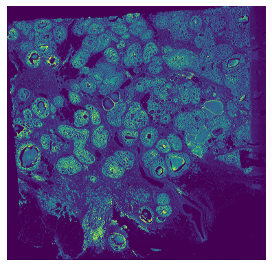

Nuclei segmentation
================================================================================

:download:`Download original notebook <examples/HDST_step1_build_nuclei_mask.ipynb>`

Code and saved outputs are reproduced from this notebook. No cells are executed during documentation builds.

.. rubric:: Step 1: Nuclei segmentation with StarDist

.. raw:: html

   
<strong>⚠️ Environment:</strong> run this notebook in the separate <strong><code>stardist</code></strong> environment, <strong>not</strong> the main <code>hiNiche</code> environment.

.. raw:: html

   
StarDist depends on TensorFlow, which requires <code>numpy&lt;2</code> and is incompatible with the RAPIDS / PyTorch stack used in steps 2 and 3.

.. code-block:: bash

   conda env create -f environment_stardist.yml
   conda activate stardist
   python -m ipykernel install --user --name stardist

.. raw:: html

   
Then select the <code>stardist</code> kernel for this notebook.

.. raw:: html

   
This notebook segments nuclei on the full-resolution H&amp;E image with the pretrained StarDist <code>2D_versatile_he</code> model and saves the nuclei label mask as a sparse <code>.npz</code> file. The output is used as <code>segmentation_mask.npz</code> in step 3.

1. Load and normalize the H&E image
--------------------------------------------------------------------------------

.. raw:: html

   
Set <code>hd_fullres_img_btf_path</code> to the full-resolution H&amp;E image (<code>.btf</code>) of your sample. The image is read lazily as a zarr store and percentile-normalized to [0, 1].

.. code-block:: python
   :linenos:

   import tifffile as tiff
   import zarr
   import matplotlib.pyplot as plt
   import scipy.spatial
   import scipy.sparse
   import scipy.stats
   import scanpy as sc
   import numpy as np
   
   def normalize(img):
       '''
       Extremely naive reimplementation of default ``cbsdeep.utils.normalize()`` 
       percentile normalisation, with a lower RAM footprint than the original.
       
       Input
       -----
       img : ``numpy.array``
           Numpy array image to normalize
       '''
       eps = 1e-20
       mi = np.percentile(img,3)
       ma = np.percentile(img,99.8)
       norm = (img - mi) / ( ma - mi + eps )
       norm[norm < 0] = 0
       norm[norm > 1] = 1
       return norm
   
   #hd_data_square_002um_path = '/Users/weihangzhang/Documents/Project/Spatial_data/HD/Mouse_Brain/binned_outputs/square_002um/' # shall contain filtered_feature_bc_matrix.h5 
   hd_fullres_img_btf_path = "/Users/weihangzhang/Documents/Project/Spatial_data/HD/Breast_Cancer3/Visium_HD_Human_Breast_Cancer_Fixed_Frozen_tissue_image.btf"
   
   with tiff.TiffFile(hd_fullres_img_btf_path) as tif:
       print(tif.series)
       store = tif.series[0].aszarr()   # lazy store，不读全图
       
   z = zarr.open(store, mode="r")
   z = normalize(z)

.. container:: cell-output

   .. code-block:: text

      [<tifffile.TiffPageSeries 0 ome>]

2. Visualize the normalized image
--------------------------------------------------------------------------------

.. code-block:: python
   :linenos:

   plt.imshow(z)
   plt.axis("off")
   plt.show()

3. Segment nuclei with StarDist
--------------------------------------------------------------------------------

.. raw:: html

   
<code>predict_instances_big</code> tiles the image automatically. <code>prob_thresh</code> and <code>nms_thresh</code> control detection sensitivity and overlap suppression.

.. code-block:: python
   :linenos:

   from stardist.models import StarDist2D
   #load and percentile normalize image, following stardist demo protocol
   #turn it to np.float16 pre normalisation to keep RAM footprint minimal
   
   stardist_model = "2D_versatile_he"
   #use pretrained stardist model
   model = StarDist2D.from_pretrained(stardist_model)
   #will need to specify axes shortly, which are model dependent
   if stardist_model == "2D_versatile_he":
       #3D image, got the axes YXC from the H&E model config.json
       model_axes = "YXC"
   elif stardist_model == "2D_versatile_fluo":
       #2D image, got the axes YX from logic and trying and it working
       model_axes = "YX"
   #run predict_instances_big() to perform automated tiling of the input
   #this is less parameterised than predict_instances, needed to pass axes too
   #pass any other **kwargs to the thing, passing them on internally
   #in practice this is going to be prob_thresh
   labels, polys = model.predict_instances_big(z, 
                                           axes=model_axes, 
                                           block_size=4096, 
                                           min_overlap=128, 
                                           context=128,
                                           prob_thresh=0.01,
                                           nms_thresh = 0.001,
                                           )
   #store resulting labels as sparse matrix NPZ - super efficient space wise
   labels_sparse = scipy.sparse.csr_matrix(labels)
   print("Found "+str(len(np.unique(labels_sparse.data)))+" objects")

.. container:: cell-output

   .. code-block:: text

      Found model '2D_versatile_he' for 'StarDist2D'.
      Loading network weights from 'weights_best.h5'.
      Loading thresholds from 'thresholds.json'.
      Using default values: prob_thresh=0.692478, nms_thresh=0.3.
      effective: block_size=(4096, 4096, 3), min_overlap=(128, 128, 0), context=(128, 128, 0)

.. container:: cell-output

   .. code-block:: text

      100%|██████████| 132/132 [23:20<00:00, 10.61s/it]

.. container:: cell-output

   .. code-block:: text

      Found 788559 objects

4. Save the segmentation mask
--------------------------------------------------------------------------------

.. raw:: html

   
The label image is stored as a sparse matrix. Save it as <code>DATA/&lt;SAMPLE&gt;/segmentation_mask.npz</code> so that step 3 can load it.

.. code-block:: python
   :linenos:

   scipy.sparse.save_npz("/Users/weihangzhang/Documents/Project/Spatial_data/HD/Breast_Cancer_DCIS1/labels_sparse_prob_0.01_0.001.npz", labels_sparse)

