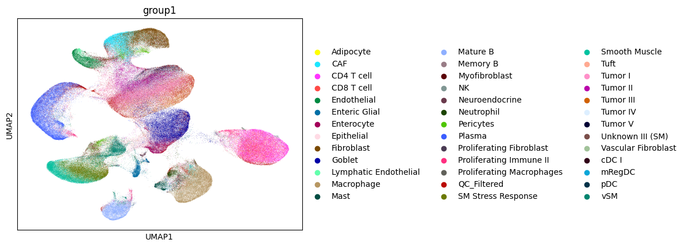
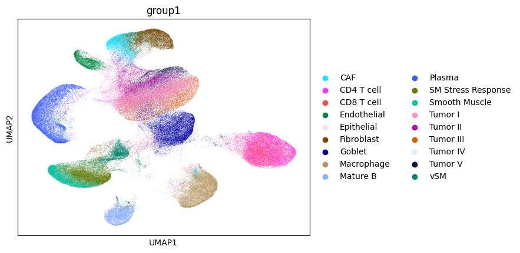

Reference expression profiles
================================================================================

:download:`Download original notebook <examples/HDST_step2_build_reference.ipynb>`

Code and saved outputs are reproduced from this notebook. No cells are executed during documentation builds.

.. code-block:: python
   :linenos:

   import os
   import scanpy as sc
   import pandas as pd
   import matplotlib.pyplot as plt
   import sys
   import anndata as ad
   import numpy as np
   import scipy.io

.. code-block:: python
   :linenos:

   def gene_lambda_by_ct(adata, ctcol = 'group'):
       pdlst=[]
       #celltypes_group = celltypes.groupby(ctcol).count().index.tolist()
       celltypes_group = list(set(adata.obs[ctcol].values))
       for ct in celltypes_group:
           ctbars = adata[adata.obs[ctcol] == ct].obs.index.tolist()
           print(f'[Log] {len(ctbars)} cells for cell type {ct}')
           cellbygenecount = adata.layers['counts'][adata.obs.index.isin(ctbars), :]
           print(f'dimension of cell by gene count', cellbygenecount.shape)
           cellbygene = pd.DataFrame(cellbygenecount.todense(), index = ctbars, columns = adata.var_names)
           genebycell = cellbygene.T
           # gene normalize expr per cell (gene count ratio over all gene count), then mean over all cells from that type.
           genenorm = (genebycell/(genebycell.sum(axis=0)))
           genenorm = genenorm.mean(axis=1) # normalized gene expr for this cell type.
           pdlst.append( 
               pd.DataFrame(genenorm, columns = [ct], index = adata.var_names)
           )
   
       genemeanpd = pd.concat(pdlst,axis=1)
       genemeanpdfc = genemeanpd/genemeanpd.mean()
       return(genemeanpd, genemeanpdfc)
   
   def select_ct_informative_genes_basic(genemeanpd, genemeanpdfc, exprcut = 0.000125, fccut = 2**0.5):
       mask_nomt = (~genemeanpd.index.str.startswith('MT-'))
       mask_noribo = (~genemeanpd.index.str.startswith(('RPS','RPL'))) 
       print(f'{ (mask_nomt&mask_noribo).sum() } genes after removing MT- and Ribo')
       # basic expression
       mask_expr_rctd = ( (genemeanpd>exprcut).sum(axis=1) )>0 
   
       print(f'{ (mask_nomt&mask_noribo&mask_expr_rctd).sum() } genes after further removing RCTD threshold gene expression 0.0125')
       ## log fold change over all cells
       mask_fc = (genemeanpdfc> fccut).sum(axis=1)>0 # rctd logfc
       print(f'{ (mask_nomt&mask_noribo&mask_expr_rctd&mask_fc).sum() } genes after further removing RCTD logfc log2 0.5')
       ## extra basic mean expr
   
       genemeanpd_filtered = genemeanpd[mask_nomt&mask_noribo&mask_expr_rctd&mask_fc]
       print(genemeanpd_filtered.shape)
       return(genemeanpd_filtered)

.. code-block:: python
   :linenos:

   adata = sc.read_10x_h5("/Users/weihangzhang/Documents/Project/Spatial_data/GSE280318/HumanColonCancer_Flex_Multiplex_count_filtered_feature_bc_matrix.h5")
   meta = pd.read_csv("/Users/weihangzhang/Documents/Project/Spatial_data/GSE280318/SingleCell_MetaData.csv")

.. container:: cell-output

   .. code-block:: text

      /Users/weihangzhang/opt/anaconda3/envs/ST-env/lib/python3.10/site-packages/anndata/_core/anndata.py:1758: UserWarning: Variable names are not unique. To make them unique, call `.var_names_make_unique`.
        utils.warn_names_duplicates("var")
      /Users/weihangzhang/opt/anaconda3/envs/ST-env/lib/python3.10/site-packages/anndata/_core/anndata.py:1758: UserWarning: Variable names are not unique. To make them unique, call `.var_names_make_unique`.
        utils.warn_names_duplicates("var")

.. code-block:: python
   :linenos:

   adata.obs_names = list(meta["Barcode"])
   adata.obs['group'] = meta['Level1'].values
   adata.obs['group1'] = meta['Level2'].values
   
   adata.obsm['X_umap'] = meta[['UMAP1', 'UMAP2']].values.astype(np.float32)

.. code-block:: python
   :linenos:

   sc.pl.umap(adata,color='group1')

Remove cell types with small numbers
--------------------------------------------------------------------------------

.. code-block:: python
   :linenos:

   adata = adata[adata.obs["group1"] != "QC_Filtered"]
   min_n = 5000 
   ct_counts = adata.obs["group1"].value_counts()
   keep_types = ct_counts[ct_counts >= min_n].index
   adata_sub = adata[adata.obs["group1"].isin(keep_types)].copy()
   
   adata_sub.var_names_make_unique()
   if('counts') not in adata_sub.layers.keys():
       adata_sub.layers["counts"] = adata_sub.X.copy()

.. container:: cell-output

   .. code-block:: text

      /Users/weihangzhang/opt/anaconda3/envs/ST-env/lib/python3.10/site-packages/anndata/_core/anndata.py:1758: UserWarning: Variable names are not unique. To make them unique, call `.var_names_make_unique`.
        utils.warn_names_duplicates("var")

.. code-block:: python
   :linenos:

   sc.pl.umap(adata_sub,color='group1')

Convert gene counts into normalized gene expression per-cell type for gene selection
------------------------------------------------------------------------------------

.. code-block:: python
   :linenos:

   genemeanpd, genemeanpdfc = gene_lambda_by_ct(adata_sub, ctcol = 'group1')

.. container:: cell-output

   .. code-block:: text

      [Log] 18552 cells for cell type Goblet
      dimension of cell by gene count (18552, 18082)
      [Log] 8688 cells for cell type Mature B
      dimension of cell by gene count (8688, 18082)
      [Log] 8208 cells for cell type Tumor V
      dimension of cell by gene count (8208, 18082)
      [Log] 27032 cells for cell type Tumor I
      dimension of cell by gene count (27032, 18082)
      [Log] 13303 cells for cell type Smooth Muscle
      dimension of cell by gene count (13303, 18082)
      [Log] 8787 cells for cell type vSM
      dimension of cell by gene count (8787, 18082)
      [Log] 5966 cells for cell type Tumor IV
      dimension of cell by gene count (5966, 18082)
      [Log] 22116 cells for cell type Plasma
      dimension of cell by gene count (22116, 18082)
      [Log] 14116 cells for cell type SM Stress Response
      dimension of cell by gene count (14116, 18082)
      [Log] 11481 cells for cell type CD8 T cell
      dimension of cell by gene count (11481, 18082)
      [Log] 5460 cells for cell type Endothelial
      dimension of cell by gene count (5460, 18082)
      [Log] 9620 cells for cell type Tumor II
      dimension of cell by gene count (9620, 18082)
      [Log] 12080 cells for cell type CAF
      dimension of cell by gene count (12080, 18082)
      [Log] 6812 cells for cell type Epithelial
      dimension of cell by gene count (6812, 18082)
      [Log] 13128 cells for cell type Tumor III
      dimension of cell by gene count (13128, 18082)
      [Log] 17898 cells for cell type Macrophage
      dimension of cell by gene count (17898, 18082)
      [Log] 12436 cells for cell type Fibroblast
      dimension of cell by gene count (12436, 18082)
      [Log] 16830 cells for cell type CD4 T cell
      dimension of cell by gene count (16830, 18082)

Select cell type-informative genes.
--------------------------------------------------------------------------------

.. raw:: html

   
- Min gene lambda 0.000125 , logFC 0.5. 

.. raw:: html

   
- This is example cutoff refers to RCTD STYLE: &quot;Using the estimated cell type expression profiles 𝜇ˆ𝑘,𝑗, we select differentially expressed genes that will be informative when estimating cell type proportions. For each cell type in the scRNA-seq reference, we select genes with minimum average expression above .0625 counts per 500 and at least 0.5 log-fold-change compared to the average expression across all cell types. &quot;

.. code-block:: python
   :linenos:

   genemeanpd_filtered = select_ct_informative_genes_basic(genemeanpd, genemeanpdfc, exprcut = 0.000125, fccut = 2**0.5)

.. container:: cell-output

   .. code-block:: text

      18071 genes after removing MT- and Ribo
      6008 genes after further removing RCTD threshold gene expression 0.0125
      6008 genes after further removing RCTD logfc log2 0.5
      (6008, 18)

Re-calculate the gene labmdas for the selected celltype-informative genes
--------------------------------------------------------------------------------

.. code-block:: python
   :linenos:

   adata_markergs = adata_sub[:, genemeanpd_filtered.index]
   genemeanpd_markergs, genemeanpdfc_markergs = gene_lambda_by_ct(adata_markergs, ctcol = 'group1')

.. container:: cell-output

   .. code-block:: text

      [Log] 18552 cells for cell type Goblet
      dimension of cell by gene count (18552, 6008)
      [Log] 8688 cells for cell type Mature B
      dimension of cell by gene count (8688, 6008)
      [Log] 8208 cells for cell type Tumor V
      dimension of cell by gene count (8208, 6008)
      [Log] 27032 cells for cell type Tumor I
      dimension of cell by gene count (27032, 6008)
      [Log] 13303 cells for cell type Smooth Muscle
      dimension of cell by gene count (13303, 6008)
      [Log] 8787 cells for cell type vSM
      dimension of cell by gene count (8787, 6008)
      [Log] 5966 cells for cell type Tumor IV
      dimension of cell by gene count (5966, 6008)
      [Log] 22116 cells for cell type Plasma
      dimension of cell by gene count (22116, 6008)
      [Log] 14116 cells for cell type SM Stress Response
      dimension of cell by gene count (14116, 6008)
      [Log] 11481 cells for cell type CD8 T cell
      dimension of cell by gene count (11481, 6008)
      [Log] 5460 cells for cell type Endothelial
      dimension of cell by gene count (5460, 6008)
      [Log] 9620 cells for cell type Tumor II
      dimension of cell by gene count (9620, 6008)
      [Log] 12080 cells for cell type CAF
      dimension of cell by gene count (12080, 6008)
      [Log] 6812 cells for cell type Epithelial
      dimension of cell by gene count (6812, 6008)
      [Log] 13128 cells for cell type Tumor III
      dimension of cell by gene count (13128, 6008)
      [Log] 17898 cells for cell type Macrophage
      dimension of cell by gene count (17898, 6008)
      [Log] 12436 cells for cell type Fibroblast
      dimension of cell by gene count (12436, 6008)
      [Log] 16830 cells for cell type CD4 T cell
      dimension of cell by gene count (16830, 6008)

Save the gene-by-cell-type lambdas matrix
--------------------------------------------------------------------------------

.. code-block:: python
   :linenos:

   outfile = "DATA/lambda_matrix.csv"
   genemeanpd_markergs.to_csv(outfile,sep=',')

