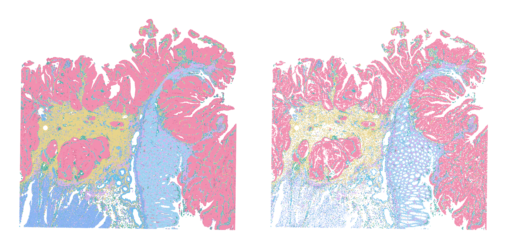
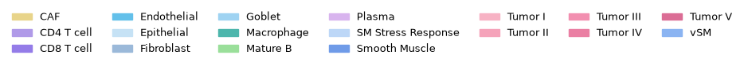
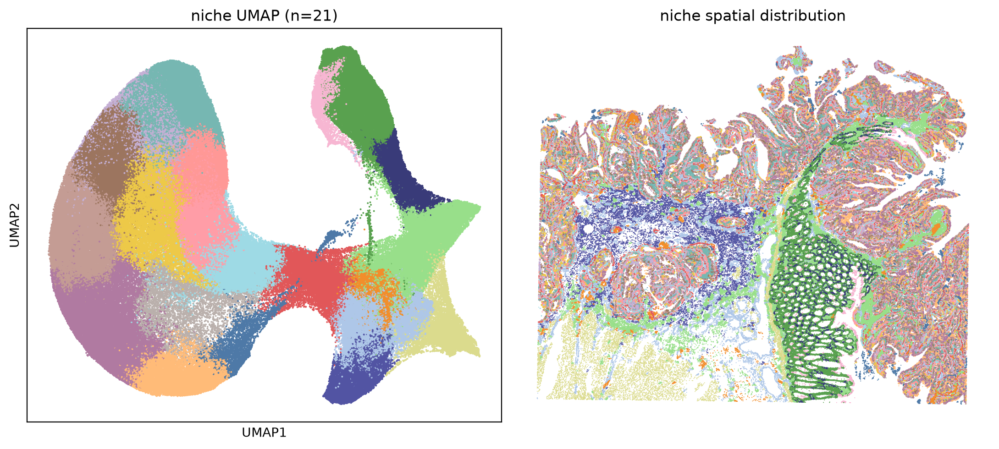
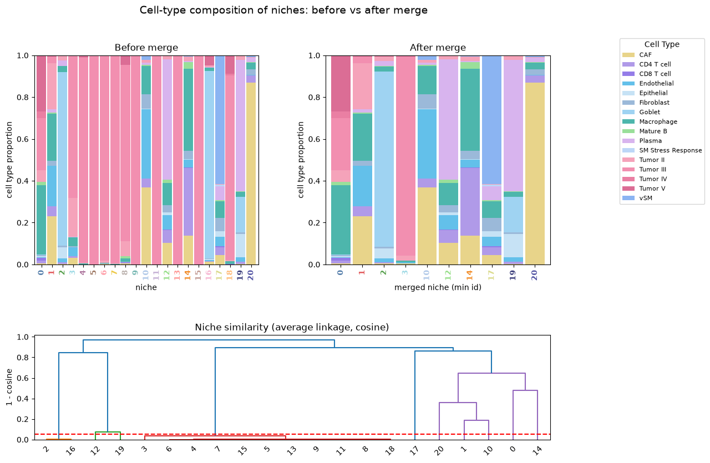
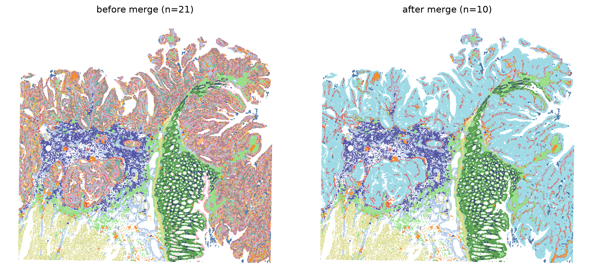

Colorectal cancer
================================================================================

:download:`Download original notebook <examples/HDST_CRC_run_hiNiche.ipynb>`

Code and saved outputs are reproduced from this notebook. No cells are executed during documentation builds.

.. rubric:: hiNiche: human colorectal cancer Visium HD analysis

.. raw:: html

   
Multi-scale (spot / cell / niche) cell-type deconvolution and niche discovery on Visium HD colorectal cancer (CRC) data.

.. raw:: html

   
<strong>Environment:</strong> run this notebook in the main <strong><code>hiNiche</code></strong> environment (<code>environment.yml</code>). Inputs: the nucleus segmentation mask from step 1 (<code>segmentation_mask.npz</code>) and the reference profiles from step 2 (<code>lambda_matrix.csv</code>).

1. Setup and imports
--------------------------------------------------------------------------------

.. code-block:: python
   :linenos:

   import os
   import sys
   # cupy (used by rapids_singlecell) compiles GPU kernels at runtime and needs the CUDA headers shipped inside the conda environment
   os.environ.setdefault("CUDA_PATH", os.path.join(sys.prefix, "targets", "x86_64-linux"))
   
   # --- Project modules ---
   import config
   import utils
   from train import run_train_seq
   
   # --- Standard library ---
   import json
   import warnings
   
   # --- Data handling ---
   import numpy as np
   import pandas as pd
   import anndata as ad
   import scanpy as sc
   import scipy.sparse as sp
   import pyarrow.parquet as pq
   
   # --- Deep learning ---
   import torch
   import torch.nn.functional as F
   
   # --- Clustering ---
   import rapids_singlecell as rsc     # GPU-accelerated neighbors / Leiden / UMAP
   from scipy.cluster.hierarchy import linkage, fcluster, dendrogram
   
   # --- Plotting ---
   import matplotlib.pyplot as plt
   import matplotlib.patches as mpatches
   
   %load_ext autoreload
   %autoreload 2
   
   warnings.filterwarnings("ignore")

.. container:: cell-output

   .. code-block:: text

      The autoreload extension is already loaded. To reload it, use:
        %reload_ext autoreload

2. Parameter configuration
--------------------------------------------------------------------------------

.. code-block:: python
   :linenos:

   SAMPLE = "CRC_HD_single_slice"
   
   # Data paths
   h5_path              = f"DATA/{SAMPLE}/filtered_feature_bc_matrix.h5"
   possition_path       = f"DATA/{SAMPLE}/tissue_positions.parquet"
   refile_path          = f"DATA/{SAMPLE}/lambda_matrix.csv"
   cell_seg_labels_path = f"DATA/{SAMPLE}/segmentation_mask.npz"
   
   #Patch save path
   PATCH_LOC = f"DATA/{SAMPLE}/mini_batch_cache"
   
   #Model save path
   MODEL_SAVE_DIR = f"DATA/{SAMPLE}/checkpoint.pt"
   
   # Cell-type color map defined in config.py
   celltype_color = getattr(config, "colormap_coloncatlas_18")
   umap_color = getattr(config, "umap_40")
   # Model / training hyperparameters
   Patch_size  = 512
   graph_knn   = 12
   niche_knn   = 15
   lr          = 0.005
   num_epochs  = 30
   edge_drop   = 0.5
   member_drop = 0.5
   neg_samples = 5
   tau         = 1
   alpha       = 1
   beta        = 1
   seed        = 42
   device      = "cuda:0"

3. Data loading and preprocessing
--------------------------------------------------------------------------------

3.1 Load counts and spot positions
~~~~~~~~~~~~~~~~~~~~~~~~~~~~~~~~~~~~~~~~~~~~~~~~~~~~~~~~~~~~~~~~~~~~~~~~~~~~~~~~

.. code-block:: python
   :linenos:

   # Reference expression profiles (genes x cell types) and nucleus segmentation labels
   ref_df = pd.read_csv(refile_path, index_col = 0)
   cell_seg_labels = sp.load_npz(cell_seg_labels_path)
   
   # Load counts
   adata = sc.read_10x_h5(h5_path)
   
   # Load spot positions
   positions = pq.read_table(possition_path).to_pandas()
   positions = positions.set_index("barcode")
   
   # Merge positions into obs
   adata.obs = adata.obs.join(positions)
   
   # Keep only in-tissue spots (in_tissue == 1)
   adata = adata[adata.obs["in_tissue"].fillna(0).astype(int) == 1].copy()
   
   # Grid (array row/col) and full-resolution pixel coordinates
   adata.obsm["spatial_grid"]  = adata.obs[["array_row", "array_col"]].to_numpy()
   adata.obsm["spatial_pixel"] = adata.obs[["pxl_col_in_fullres", "pxl_row_in_fullres"]].values

3.2 Quality control, background filtering, and normalization
~~~~~~~~~~~~~~~~~~~~~~~~~~~~~~~~~~~~~~~~~~~~~~~~~~~~~~~~~~~~~~~~~~~~~~~~~~~~~~~~

.. code-block:: python
   :linenos:

   # Keep raw counts before normalization
   adata.layers["counts"] = adata.X.copy()
   
   adata.var_names_make_unique()
   
   # Flag low-count background regions and drop them
   adata = utils.background_detector(adata, threshold = 50, n_neighs =4, n_rings = 4)
   print(f"[Log] original adata size is {adata.shape}")
   
   before = adata.shape[0]
   adata = adata[adata.obs["low_count_region"] < 1]
   after = adata.shape[0]
   print(f"[Log] filtering background: {before} spots to {after} spots")
   
   # Library-size normalization + log transform
   sc.pp.normalize_total(adata, target_sum=1e4)
   sc.pp.log1p(adata)

.. container:: cell-output

   .. code-block:: text

      [Log] original adata size is (8731400, 18085)
      [Log] filtering background: 8731400 spots to 7432511 spots

3.3 Align genes with the reference
~~~~~~~~~~~~~~~~~~~~~~~~~~~~~~~~~~~~~~~~~~~~~~~~~~~~~~~~~~~~~~~~~~~~~~~~~~~~~~~~

.. code-block:: python
   :linenos:

   # Restrict to genes shared between the data and the reference
   overlap_gs = adata.var.index.intersection(ref_df.index)
   print(f"[Log] num of gene overlap {len( overlap_gs )}")
   
   adata.obsm["X_mle"] = adata.layers["counts"][:, adata.var_names.isin(overlap_gs)]   # raw counts
   adata.obsm["X_input"] = adata[:, adata.var_names.isin(overlap_gs)].X                # normalized model input
   
   print(f"[Log] input gene number is {len(overlap_gs)}")
   ref_matrix = ref_df.loc[overlap_gs].values
   ref_matrix = np.array(ref_matrix)
   
   celltypes = list(ref_df.columns)
   print(f"[Log] rna ref size is {ref_matrix.shape}")

.. container:: cell-output

   .. code-block:: text

      [Log] num of gene overlap 6008
      [Log] input gene number is 6008
      [Log] rna ref size is (6008, 18)

4. Build the spot / cell / niche hierarchy
--------------------------------------------------------------------------------

4.1 Spot-to-cell and spot-to-niche assignment
~~~~~~~~~~~~~~~~~~~~~~~~~~~~~~~~~~~~~~~~~~~~~~~~~~~~~~~~~~~~~~~~~~~~~~~~~~~~~~~~

.. code-block:: python
   :linenos:

   # Spot -> cell assignment from nucleus segmentation
   S_s2c_all, cell_background_mask = utils.spot2cell_nuclieseg(adata.obsm["spatial_pixel"], cell_seg_labels, max_spots_per_cell=100, min_spots_per_cell= 3)
   print(f"[Log] {S_s2c_all.shape[1]} cells are detected")
   
   # Spot -> niche assignment: each niche is a cell plus its nearest neighbors
   S_s2n_all, niche_background_mask, active_niche_indices, S_c2n_all = utils.spot2niche_by_cell_knn(adata.obsm["spatial_grid"], S_s2c_all, k_niche=niche_knn)
   background_mask = {"cell": cell_background_mask, "niche":niche_background_mask}

.. container:: cell-output

   .. code-block:: text

      [Log] Active Cells (before filtering): 552203
      [Log] Valid Cells (3 <= spots <= 100): 373439
      [Log] Filtered Cells (< 3 spots): 178764
      [Log] Filtered Cells (> 100 spots): 0
      [Log] 373439 cells are detected
      [Log] Active Niches: 373439, Cells per Niche (k): 15

4.2 Spatial KNN graphs
~~~~~~~~~~~~~~~~~~~~~~~~~~~~~~~~~~~~~~~~~~~~~~~~~~~~~~~~~~~~~~~~~~~~~~~~~~~~~~~~

.. code-block:: python
   :linenos:

   # Spatial KNN graphs at spot and cell level
   spot_edges = utils.build_spot_knn_graph(adata.obsm["spatial_grid"], graph_knn)
   cell_edges = utils.build_cell_knn_graph(adata.obsm["spatial_grid"], S_s2c_all, graph_knn)
   # Niche graph: reuses the cell KNN graph (one niche per cell), same k as spot/cell graphs
   niche_edges = cell_edges

.. container:: cell-output

   .. code-block:: text

      [Log] 90083410 edges generated from 7432511 nodes (k=12)
      [Log] 5072262 edges generated from 373439 nodes (k=12)

4.3 Spatial blocking and subgraph caching
~~~~~~~~~~~~~~~~~~~~~~~~~~~~~~~~~~~~~~~~~~~~~~~~~~~~~~~~~~~~~~~~~~~~~~~~~~~~~~~~

.. code-block:: python
   :linenos:

   # Split the slide into overlapping spatial blocks (core + halo) for mini-batch training
   batch_mask, block_ids = utils.make_block_masks(adata.obsm["spatial_grid"], Patch_size=Patch_size, halo=32, S_s2c=S_s2c_all, S_s2n=S_s2n_all)
   
   # Build and cache per-block subgraph data to disk
   utils.build_subgraph_data(adata, ref_matrix, spot_edges, cell_edges, niche_edges,
                             S_s2c_all, S_s2n_all, S_c2n_all, background_mask, batch_mask, block_ids, PATCH_LOC)
   print(f"[Log] Original ST is patchfied to {len(block_ids)} blocks with avg {batch_mask['spot_level_core'].sum(dim=1).float().mean().item():.0f} spots, {batch_mask['cell_level_core'].sum(dim=1).float().mean().item():.0f} cells and {batch_mask['niche_level_core'].sum(dim=1).float().mean().item():.0f} niches per block")

.. container:: cell-output

   .. code-block:: text

      [Log] Generating spot masks for 49 blocks...

.. container:: cell-output

   .. code-block:: text

      [Log] Building & saving mini-batches: 100%|██████████| 49/49 [07:34<00:00,  9.28s/it]

.. container:: cell-output

   .. code-block:: text

      [Log] Saved 41 blocks → DATA/CRC_HD_single_slice/mini_batch_cache
      [Log] Original ST is patchfied to 49 blocks with avg 151684 spots, 7678 cells and 8090 niches per block

5. Model training
--------------------------------------------------------------------------------

.. code-block:: python
   :linenos:

   emb_all, slice_id = run_train_seq(total_unit_number_per_level = {"spot": S_s2c_all.shape[0], "cell": S_s2c_all.shape[1], "niche": S_s2n_all.shape[1]},
                                     PATCH_LOC = PATCH_LOC,
                                     MODEL_SAVE_DIR = MODEL_SAVE_DIR,
                                     ref_matrix = ref_matrix,
                                     lr = lr,
                                     in_dim = len(overlap_gs),
                                     hidden_dim = len(celltypes),
                                     num_epochs = num_epochs,
                                     edge_drop = edge_drop,
                                     member_drop = member_drop,
                                     neg_samples = neg_samples,
                                     tau = tau,
                                     alpha = alpha,
                                     beta = beta,
                                     seed = seed,
                                     device = device)

.. container:: cell-output

   .. code-block:: text

      Epoch 1: 100%|██████████| 41/41 [00:12<00:00,  3.18it/s, cl=5.6419, nll=486.4660, entp=-3.1439]
      Epoch 2: 100%|██████████| 41/41 [00:12<00:00,  3.26it/s, cl=5.2754, nll=472.1993, entp=-3.1155]
      Epoch 3: 100%|██████████| 41/41 [00:12<00:00,  3.23it/s, cl=5.0918, nll=462.1783, entp=-3.1147]
      Epoch 4: 100%|██████████| 41/41 [00:12<00:00,  3.26it/s, cl=5.1022, nll=459.9352, entp=-3.0412]
      Epoch 5: 100%|██████████| 41/41 [00:12<00:00,  3.28it/s, cl=5.0860, nll=459.4250, entp=-3.0130]
      Epoch 6: 100%|██████████| 41/41 [00:12<00:00,  3.21it/s, cl=5.0761, nll=459.1580, entp=-3.0123]
      Epoch 7: 100%|██████████| 41/41 [00:12<00:00,  3.29it/s, cl=5.0674, nll=458.9727, entp=-3.0196]
      Epoch 8: 100%|██████████| 41/41 [00:12<00:00,  3.22it/s, cl=5.0577, nll=458.8439, entp=-3.0274]
      Epoch 9: 100%|██████████| 41/41 [00:12<00:00,  3.21it/s, cl=5.0479, nll=458.7375, entp=-3.0375]
      Epoch 10: 100%|██████████| 41/41 [00:12<00:00,  3.17it/s, cl=5.0379, nll=458.6532, entp=-3.0408]
      Epoch 11: 100%|██████████| 41/41 [00:12<00:00,  3.28it/s, cl=5.0290, nll=458.5824, entp=-3.0495]
      Epoch 12: 100%|██████████| 41/41 [00:12<00:00,  3.22it/s, cl=5.0213, nll=458.5295, entp=-3.0536]
      Epoch 13: 100%|██████████| 41/41 [00:12<00:00,  3.29it/s, cl=5.0132, nll=458.4867, entp=-3.0649]
      Epoch 14: 100%|██████████| 41/41 [00:12<00:00,  3.30it/s, cl=5.0067, nll=458.4440, entp=-3.0753]
      Epoch 15: 100%|██████████| 41/41 [00:12<00:00,  3.17it/s, cl=5.0001, nll=458.4063, entp=-3.0853]
      Epoch 16: 100%|██████████| 41/41 [00:12<00:00,  3.28it/s, cl=4.9933, nll=458.3757, entp=-3.0952]
      Epoch 17: 100%|██████████| 41/41 [00:12<00:00,  3.27it/s, cl=4.9875, nll=458.3429, entp=-3.1028]
      Epoch 18: 100%|██████████| 41/41 [00:12<00:00,  3.28it/s, cl=4.9814, nll=458.3133, entp=-3.1113]
      Epoch 19: 100%|██████████| 41/41 [00:12<00:00,  3.29it/s, cl=4.9766, nll=458.2824, entp=-3.1180]
      Epoch 20: 100%|██████████| 41/41 [00:12<00:00,  3.29it/s, cl=4.9713, nll=458.2678, entp=-3.1285]
      Epoch 21: 100%|██████████| 41/41 [00:12<00:00,  3.32it/s, cl=4.9679, nll=458.2473, entp=-3.1338]
      Epoch 22: 100%|██████████| 41/41 [00:13<00:00,  3.14it/s, cl=4.9629, nll=458.2257, entp=-3.1394]
      Epoch 23: 100%|██████████| 41/41 [00:12<00:00,  3.20it/s, cl=4.9599, nll=458.2142, entp=-3.1451]
      Epoch 24: 100%|██████████| 41/41 [00:12<00:00,  3.27it/s, cl=4.9554, nll=458.1894, entp=-3.1480]
      Epoch 25: 100%|██████████| 41/41 [00:12<00:00,  3.18it/s, cl=4.9525, nll=458.1759, entp=-3.1542]
      Epoch 26: 100%|██████████| 41/41 [00:12<00:00,  3.27it/s, cl=4.9505, nll=458.1647, entp=-3.1573]
      Epoch 27: 100%|██████████| 41/41 [00:12<00:00,  3.20it/s, cl=4.9468, nll=458.1486, entp=-3.1606]
      Epoch 28: 100%|██████████| 41/41 [00:12<00:00,  3.34it/s, cl=4.9433, nll=458.1398, entp=-3.1660]
      Epoch 29: 100%|██████████| 41/41 [00:12<00:00,  3.35it/s, cl=4.9418, nll=458.1311, entp=-3.1699]
      Epoch 30: 100%|██████████| 41/41 [00:12<00:00,  3.18it/s, cl=4.9408, nll=458.1254, entp=-3.1758]

.. container:: cell-output

   .. code-block:: text

      Training finished!
      Model saved to DATA/CRC_HD_single_slice/checkpoint.pt

.. container:: cell-output

   .. code-block:: text

      generating embeddings (slice 0)...: 100%|██████████| 41/41 [00:11<00:00,  3.45it/s]

6. Re-assign unmapped spots
--------------------------------------------------------------------------------

.. code-block:: python
   :linenos:

   # Re-assign unmapped (background) spots to nearby cells using spot embeddings
   spot_embs = emb_all["spot"].detach().cpu().numpy()
   new_assignments = utils.reassign_unmapped_spots(
       S_s2c_all,
       adata.obsm["spatial_grid"],          # grid coordinates, 1 unit = 1 spot
       spot_embs,
       algorithm="fixed_boundary",
       fixed_distance=2,
   )
   
   print(f"[Log] {len(new_assignments)} background spots has been re-assigned")
   
   S_s2c_updated = utils.update_S(S_s2c_all, new_assignments)
   
   # Spots that were re-assigned are no longer background
   cell_background_mask_updated = []
   for i in range(len(cell_background_mask)):
       if i in new_assignments: cell_background_mask_updated.append(False)
       else: cell_background_mask_updated.append(bool(cell_background_mask[i]))

.. container:: cell-output

   .. code-block:: text

      Total unassigned spots: 4876154

.. container:: cell-output

   .. code-block:: text

      Assigning spots (boundary): 100%|██████████| 4876154/4876154 [02:47<00:00, 29080.93it/s]

.. container:: cell-output

   .. code-block:: text

      [Log] 2911315 background spots has been re-assigned

7. Visualization
--------------------------------------------------------------------------------

7.1 Spot- and cell-level cell-type maps
~~~~~~~~~~~~~~~~~~~~~~~~~~~~~~~~~~~~~~~~~~~~~~~~~~~~~~~~~~~~~~~~~~~~~~~~~~~~~~~~

.. code-block:: python
   :linenos:

   fig, axes = plt.subplots(1, 2, figsize=(6, 3), dpi=600)   # left: spot level, right: cell level
   
   keys = ["spot", "cell"]
   labels_all = {}
   for i, ax in enumerate(axes):
       check = keys[i]
       x_raw, y_raw = adata.obsm["spatial_pixel"][:, 0], adata.obsm["spatial_pixel"][:, 1]
   
       # Cell-type probabilities
       prob = F.softmax(emb_all[check], dim=1)
       max_prob_raw, max_idx_raw = torch.max(prob, dim=1)
   
       if check == "cell":
           # Broadcast each cell's prediction to its spots (spot -> cell mapping)
           S = S_s2c_updated.coalesce()
           rows, cols = S.indices()[0], S.indices()[1]
           spot2target = torch.full((S.size(0),), -1, dtype=torch.long, device=S.device)
           spot2target[rows] = cols
           max_idx = torch.where(spot2target >= 0, max_idx_raw[spot2target], torch.tensor(-1, device=S.device))
           max_prob = torch.where(spot2target >= 0, max_prob_raw[spot2target], torch.tensor(0.0, device=S.device))
       else:
           max_prob, max_idx = max_prob_raw, max_idx_raw
   
       # --- Label assignment ---
       cell_labels = []
       for j in range(len(max_prob)):
           # max_idx == -1: the spot does not belong to any valid cell
           if max_idx[j] == -1:
               cell_labels.append("filtered")
           elif max_prob[j] < 0.1:
               cell_labels.append("ambiguous")
           else:
               cell_labels.append(celltypes[max_idx[j]])
       labels_all[check] = cell_labels
   
       colors = [celltype_color[name] for name in cell_labels]
       ax.scatter(x_raw, y_raw, c=colors, s=0.5, marker='.', linewidths=0)
       ax.invert_yaxis()
       ax.axis("off")
   
   plt.tight_layout()
   plt.show()
   
   # --- Legend ---
   cell_type = np.asarray(celltypes)[F.softmax(emb_all["spot"], dim=1).argmax(1).cpu().numpy()]
   handles = [mpatches.Patch(color=celltype_color.get(c, "#cccccc"), label=c) for c in np.unique(cell_type)]
   figL, axL = plt.subplots(figsize=(11, 0.6)); axL.axis("off")
   axL.legend(handles=handles, ncol=7, frameon=False, loc="center", fontsize=9)
   plt.show()

7.2 Niche clustering (UMAP + spatial map)
~~~~~~~~~~~~~~~~~~~~~~~~~~~~~~~~~~~~~~~~~~~~~~~~~~~~~~~~~~~~~~~~~~~~~~~~~~~~~~~~

.. code-block:: python
   :linenos:

   import torch
   torch.cuda.empty_cache()
   
   resolution = 0.8   # Leiden resolution; higher -> more clusters
   emb_k = 50
   
   # --- 1. Cluster niche embeddings (Leiden) + UMAP, sharing one neighbor graph ---
   adata_tmp = ad.AnnData(emb_all["niche"].numpy())
   rsc.pp.neighbors(adata_tmp, use_rep='X', n_neighbors=emb_k)
   rsc.tl.leiden(adata_tmp, resolution=resolution, random_state=seed)
   rsc.tl.umap(adata_tmp, random_state=seed)
   niche_label = adata_tmp.obs['leiden'].astype(int).values
   niche_umap = adata_tmp.obsm["X_umap"]
   clusters_id = {"niche": niche_label}
   n_clusters = len(np.unique(niche_label))
   
   # --- 2. Estimate each cell's position from S_s2c_updated (mean of its spots' coordinates) ---
   S = S_s2c_updated.coalesce()
   s_rows, c_cols = S.indices()
   n_cell = S.size(1)
   spatial = torch.as_tensor(adata.obsm["spatial_pixel"], dtype=torch.float32, device=S.device)
   
   cell_pos = torch.zeros((n_cell, 2), device=S.device).index_add_(0, c_cols, spatial[s_rows])
   cell_cnt = torch.zeros(n_cell, device=S.device).index_add_(0, c_cols, torch.ones_like(c_cols, dtype=torch.float32))
   cell_pos /= cell_cnt.clamp(min=1).unsqueeze(1)
   
   # --- 3. Map niche clusters back to cells ---
   cell_niche = torch.full((n_cell,), -1, dtype=torch.long, device=S.device)
   active = torch.as_tensor(active_niche_indices, device=S.device).long()
   cell_niche[active] = torch.as_tensor(niche_label, device=S.device).long()
   
   keep = (cell_niche >= 0) & (cell_cnt > 0)
   pos = cell_pos[keep].cpu().numpy()
   ids = cell_niche[keep].cpu().numpy()
   
   # --- 4. Left: niche UMAP; right: niche spatial distribution at cell level (umap_40 colors) ---
   fig, axes = plt.subplots(1, 2, figsize=(11, 5), dpi=200)
   
   axes[0].scatter(niche_umap[:, 0], niche_umap[:, 1],
                   c=[umap_color[f"Cluster_{v}"] for v in niche_label], s=2, linewidths=0)
   axes[0].set_title(f"niche UMAP (n={n_clusters})")
   axes[0].set_xticks([]); axes[0].set_yticks([])
   axes[0].set_xlabel("UMAP1"); axes[0].set_ylabel("UMAP2")
   
   axes[1].scatter(pos[:, 0], pos[:, 1],
                   c=[umap_color[f"Cluster_{v}"] for v in ids], s=2, marker='.', linewidths=0)
   axes[1].set_title("niche spatial distribution")
   axes[1].invert_yaxis(); axes[1].axis("off")
   
   plt.tight_layout()
   plt.show()

7.3 Merge niches by cell-type composition
~~~~~~~~~~~~~~~~~~~~~~~~~~~~~~~~~~~~~~~~~~~~~~~~~~~~~~~~~~~~~~~~~~~~~~~~~~~~~~~~

.. code-block:: python
   :linenos:

   niche_palette = getattr(config, "umap_40")   # colors indexed by niche cluster id
   
   # ---- Cell-type prediction (softmax temperature does not affect argmax, so it is comparable before/after) ----
   cell_type = np.asarray(celltypes)[F.softmax(emb_all["cell"], dim=1).argmax(1).cpu().numpy()]
   
   # ---- Composition table (before merge) ----
   df_counts = pd.crosstab(np.asarray(clusters_id["niche"]), cell_type)
   
   # ---- Hierarchical clustering + merge ----
   comp = df_counts.div(df_counts.sum(1), axis=0)              # row-normalized composition
   Z = linkage(comp.values, method="average", metric="cosine")
   
   merge_thresh = 0.05
   merged = fcluster(Z, t=merge_thresh, criterion="distance")
   group_members = {}
   for old, g in zip(comp.index, merged):
       group_members.setdefault(g, []).append(int(old))
   old2new = {o: min(members) for members in group_members.values() for o in members}   # smallest id in each group becomes the new label
   
   print(f"{len(comp)} niche clusters -> {len(set(old2new.values()))} merged")
   for rep in sorted(set(old2new.values())):
       members = sorted(o for o, r in old2new.items() if r == rep)
       if len(members) > 1:
           print(f"  {members} -> {rep}")
   
   niche_merged = np.array([old2new[l] for l in clusters_id["niche"]])
   clusters_id["niche_merged"] = niche_merged
   
   # ---- Composition table (after merge) ----
   dfm = pd.crosstab(niche_merged, cell_type)
   
   # ---- Convert to proportions (row-normalized, each bar stacks to 1) ----
   comp_before = df_counts.div(df_counts.sum(1), axis=0)      # same as comp
   comp_after  = dfm.div(dfm.sum(1), axis=0)
   
   # ================= Layout: top row before/after merge, bottom row full-width dendrogram =================
   fig = plt.figure(figsize=(12, 9))
   gs = fig.add_gridspec(2, 2, height_ratios=[2, 1], hspace=0.45, wspace=0.3)
   ax_before = fig.add_subplot(gs[0, 0])
   ax_after  = fig.add_subplot(gs[0, 1])
   ax_dendro = fig.add_subplot(gs[1, :])
   
   def stacked(ax, df, title, xlabel):
       """Stacked bar chart of cell-type proportions per niche; x tick labels colored by niche."""
       df.plot(kind="bar", stacked=True, ax=ax,
               color=[celltype_color[c] for c in df.columns], width=0.9, legend=False)
       for tick, nid in zip(ax.get_xticklabels(), df.index):
           tick.set_color(niche_palette[f"Cluster_{nid % 40}"]); tick.set_fontweight("bold")
       ax.set_title(title); ax.set_xlabel(xlabel); ax.set_ylabel("cell type proportion")
       ax.set_ylim(0, 1)
   
   stacked(ax_before, comp_before, "Before merge", "niche")
   stacked(ax_after,  comp_after,  "After merge",  "merged niche (min id)")
   
   # Single legend on the right (the before-merge panel has the most complete set of types)
   handles, labels = ax_before.get_legend_handles_labels()
   fig.legend(handles, labels, bbox_to_anchor=(1.0, 0.92), loc="upper left",
              title="Cell Type", prop={"size": 8})
   
   # Bottom row: dendrogram + merge threshold line
   dendrogram(Z, labels=comp.index.tolist(), ax=ax_dendro)
   ax_dendro.axhline(merge_thresh, ls="--", c="r")
   ax_dendro.set_ylabel("1 - cosine")
   ax_dendro.set_title("Niche similarity (average linkage, cosine)")
   
   fig.suptitle("Cell-type composition of niches: before vs after merge", fontsize=14)
   plt.show()

.. container:: cell-output

   .. code-block:: text

      21 niche clusters -> 10 merged
        [2, 16] -> 2
        [3, 4, 5, 6, 7, 8, 9, 11, 13, 15, 18] -> 3

7.4 Niche spatial map before vs. after merge
~~~~~~~~~~~~~~~~~~~~~~~~~~~~~~~~~~~~~~~~~~~~~~~~~~~~~~~~~~~~~~~~~~~~~~~~~~~~~~~~

.. code-block:: python
   :linenos:

   # Merged niche label for each cell (remapped with old2new from the merge step)
   ids_merged = np.array([old2new[i] for i in ids])
   
   fig, axes = plt.subplots(1, 2, figsize=(11, 5), dpi=200)
   
   # Left: before merge
   axes[0].scatter(pos[:, 0], pos[:, 1],
                   c=[umap_color[f"Cluster_{v % 40}"] for v in ids], s=3, marker='.', linewidths=0)
   axes[0].set_title(f"before merge (n={len(np.unique(ids))})")
   
   # Right: after merge
   axes[1].scatter(pos[:, 0], pos[:, 1],
                   c=[umap_color[f"Cluster_{v % 40}"] for v in ids_merged], s=3, marker='.', linewidths=0)
   axes[1].set_title(f"after merge (n={len(np.unique(ids_merged))})")
   
   for a in axes:
       a.invert_yaxis(); a.set_aspect("equal"); a.axis("off")
   plt.tight_layout()
   plt.show()

8. ROI case studies
--------------------------------------------------------------------------------

.. raw:: html

   
Regions of interest in full-resolution pixel coordinates, each given as <code>[x_min, y_min, x_max, y_max]</code>.

.. code-block:: python
   :linenos:

   #ROIs = [[61350, 9950, 64150, 12550],
   #        [44750, 3750, 46850, 5850],
   #        [56850, 17750, 58950, 19850]]
   
   ROIs = [[56250, 8250, 57350, 9350], 
           [47750, 9850, 49850, 11750],
           [61350, 9950, 64150, 12550],
           [55250, 13250, 57350, 15350]]

8.1 Cell types in the ROIs
~~~~~~~~~~~~~~~~~~~~~~~~~~~~~~~~~~~~~~~~~~~~~~~~~~~~~~~~~~~~~~~~~~~~~~~~~~~~~~~~

.. code-block:: python
   :linenos:

   fig, axes = plt.subplots(1, len(ROIs), figsize=(6*len(ROIs), 6), dpi=600)
   for i, roi in enumerate(ROIs):
       x_min, y_min, x_max, y_max = roi
       utils.plot_roi_by_xy(
           axes[i], x_min, x_max, y_min, y_max,
           adata,
           S_s2c_updated,
           labels_all["cell"],
           celltype_color,
           fill_alpha=1,
           contour_lw=0.0
       )
   
   plt.tight_layout()
   plt.show()

.. image:: _images/bc2aa1bb15838e88ff15a36ddb6abfc62c81a4263d3b82e31969945f51b3b681.png
   :alt: Saved result from Colorectal cancer
   :width: 100%

8.2 Merged niches in the ROIs
~~~~~~~~~~~~~~~~~~~~~~~~~~~~~~~~~~~~~~~~~~~~~~~~~~~~~~~~~~~~~~~~~~~~~~~~~~~~~~~~

.. code-block:: python
   :linenos:

   # --- Broadcast merged niche clusters to spots: spot -> cell -> niche (via the niche's center cell) ---
   S = S_s2c_updated.coalesce()
   s_rows, c_cols = S.indices()[0], S.indices()[1]
   spot2cell = torch.full((S.size(0),), -1, dtype=torch.long, device=S.device)
   spot2cell[s_rows] = c_cols.long()
   
   cell_niche_cluster_id = torch.full((S.size(1),), -1, dtype=torch.long, device=S.device)
   active_idx = torch.as_tensor(active_niche_indices, device=S.device).long()
   cell_niche_cluster_id[active_idx] = torch.as_tensor(clusters_id["niche_merged"], device=S.device).long()
   
   # Spots without a mapped cell / niche are labeled "Filtered"
   cluster_at_spot = torch.where(spot2cell >= 0,
                                 cell_niche_cluster_id[spot2cell],
                                 torch.tensor(-1, dtype=torch.long, device=S.device)).cpu().numpy()
   labels_niche_spot = ["Filtered" if v == -1 else f"Cluster_{v % 40}" for v in cluster_at_spot]
   
   fig, axes = plt.subplots(1, len(ROIs), figsize=(6*len(ROIs), 6), dpi=600)
   for i, roi in enumerate(ROIs):
       x_min, y_min, x_max, y_max = roi
       utils.plot_roi_by_xy(
           axes[i], x_min, x_max, y_min, y_max,
           adata,
           S_s2c_updated,
           labels_niche_spot,
           umap_color,
           fill_alpha=1,
           contour_lw=0.0
       )
   
   plt.tight_layout()
   plt.show()

.. image:: _images/da87346dad4637994556e0fc4b2ded62c7ca047c5cbb3ea8c114873c61b8ff73.png
   :alt: Saved result from Colorectal cancer
   :width: 100%

