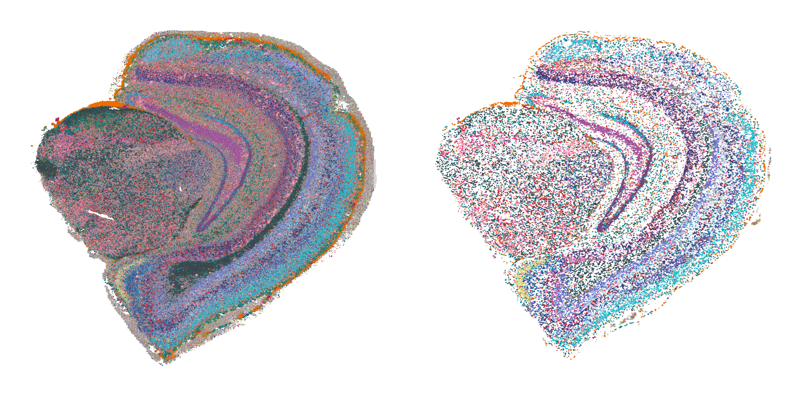
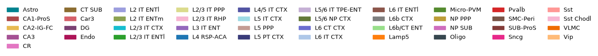
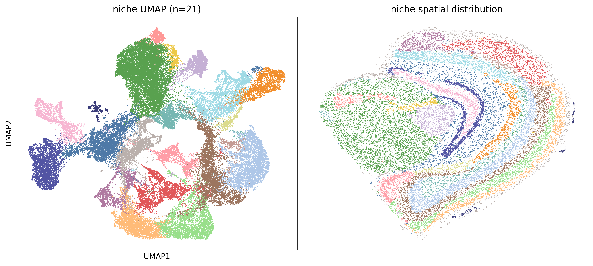
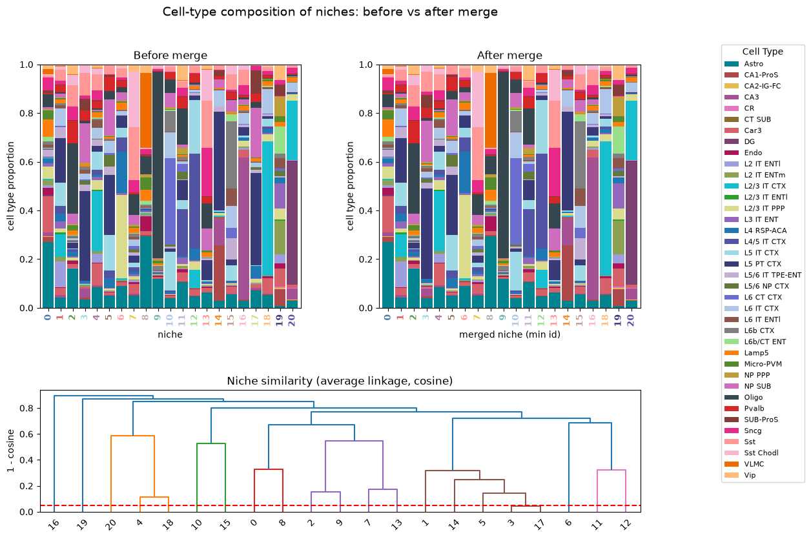
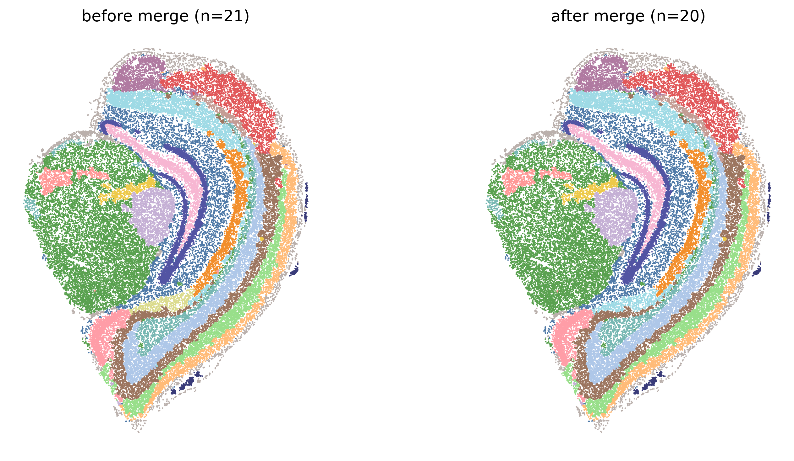
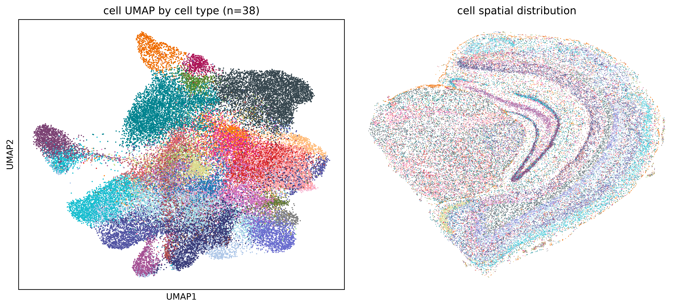
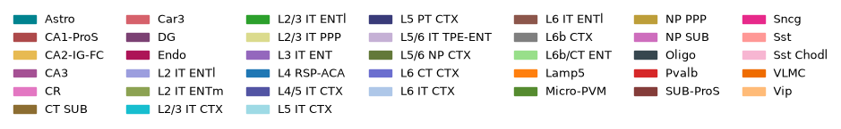
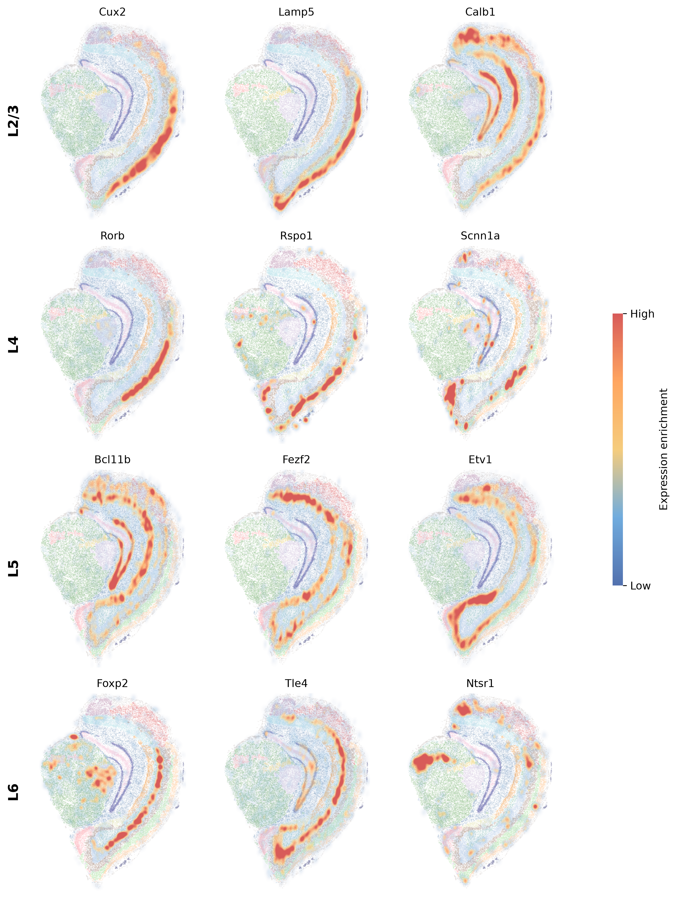

Mouse midbrain (Stereo-seq)
================================================================================

:download:`Download original notebook <examples/HDST_midbrain_run_hiNiche.ipynb>`

Code and saved outputs are reproduced from this notebook. No cells are executed during documentation builds.

.. rubric:: hiNiche: mouse midbrain Stereo-seq analysis

.. raw:: html

   
Multi-scale (spot / cell / niche) cell-type deconvolution and niche discovery on Stereo-seq mouse brain data (bin4).

.. raw:: html

   
<strong>Environment:</strong> run this notebook in the main <strong><code>hiNiche</code></strong> environment (<code>environment.yml</code>). Input: <code>bin4_adult_brain.h5ad</code>, which already holds the spot -&gt; cell assignment (<code>obsm[&quot;cell_assignment&quot;]</code>), and the reference profiles <code>lambda_matrix.csv</code>.

1. Setup and imports
--------------------------------------------------------------------------------

.. code-block:: python
   :linenos:

   import os
   import sys
   # cupy (used by rapids_singlecell) compiles GPU kernels at runtime and needs the CUDA headers shipped inside the conda environment
   os.environ.setdefault("CUDA_PATH", os.path.join(sys.prefix, "targets", "x86_64-linux"))
   
   # --- Project modules ---
   import config
   import utils
   from train import run_train_seq
   
   # --- Standard library ---
   import json
   import warnings
   from collections import Counter
   
   # --- Data handling ---
   import numpy as np
   import pandas as pd
   import anndata as ad
   import scanpy as sc
   import scipy.sparse as sp
   
   # --- Deep learning ---
   import torch
   import torch.nn.functional as F
   
   # --- Clustering ---
   import rapids_singlecell as rsc     # GPU-accelerated neighbors / Leiden / UMAP
   from scipy.cluster.hierarchy import linkage, fcluster, dendrogram
   
   # --- Plotting ---
   import matplotlib.pyplot as plt
   import matplotlib.patches as mpatches
   from matplotlib.lines import Line2D
   
   %load_ext autoreload
   %autoreload 2
   
   warnings.filterwarnings("ignore")

.. container:: cell-output

   .. code-block:: text

      The autoreload extension is already loaded. To reload it, use:
        %reload_ext autoreload

2. Parameter configuration
--------------------------------------------------------------------------------

.. code-block:: python
   :linenos:

   SAMPLE = "Mouse_midbrain_Stereo_single_slice"
   
   # Data paths
   h5_path     = f"DATA/{SAMPLE}/bin4_adult_brain.h5ad"
   refile_path = f"DATA/{SAMPLE}/lambda_matrix.csv"
   
   #Patch save path
   PATCH_LOC = f"DATA/{SAMPLE}/mini_batch_cache"
   
   #Model save path
   MODEL_SAVE_DIR = f"DATA/{SAMPLE}/checkpoint.pt"
   
   # Cell-type color map defined in config.py
   celltype_color = getattr(config, "colormap_mouse_brain_41")
   umap_color = getattr(config, "umap_40")
   
   # Model / training hyperparameters
   Patch_size  = 512
   graph_knn   = 12
   niche_knn   = 15
   lr          = 0.005
   num_epochs  = 30
   edge_drop   = 0.5
   member_drop = 0.5
   neg_samples = 5
   tau         = 1
   alpha       = 1
   beta        = 1
   seed        = 42
   device      = "cuda:0"

3. Data loading and preprocessing
--------------------------------------------------------------------------------

3.1 Load counts and spot positions
~~~~~~~~~~~~~~~~~~~~~~~~~~~~~~~~~~~~~~~~~~~~~~~~~~~~~~~~~~~~~~~~~~~~~~~~~~~~~~~~

.. code-block:: python
   :linenos:

   # Reference expression profiles (genes x cell types)
   ref_df = pd.read_csv(refile_path, index_col = 0)
   
   # Load bin4 counts; obsm["cell_assignment"] is the precomputed spot -> cell matrix
   adata = sc.read_h5ad(h5_path)
   
   # Grid (bin index) and pixel coordinates
   adata.obsm["spatial_grid"]  = adata.obs[["bin_x_count", "bin_y_count"]].to_numpy()
   adata.obsm["spatial_pixel"] = np.asarray(adata.obsm["spatial_pixel"])
   adata

.. container:: cell-output

   .. code-block:: text

      AnnData object with n_obs × n_vars = 5893711 × 26177
          obs: 'bin_x_px', 'bin_y_px', 'bin_x_um', 'bin_y_um', 'bin_x_count', 'bin_y_count', 'in_cell', 'cell_id'
          uns: 'cell_ids', 'coordinate_info'
          obsm: 'cell_assignment', 'incell_mask', 'spatial_bin4count', 'spatial_pixel', 'spatial_um', 'spatial_grid'

3.2 Quality control, background filtering, and normalization
~~~~~~~~~~~~~~~~~~~~~~~~~~~~~~~~~~~~~~~~~~~~~~~~~~~~~~~~~~~~~~~~~~~~~~~~~~~~~~~~

.. code-block:: python
   :linenos:

   # Keep raw counts before normalization
   adata.layers["counts"] = adata.X.copy()
   
   adata.var_names_make_unique()
   adata.var["mt"] = adata.var_names.str.startswith("MT-")
   sc.pp.calculate_qc_metrics(adata, qc_vars=["mt"], inplace=True)
   
   # Flag low-count background regions and drop them
   adata = utils.background_detector(adata, threshold = 50, n_neighs =4, n_rings = 4)
   print(f"[Log] original adata size is {adata.shape}")
   
   before = adata.shape[0]
   adata = adata[adata.obs["low_count_region"] < 1]
   after = adata.shape[0]
   print(f"[Log] filtering background: {before} spots to {after} spots")
   
   # Library-size normalization + log transform
   sc.pp.normalize_total(adata, target_sum=1e4)
   sc.pp.log1p(adata)

.. container:: cell-output

   .. code-block:: text

      [Log] original adata size is (5893711, 26177)
      [Log] filtering background: 5893711 spots to 5549415 spots

3.3 Align genes with the reference
~~~~~~~~~~~~~~~~~~~~~~~~~~~~~~~~~~~~~~~~~~~~~~~~~~~~~~~~~~~~~~~~~~~~~~~~~~~~~~~~

.. code-block:: python
   :linenos:

   # Restrict to genes shared between the data and the reference
   overlap_gs = adata.var.index.intersection(ref_df.index)
   print(f"[Log] num of gene overlap {len( overlap_gs )}")
   
   adata.obsm["X_mle"] = adata.layers["counts"][:, adata.var_names.isin(overlap_gs)]   # raw counts
   adata.obsm["X_input"] = adata[:, adata.var_names.isin(overlap_gs)].X                # normalized model input
   
   print(f"[Log] input gene number is {len(overlap_gs)}")
   ref_matrix = ref_df.loc[overlap_gs].values
   ref_matrix = np.array(ref_matrix)
   
   celltypes = list(ref_df.columns)
   print(f"[Log] rna ref size is {ref_matrix.shape}")

.. container:: cell-output

   .. code-block:: text

      [Log] num of gene overlap 5166
      [Log] input gene number is 5166
      [Log] rna ref size is (5166, 41)

4. Build the spot / cell / niche hierarchy
--------------------------------------------------------------------------------

4.1 Spot-to-cell and spot-to-niche assignment
~~~~~~~~~~~~~~~~~~~~~~~~~~~~~~~~~~~~~~~~~~~~~~~~~~~~~~~~~~~~~~~~~~~~~~~~~~~~~~~~

.. code-block:: python
   :linenos:

   # Spot -> cell assignment from the precomputed cell segmentation in the h5ad
   S_s2c_all, cell_background_mask = utils.spot2cell_from_assignment(adata.obsm["cell_assignment"], max_spots_per_cell=100, min_spots_per_cell=3)
   print(f"[Log] {S_s2c_all.shape[1]} cells are detected")
   
   # Spot -> niche assignment: each niche is a cell plus its nearest neighbors
   S_s2n_all, niche_background_mask, active_niche_indices, S_c2n_all = utils.spot2niche_by_cell_knn(adata.obsm["spatial_grid"], S_s2c_all, k_niche=niche_knn)
   background_mask = {"cell": cell_background_mask, "niche":niche_background_mask}

.. container:: cell-output

   .. code-block:: text

      [Log] Active Cells (before filtering): 54838
      [Log] Valid Cells (3 <= spots <= 100): 47042
      [Log] Filtered Cells (< 3 spots): 549
      [Log] Filtered Cells (> 100 spots): 7247
      [Log] 47042 cells are detected
      [Log] Active Niches: 47042, Cells per Niche (k): 15

4.2 Spatial KNN graphs
~~~~~~~~~~~~~~~~~~~~~~~~~~~~~~~~~~~~~~~~~~~~~~~~~~~~~~~~~~~~~~~~~~~~~~~~~~~~~~~~

.. code-block:: python
   :linenos:

   # Spatial KNN graphs at spot and cell level
   spot_edges = utils.build_spot_knn_graph(adata.obsm["spatial_grid"], graph_knn)
   cell_edges = utils.build_cell_knn_graph(adata.obsm["spatial_grid"], S_s2c_all, graph_knn)
   # Niche graph: reuses the cell KNN graph (one niche per cell), same k as spot/cell graphs
   niche_edges = cell_edges

.. container:: cell-output

   .. code-block:: text

      [Log] 67171214 edges generated from 5549415 nodes (k=12)
      [Log] 634832 edges generated from 47042 nodes (k=12)

4.3 Spatial blocking and subgraph caching
~~~~~~~~~~~~~~~~~~~~~~~~~~~~~~~~~~~~~~~~~~~~~~~~~~~~~~~~~~~~~~~~~~~~~~~~~~~~~~~~

.. code-block:: python
   :linenos:

   # Split the slide into overlapping spatial blocks (core + halo) for mini-batch training
   batch_mask, block_ids = utils.make_block_masks(adata.obsm["spatial_grid"], Patch_size=Patch_size, halo=32, S_s2c=S_s2c_all, S_s2n=S_s2n_all)
   
   # Build and cache per-block subgraph data to disk
   utils.build_subgraph_data(adata, ref_matrix, spot_edges, cell_edges, niche_edges,
                             S_s2c_all, S_s2n_all, S_c2n_all, background_mask, batch_mask, block_ids, PATCH_LOC)
   print(f"[Log] Original ST is patchfied to {len(block_ids)} blocks with avg {batch_mask['spot_level_core'].sum(dim=1).float().mean().item():.0f} spots, {batch_mask['cell_level_core'].sum(dim=1).float().mean().item():.0f} cells and {batch_mask['niche_level_core'].sum(dim=1).float().mean().item():.0f} niches per block")

.. container:: cell-output

   .. code-block:: text

      [Log] Generating spot masks for 42 blocks...

.. container:: cell-output

   .. code-block:: text

      [Log] Building & saving mini-batches: 100%|██████████| 42/42 [03:02<00:00,  4.34s/it]

.. container:: cell-output

   .. code-block:: text

      [Log] Saved 29 blocks → DATA/Mouse_midbrain_Stereo_single_slice/mini_batch_cache
      [Log] Original ST is patchfied to 42 blocks with avg 132129 spots, 1153 cells and 1315 niches per block

5. Model training
--------------------------------------------------------------------------------

.. code-block:: python
   :linenos:

   emb_all, slice_id = run_train_seq(total_unit_number_per_level = {"spot": S_s2c_all.shape[0], "cell": S_s2c_all.shape[1], "niche": S_s2n_all.shape[1]},
                                     PATCH_LOC = PATCH_LOC,
                                     MODEL_SAVE_DIR = MODEL_SAVE_DIR,
                                     ref_matrix = ref_matrix,
                                     lr = lr,
                                     in_dim = len(overlap_gs),
                                     hidden_dim = len(celltypes),
                                     num_epochs = num_epochs,
                                     edge_drop = edge_drop, 
                                     member_drop = member_drop,
                                     neg_samples = neg_samples,
                                     tau = tau,
                                     alpha = alpha,
                                     beta = beta,
                                     seed = seed,
                                     device = device)

.. container:: cell-output

   .. code-block:: text

      Epoch 1: 100%|██████████| 29/29 [00:05<00:00,  4.95it/s, cl=5.6648, nll=345.1888, entp=-6.7346]
      Epoch 2: 100%|██████████| 29/29 [00:05<00:00,  5.36it/s, cl=5.4639, nll=342.6654, entp=-6.4974]
      Epoch 3: 100%|██████████| 29/29 [00:05<00:00,  5.44it/s, cl=5.2626, nll=341.5397, entp=-6.5937]
      Epoch 4: 100%|██████████| 29/29 [00:05<00:00,  5.37it/s, cl=5.1920, nll=340.7286, entp=-6.5274]
      Epoch 5: 100%|██████████| 29/29 [00:05<00:00,  5.40it/s, cl=5.1716, nll=340.1850, entp=-6.4825]
      Epoch 6: 100%|██████████| 29/29 [00:05<00:00,  5.31it/s, cl=5.1408, nll=339.7544, entp=-6.4531]
      Epoch 7: 100%|██████████| 29/29 [00:05<00:00,  5.42it/s, cl=5.1233, nll=339.4720, entp=-6.4169]
      Epoch 8: 100%|██████████| 29/29 [00:05<00:00,  5.32it/s, cl=5.1059, nll=339.1692, entp=-6.4265]
      Epoch 9: 100%|██████████| 29/29 [00:05<00:00,  5.37it/s, cl=5.1077, nll=338.9677, entp=-6.4257]
      Epoch 10: 100%|██████████| 29/29 [00:05<00:00,  5.43it/s, cl=5.1024, nll=338.7720, entp=-6.4062]
      Epoch 11: 100%|██████████| 29/29 [00:05<00:00,  5.20it/s, cl=5.1027, nll=338.6015, entp=-6.4078]
      Epoch 12: 100%|██████████| 29/29 [00:05<00:00,  5.31it/s, cl=5.1076, nll=338.4385, entp=-6.3966]
      Epoch 13: 100%|██████████| 29/29 [00:05<00:00,  5.22it/s, cl=5.1032, nll=338.2825, entp=-6.3874]
      Epoch 14: 100%|██████████| 29/29 [00:05<00:00,  5.35it/s, cl=5.1057, nll=338.1365, entp=-6.3661]
      Epoch 15: 100%|██████████| 29/29 [00:05<00:00,  5.34it/s, cl=5.1016, nll=338.0426, entp=-6.3912]
      Epoch 16: 100%|██████████| 29/29 [00:05<00:00,  5.39it/s, cl=5.1017, nll=337.9334, entp=-6.3953]
      Epoch 17: 100%|██████████| 29/29 [00:05<00:00,  5.39it/s, cl=5.0992, nll=337.8434, entp=-6.3981]
      Epoch 18: 100%|██████████| 29/29 [00:05<00:00,  5.41it/s, cl=5.1022, nll=337.7450, entp=-6.3902]
      Epoch 19: 100%|██████████| 29/29 [00:05<00:00,  5.24it/s, cl=5.0952, nll=337.6822, entp=-6.4087]
      Epoch 20: 100%|██████████| 29/29 [00:05<00:00,  5.25it/s, cl=5.0951, nll=337.6017, entp=-6.4080]
      Epoch 21: 100%|██████████| 29/29 [00:05<00:00,  5.36it/s, cl=5.0964, nll=337.5437, entp=-6.4010]
      Epoch 22: 100%|██████████| 29/29 [00:05<00:00,  5.36it/s, cl=5.0920, nll=337.4801, entp=-6.4082]
      Epoch 23: 100%|██████████| 29/29 [00:05<00:00,  5.39it/s, cl=5.0897, nll=337.4296, entp=-6.4055]
      Epoch 24: 100%|██████████| 29/29 [00:05<00:00,  5.39it/s, cl=5.0878, nll=337.3776, entp=-6.4058]
      Epoch 25: 100%|██████████| 29/29 [00:05<00:00,  5.41it/s, cl=5.0861, nll=337.3385, entp=-6.3978]
      Epoch 26: 100%|██████████| 29/29 [00:05<00:00,  5.40it/s, cl=5.0843, nll=337.2973, entp=-6.4023]
      Epoch 27: 100%|██████████| 29/29 [00:05<00:00,  5.34it/s, cl=5.0824, nll=337.2533, entp=-6.4015]
      Epoch 28: 100%|██████████| 29/29 [00:05<00:00,  5.41it/s, cl=5.0789, nll=337.2198, entp=-6.4050]
      Epoch 29: 100%|██████████| 29/29 [00:05<00:00,  5.39it/s, cl=5.0787, nll=337.1915, entp=-6.4028]
      Epoch 30: 100%|██████████| 29/29 [00:05<00:00,  5.39it/s, cl=5.0759, nll=337.1638, entp=-6.4103]

.. container:: cell-output

   .. code-block:: text

      Training finished!
      Model saved to DATA/Mouse_midbrain_Stereo_single_slice/checkpoint.pt

.. container:: cell-output

   .. code-block:: text

      generating embeddings (slice 0)...: 100%|██████████| 29/29 [00:06<00:00,  4.40it/s]

6. Visualization
--------------------------------------------------------------------------------

6.1 Spot- and cell-level cell-type maps
~~~~~~~~~~~~~~~~~~~~~~~~~~~~~~~~~~~~~~~~~~~~~~~~~~~~~~~~~~~~~~~~~~~~~~~~~~~~~~~~

.. code-block:: python
   :linenos:

   fig, axes = plt.subplots(1, 2, figsize=(6, 3), dpi=600)   # left: spot level, right: cell level
   
   keys = ["spot", "cell"]
   labels_all = {}
   for i, ax in enumerate(axes):
       check = keys[i]
       x_raw, y_raw = adata.obsm["spatial_pixel"][:, 0], adata.obsm["spatial_pixel"][:, 1]
   
       # Cell-type probabilities
       prob = F.softmax(emb_all[check], dim=1)
       max_prob_raw, max_idx_raw = torch.max(prob, dim=1)
   
       if check == "cell":
           # Broadcast each cell's prediction to its spots (spot -> cell mapping)
           S = S_s2c_all.coalesce()
           rows, cols = S.indices()[0], S.indices()[1]
           spot2target = torch.full((S.size(0),), -1, dtype=torch.long, device=S.device)
           spot2target[rows] = cols
           max_idx = torch.where(spot2target >= 0, max_idx_raw[spot2target], torch.tensor(-1, device=S.device))
           max_prob = torch.where(spot2target >= 0, max_prob_raw[spot2target], torch.tensor(0.0, device=S.device))
       else:
           max_prob, max_idx = max_prob_raw, max_idx_raw
   
       # --- Label assignment ---
       cell_labels = []
       for j in range(len(max_prob)):
           # max_idx == -1: the spot does not belong to any valid cell
           if max_idx[j] == -1:
               cell_labels.append("filtered")
           elif max_prob[j] < 0.1:
               cell_labels.append("ambiguous")
           else:
               cell_labels.append(celltypes[max_idx[j]])
       labels_all[check] = cell_labels
   
       colors = [celltype_color[name] for name in cell_labels]
       ax.scatter(x_raw, y_raw, c=colors, s=0.5, marker='.', linewidths=0)
       ax.invert_yaxis()
       ax.axis("off")
   
   plt.tight_layout()
   plt.show()
   
   # --- Legend ---
   cell_type = np.asarray(celltypes)[F.softmax(emb_all["spot"], dim=1).argmax(1).cpu().numpy()]
   handles = [mpatches.Patch(color=celltype_color.get(c, "#cccccc"), label=c) for c in np.unique(cell_type)]
   figL, axL = plt.subplots(figsize=(11, 0.6)); axL.axis("off")
   axL.legend(handles=handles, ncol=10, frameon=False, loc="center", fontsize=9)
   plt.show()

6.2 Niche clustering (UMAP + spatial map)
~~~~~~~~~~~~~~~~~~~~~~~~~~~~~~~~~~~~~~~~~~~~~~~~~~~~~~~~~~~~~~~~~~~~~~~~~~~~~~~~

.. code-block:: python
   :linenos:

   import torch
   torch.cuda.empty_cache()
   
   resolution = 0.5   # Leiden resolution; higher -> more clusters
   emb_k = 50
   
   # --- 1. Cluster niche embeddings (Leiden) + UMAP, sharing one neighbor graph ---
   adata_tmp = ad.AnnData(emb_all["niche"].numpy())
   rsc.pp.neighbors(adata_tmp, use_rep='X', n_neighbors=emb_k)
   rsc.tl.leiden(adata_tmp, resolution=resolution, random_state=seed)
   rsc.tl.umap(adata_tmp, random_state=seed)
   niche_label = adata_tmp.obs['leiden'].astype(int).values
   niche_umap = adata_tmp.obsm["X_umap"]
   clusters_id = {"niche": niche_label}
   n_clusters = len(np.unique(niche_label))
   print(f"niche: {n_clusters} clusters")
   
   # --- 2. Estimate each cell's position from S_s2c_all (mean of its spots' coordinates) ---
   S = S_s2c_all.coalesce()
   s_rows, c_cols = S.indices()
   n_cell = S.size(1)
   spatial = torch.as_tensor(adata.obsm["spatial_pixel"], dtype=torch.float32, device=S.device)
   
   cell_pos = torch.zeros((n_cell, 2), device=S.device).index_add_(0, c_cols, spatial[s_rows])
   cell_cnt = torch.zeros(n_cell, device=S.device).index_add_(0, c_cols, torch.ones_like(c_cols, dtype=torch.float32))
   cell_pos /= cell_cnt.clamp(min=1).unsqueeze(1)
   
   # --- 3. Map niche clusters back to cells ---
   cell_niche = torch.full((n_cell,), -1, dtype=torch.long, device=S.device)
   active = torch.as_tensor(active_niche_indices, device=S.device).long()
   cell_niche[active] = torch.as_tensor(niche_label, device=S.device).long()
   
   keep = (cell_niche >= 0) & (cell_cnt > 0)
   pos = cell_pos[keep].cpu().numpy()
   ids = cell_niche[keep].cpu().numpy()
   
   # --- 4. Left: niche UMAP; right: niche spatial distribution at cell level (umap_40 colors) ---
   fig, axes = plt.subplots(1, 2, figsize=(11, 5), dpi=600)
   
   axes[0].scatter(niche_umap[:, 0], niche_umap[:, 1],
                   c=[umap_color[f"Cluster_{v}"] for v in niche_label], s=2, linewidths=0)
   axes[0].set_title(f"niche UMAP (n={n_clusters})")
   axes[0].set_xticks([]); axes[0].set_yticks([])
   axes[0].set_xlabel("UMAP1"); axes[0].set_ylabel("UMAP2")
   
   axes[1].scatter(pos[:, 0], pos[:, 1],
                   c=[umap_color[f"Cluster_{v}"] for v in ids], s=2, marker='.', linewidths=0)
   axes[1].set_title("niche spatial distribution")
   axes[1].invert_yaxis(); axes[1].axis("off")
   
   plt.tight_layout()
   plt.show()

.. container:: cell-output

   .. code-block:: text

      niche: 21 clusters

6.3 Merge niches by cell-type composition
~~~~~~~~~~~~~~~~~~~~~~~~~~~~~~~~~~~~~~~~~~~~~~~~~~~~~~~~~~~~~~~~~~~~~~~~~~~~~~~~

.. code-block:: python
   :linenos:

   # ---- Cell-type prediction (softmax temperature does not affect argmax, so it is comparable before/after) ----
   cell_type = np.asarray(celltypes)[F.softmax(emb_all["cell"], dim=1).argmax(1).cpu().numpy()]
   
   # ---- Composition table (before merge) ----
   df_counts = pd.crosstab(np.asarray(clusters_id["niche"]), cell_type)
   
   # ---- Hierarchical clustering + merge ----
   comp = df_counts.div(df_counts.sum(1), axis=0)              # row-normalized composition
   Z = linkage(comp.values, method="average", metric="cosine")
   #Z = linkage(comp.values, method="ward", metric="euclidean")
   
   merge_thresh = 0.05
   merged = fcluster(Z, t=merge_thresh, criterion="distance")
   group_members = {}
   for old, g in zip(comp.index, merged):
       group_members.setdefault(g, []).append(int(old))
   old2new = {o: min(members) for members in group_members.values() for o in members}   # smallest id in each group becomes the new label
   
   print(f"{len(comp)} niche clusters -> {len(set(old2new.values()))} merged")
   for rep in sorted(set(old2new.values())):
       members = sorted(o for o, r in old2new.items() if r == rep)
       if len(members) > 1:
           print(f"  {members} -> {rep}")
   
   niche_merged = np.array([old2new[l] for l in clusters_id["niche"]])
   clusters_id["niche_merged"] = niche_merged
   
   # ---- Composition table (after merge) ----
   dfm = pd.crosstab(niche_merged, cell_type)
   
   # ---- Convert to proportions (row-normalized, each bar stacks to 1) ----
   comp_before = df_counts.div(df_counts.sum(1), axis=0)      # same as comp
   comp_after  = dfm.div(dfm.sum(1), axis=0)
   
   # ================= Layout: top row before/after merge, bottom row full-width dendrogram =================
   fig = plt.figure(figsize=(12, 9))
   gs = fig.add_gridspec(2, 2, height_ratios=[2, 1], hspace=0.45, wspace=0.3)
   ax_before = fig.add_subplot(gs[0, 0])
   ax_after  = fig.add_subplot(gs[0, 1])
   ax_dendro = fig.add_subplot(gs[1, :])
   
   def stacked(ax, df, title, xlabel):
       """Stacked bar chart of cell-type proportions per niche; x tick labels colored by niche."""
       df.plot(kind="bar", stacked=True, ax=ax,
               color=[celltype_color[c] for c in df.columns], width=0.9, legend=False)
       for tick, nid in zip(ax.get_xticklabels(), df.index):
           tick.set_color(umap_color[f"Cluster_{nid % 40}"]); tick.set_fontweight("bold")
       ax.set_title(title); ax.set_xlabel(xlabel); ax.set_ylabel("cell type proportion")
       ax.set_ylim(0, 1)
   
   stacked(ax_before, comp_before, "Before merge", "niche")
   stacked(ax_after,  comp_after,  "After merge",  "merged niche (min id)")
   
   # Single legend on the right (the before-merge panel has the most complete set of types)
   handles, labels = ax_before.get_legend_handles_labels()
   fig.legend(handles, labels, bbox_to_anchor=(1.0, 0.92), loc="upper left",
              title="Cell Type", prop={"size": 8})
   
   # Bottom row: dendrogram + merge threshold line
   dendrogram(Z, labels=comp.index.tolist(), ax=ax_dendro)
   ax_dendro.axhline(merge_thresh, ls="--", c="r")
   ax_dendro.set_ylabel("1 - cosine")
   ax_dendro.set_title("Niche similarity (average linkage, cosine)")
   
   fig.suptitle("Cell-type composition of niches: before vs after merge", fontsize=14)
   plt.show()

.. container:: cell-output

   .. code-block:: text

      21 niche clusters -> 20 merged
        [3, 17] -> 3

6.4 Niche spatial map before vs. after merge
~~~~~~~~~~~~~~~~~~~~~~~~~~~~~~~~~~~~~~~~~~~~~~~~~~~~~~~~~~~~~~~~~~~~~~~~~~~~~~~~

.. code-block:: python
   :linenos:

   # Merged niche label for each cell (remapped with old2new from the merge step)
   ids_merged = np.array([old2new[i] for i in ids])
   
   fig, axes = plt.subplots(1, 2, figsize=(11, 5), dpi=300)
   
   # Left: before merge
   axes[0].scatter(pos[:, 0], pos[:, 1],
                   c=[umap_color[f"Cluster_{v % 40}"] for v in ids], s=5, marker='.', linewidths=0)
   axes[0].set_title(f"before merge (n={len(np.unique(ids))})")
   
   # Right: after merge
   axes[1].scatter(pos[:, 0], pos[:, 1],
                   c=[umap_color[f"Cluster_{v % 40}"] for v in ids_merged], s=5, marker='.', linewidths=0)
   axes[1].set_title(f"after merge (n={len(np.unique(ids_merged))})")
   
   for a in axes:
       a.invert_yaxis(); a.set_aspect("equal"); a.axis("off")
   plt.tight_layout()
   plt.show()

.. code-block:: python
   :linenos:

   # --- Save niche cluster ids (before / after merge) and niche UMAP coordinates ---
   # One row per niche (row order = rows of emb_all["niche"])
   niche_out = pd.DataFrame({
       "center_cell":        torch.as_tensor(active_niche_indices).cpu().numpy(),   # cell index of the niche center
       "niche_before_merge": np.asarray(clusters_id["niche"]),
       "niche_after_merge":  np.asarray(clusters_id["niche_merged"]),
       "UMAP1":              niche_umap[:, 0],
       "UMAP2":              niche_umap[:, 1],
   })
   niche_out.index.name = "niche"
   niche_out_path = f"DATA/{SAMPLE}/niche_clusters.csv"
   niche_out.to_csv(niche_out_path)
   print(f"[Log] saved {len(niche_out)} niches -> {niche_out_path}")
   niche_out.head()

.. container:: cell-output

   .. code-block:: text

      [Log] saved 47042 niches -> DATA/Mouse_midbrain_Stereo_single_slice/niche_clusters.csv

.. container:: cell-output

   .. code-block:: text

      center_cell  niche_before_merge  niche_after_merge     UMAP1     UMAP2
      niche                                                                        
      0                0                   8                  8 -2.972198 -1.024055
      1                1                   8                  8 -3.395832 -0.879634
      2                2                   8                  8 -3.034191 -1.051774
      3                3                   8                  8 -3.099077 -0.954741
      4                4                   8                  8 -3.368946 -0.896823

6.5 Cell embedding UMAP and spatial cell-type map
~~~~~~~~~~~~~~~~~~~~~~~~~~~~~~~~~~~~~~~~~~~~~~~~~~~~~~~~~~~~~~~~~~~~~~~~~~~~~~~~

.. code-block:: python
   :linenos:

   # --- 1. Cell embedding -> UMAP ---
   adata_cell = ad.AnnData(emb_all["cell"].numpy())
   sc.pp.neighbors(adata_cell, use_rep='X', n_neighbors=emb_k)
   sc.tl.umap(adata_cell, random_state=seed)
   cell_umap = adata_cell.obsm["X_umap"]
   
   # --- 2. Cell type per cell (argmax) ---
   cell_type = np.asarray(celltypes)[F.softmax(emb_all["cell"], dim=1).argmax(1).cpu().numpy()]
   col = lambda arr: [celltype_color.get(c, "#cccccc") for c in arr]
   
   # --- 3. Cell coordinates (mean of its spots) ---
   S = S_s2c_all.coalesce()
   s_rows, c_cols = S.indices()
   n_cell = S.size(1)
   spatial = torch.as_tensor(adata.obsm["spatial_pixel"], dtype=torch.float32, device=S.device)
   cell_pos = torch.zeros((n_cell, 2), device=S.device).index_add_(0, c_cols, spatial[s_rows])
   cell_cnt = torch.zeros(n_cell, device=S.device).index_add_(0, c_cols, torch.ones_like(c_cols, dtype=torch.float32))
   cell_pos = (cell_pos / cell_cnt.clamp(min=1).unsqueeze(1)).cpu().numpy()
   keep = cell_cnt.cpu().numpy() > 0
   
   # --- 4. Left: cell UMAP colored by type; right: spatial map colored by type ---
   fig, axes = plt.subplots(1, 2, figsize=(11, 5), dpi=600)
   axes[0].scatter(cell_umap[:, 0], cell_umap[:, 1], c=col(cell_type), s=2, linewidths=0)
   axes[0].set_title(f"cell UMAP by cell type (n={len(np.unique(cell_type))})")
   axes[0].set_xticks([]); axes[0].set_yticks([]); axes[0].set_xlabel("UMAP1"); axes[0].set_ylabel("UMAP2")
   
   axes[1].scatter(cell_pos[keep, 0], cell_pos[keep, 1], c=col(cell_type[keep]), s=2, marker='.', linewidths=0)
   axes[1].set_title("cell spatial distribution")
   axes[1].invert_yaxis(); axes[1].axis("off")
   plt.tight_layout(); plt.show()
   #plt.savefig("cell_type.png")
   
   # --- Legend ---
   handles = [mpatches.Patch(color=celltype_color.get(c, "#cccccc"), label=c) for c in np.unique(cell_type)]
   figL, axL = plt.subplots(figsize=(11, 0.6)); axL.axis("off")
   axL.legend(handles=handles, ncol=7, frameon=False, loc="center", fontsize=9)
   plt.show()

7. Layer marker density with niche overlay
--------------------------------------------------------------------------------

.. raw:: html

   
Expression density (weighted KDE) of cortical layer markers, drawn over the niche clusters.

.. code-block:: python
   :linenos:

   import matplotlib as mpl
   from scipy.stats import gaussian_kde
   from matplotlib.colors import LinearSegmentedColormap
   
   # Colormap of the gene density (enrichment) heat map, shared by all panels and the color bar
   DENSITY_CMAP = LinearSegmentedColormap.from_list(
       "custom_gene_density_cmap",
       ["#5271ae", "#70acde", "#F5cc7d", "#ffa660", "#d85b59"])
   
   
   def plot_gene_spatial_kde_roi(
       ax, adata, gene,
       x_min, x_max, y_min, y_max,
       spatial_key="spatial_grid", gridsize=300, cmap=None,
       invert_y=True, add_colorbar=False, bw_method=0.05,
       vmin=None, vmax=None, density_alpha=True, zorder=5,
   ):
       """Expression-weighted KDE of one gene inside an ROI."""
       x = adata.obsm[spatial_key][:, 0]
       y = adata.obsm[spatial_key][:, 1]
       mask = (x >= x_min) & (x <= x_max) & (y >= y_min) & (y <= y_max)
       x_roi, y_roi = x[mask], y[mask]
   
       expr = adata[:, gene].layers["counts"]
       expr = expr.toarray().reshape(-1) if hasattr(expr, "toarray") else np.asarray(expr).reshape(-1)
       expr_roi = expr[mask]
   
       valid = np.isfinite(expr_roi) & (expr_roi > 0)
       x_roi, y_roi, expr_roi = x_roi[valid], y_roi[valid], expr_roi[valid]
       if len(x_roi) < 2:
           raise ValueError("too few expressing spots in the ROI for a KDE")
   
       if cmap is None:
           cmap = DENSITY_CMAP
   
       xx, yy = np.meshgrid(np.linspace(x_min, x_max, gridsize),
                            np.linspace(y_min, y_max, gridsize))
       kde = gaussian_kde(np.vstack([x_roi, y_roi]), weights=expr_roi, bw_method=bw_method)
       zz = kde(np.vstack([xx.ravel(), yy.ravel()])).reshape(xx.shape)
   
       if vmin is None: vmin = np.nanmin(zz)
       if vmax is None: vmax = np.nanpercentile(zz, 99)
   
       # Density as transparency: low density is transparent (niches show through), high density is opaque
       alpha = np.clip((zz - vmin) / (vmax - vmin + 1e-12), 0, 1) if density_alpha else None
   
       im = ax.imshow(zz, origin="lower", extent=[x_min, x_max, y_min, y_max],
                      cmap=cmap, aspect="equal", vmin=vmin, vmax=vmax,
                      alpha=alpha, zorder=zorder)                       # heat map on top
       ax.set_xlim(x_min, x_max); ax.set_ylim(y_min, y_max)
       if invert_y: ax.invert_yaxis()
       ax.axis("off")
       if add_colorbar: plt.colorbar(im, ax=ax, fraction=0.046, pad=0.5)
       return im
   
   
   # ================== Whole-slide extent + per-gene wrapper ==================
   xy = adata.obsm["spatial_grid"]
   FULL = dict(x_min=xy[:, 0].min(), x_max=xy[:, 0].max(),
               y_min=xy[:, 1].min(), y_max=xy[:, 1].max())
   
   def plot_gene(ax, gene):
       plot_gene_spatial_kde_roi(ax=ax, adata=adata, gene=gene,
                                 gridsize=300, add_colorbar=False, **FULL)
   
   # ================== Niche clusters at cell level (bottom layer, grid coordinates) ==================
   S = S_s2c_all.coalesce()
   s_rows, c_cols = S.indices()[0], S.indices()[1]
   n_cell = S.size(1)
   grid = torch.as_tensor(adata.obsm["spatial_grid"], dtype=torch.float32, device=S.device)
   cell_pos_grid = torch.zeros((n_cell, 2), device=S.device).index_add_(0, c_cols, grid[s_rows])
   cell_cnt = torch.zeros(n_cell, device=S.device).index_add_(0, c_cols, torch.ones_like(c_cols, dtype=torch.float32))
   cell_pos_grid = (cell_pos_grid / cell_cnt.clamp(min=1).unsqueeze(1)).cpu().numpy()
   
   cn = cell_niche.cpu().numpy()     # niche cluster of each center cell (section 6.2)
   keep_n = (cn >= 0) & (cell_cnt.cpu().numpy() > 0)
   niche_coords = cell_pos_grid[keep_n]
   niche_labels = cn[keep_n]
   
   def overlay_niche(ax, alpha=0.2, s=2):
       ax.scatter(niche_coords[:, 0], niche_coords[:, 1],
                  c=[umap_color[f"Cluster_{v % 40}"] for v in niche_labels],
                  s=s, marker='.', linewidths=0, alpha=alpha, zorder=1)   # bottom layer
   
   # ================== Marker genes ==================
   genes_by_layer = {
       "L2/3": ["Cux2", "Lamp5", "Calb1"],
       "L4":   ["Rorb", "Rspo1", "Scnn1a"],
       "L5":   ["Bcl11b", "Fezf2", "Etv1"],
       "L6":   ["Foxp2", "Tle4", "Ntsr1"],
   }
   lower2name = {g.lower(): g for g in adata.var_names}
   resolved = {}
   for layer, gs in genes_by_layer.items():
       keep_g = []
       for g in gs:
           hit = lower2name.get(g.lower())
           (keep_g.append(hit) if hit else print(f"[skip] {layer}: {g} not in var_names"))
       resolved[layer] = keep_g
   
   layers = [l for l in resolved if resolved[l]]
   ncols  = max(len(resolved[l]) for l in layers)
   nrows  = len(layers)
   
   # ================== Grid: niches first, then the density heat map on top ==================
   fig, axes = plt.subplots(nrows, ncols, figsize=(3 * ncols, 3 * nrows), dpi=300, squeeze=False)
   for r, layer in enumerate(layers):
       gs = resolved[layer]
       for c in range(ncols):
           ax = axes[r][c]
           if c < len(gs):
               try:
                   overlay_niche(ax)             # 1) bottom: niche clusters
                   plot_gene(ax, gs[c])          # 2) top: gene density
                   ax.set_title(gs[c], fontsize=10)
               except Exception as e:
                   ax.axis("off"); print(f"[fail] {gs[c]}: {e}")
           else:
               ax.axis("off")
       axes[r][0].text(-0.12, 0.5, layer, transform=axes[r][0].transAxes,
                       ha="right", va="center", fontsize=13, fontweight="bold", rotation=90)
   
   # ================== Enrichment legend: one shared color bar ==================
   # Each panel is scaled to its own [min, 99th percentile], so the bar shows relative enrichment (low -> high)
   fig.tight_layout(rect=[0, 0, 0.9, 1])
   cax = fig.add_axes([0.92, 0.35, 0.015, 0.3])
   cb = fig.colorbar(mpl.cm.ScalarMappable(norm=mpl.colors.Normalize(0, 1), cmap=DENSITY_CMAP), cax=cax)
   cb.set_ticks([0, 1]); cb.set_ticklabels(["Low", "High"])
   cb.set_label("Expression enrichment", fontsize=10)
   cb.outline.set_visible(False)
   
   # ================== Save at high resolution ==================
   fig_path = f"DATA/{SAMPLE}/layer_markers_density_niche_overlay.png"
   fig.savefig(fig_path, dpi=600, bbox_inches="tight", facecolor="white")
   print(f"[Log] saved -> {fig_path}")
   plt.show()

.. container:: cell-output

   .. code-block:: text

      [Log] saved -> DATA/Mouse_midbrain_Stereo_single_slice/layer_markers_density_niche_overlay.png

