Mouse brain
================================================================================

:download:`Download original notebook <examples/HDST_mousebrain_run_hiNiche.ipynb>`

Code and saved outputs are reproduced from this notebook. No cells are executed during documentation builds.

.. rubric:: hiNiche: Mouse Brain Visium HD analysis

.. raw:: html

   
Multi-scale (spot / cell / niche) cell-type deconvolution and niche discovery on Visium HD mouse brain data.

1. Setup and imports
--------------------------------------------------------------------------------

.. code-block:: python
   :linenos:

   import os
   import sys
   # cupy (used by rapids_singlecell) compiles GPU kernels at runtime and needs the CUDA headers shipped inside the conda environment
   os.environ.setdefault("CUDA_PATH", os.path.join(sys.prefix, "targets", "x86_64-linux"))
   
   # --- Project modules ---
   import config
   import utils
   from train import run_train_seq
   
   # --- Standard library ---
   import json
   import warnings
   from collections import Counter
   
   # --- Data handling ---
   import numpy as np
   import pandas as pd
   import anndata as ad
   import scanpy as sc
   import scipy.sparse as sp
   import pyarrow.parquet as pq
   import tifffile
   
   # --- Deep learning ---
   import torch
   import torch.nn.functional as F
   
   # --- Clustering ---
   import rapids_singlecell as rsc     # GPU-accelerated neighbors / Leiden / UMAP
   from scipy.cluster.hierarchy import linkage, fcluster, dendrogram
   
   # --- Plotting ---
   import matplotlib.pyplot as plt
   import matplotlib.patches as mpatches
   from matplotlib.lines import Line2D
   
   %load_ext autoreload
   %autoreload 2
   
   warnings.filterwarnings("ignore")

.. container:: cell-output

   .. code-block:: text

      The autoreload extension is already loaded. To reload it, use:
        %reload_ext autoreload

2. Parameter configuration
--------------------------------------------------------------------------------

.. code-block:: python
   :linenos:

   SAMPLE = "Mousebrain_HD_single_slice"
   
   # Data paths
   h5_path              = f"DATA/{SAMPLE}/filtered_feature_bc_matrix.h5"
   possition_path       = f"DATA/{SAMPLE}/tissue_positions.parquet"
   refile_path          = f"DATA/{SAMPLE}/lambda_matrix.csv"
   cell_seg_labels_path = f"DATA/{SAMPLE}/segmentation_mask.npz"
   he_image_path        = f"DATA/{SAMPLE}/Visium_HD_Mouse_Brain_Fixed_Frozen_tissue_image.btf"
   
   #Patch save path
   PATCH_LOC = f"DATA/{SAMPLE}/mini_batch_cache"
   
   #Model save path
   MODEL_SAVE_DIR = f"DATA/{SAMPLE}/checkpoint.pt"
   
   # Cell-type color map defined in config.py
   celltype_color= getattr(config, "colormap_mouse_brain_41")
   umap_color = getattr(config, "umap_40")
   # Model / training hyperparameters
   Patch_size  = 512
   graph_knn   = 12
   niche_knn   = 20
   lr          = 0.005
   num_epochs  = 30
   edge_drop   = 0.5 
   member_drop = 0.5
   neg_samples = 5
   tau         = 1
   alpha       = 1
   beta        = 2
   seed        = 42
   device      = "cuda:0"

3. Data loading and preprocessing
--------------------------------------------------------------------------------

3.1 Load counts, spot positions, and H&E image
~~~~~~~~~~~~~~~~~~~~~~~~~~~~~~~~~~~~~~~~~~~~~~~~~~~~~~~~~~~~~~~~~~~~~~~~~~~~~~~~

.. code-block:: python
   :linenos:

   # Reference expression profiles (genes x cell types) and nucleus segmentation labels
   ref_df = pd.read_csv(refile_path, index_col = 0)
   cell_seg_labels = sp.load_npz(cell_seg_labels_path)
   
   # Load counts
   adata = sc.read_10x_h5(h5_path)
   
   # Load spot positions
   positions = pq.read_table(possition_path).to_pandas()
   positions = positions.set_index("barcode")
   
   # Merge positions into obs
   adata.obs = adata.obs.join(positions)
   
   # Keep only in-tissue spots (in_tissue == 1)
   adata = adata[adata.obs["in_tissue"].fillna(0).astype(int) == 1].copy()
   adata = adata[adata.obs["in_tissue"] == 1].copy()
   
   # Load the full-resolution H&E image
   with tifffile.TiffFile(he_image_path) as tif:
       series = tif.series[0]
       full_res = series.levels[0].asarray()      # highest resolution level (same as z['0'] before)
       # For a downsampled level: series.levels[2].asarray(), etc.
       # To list levels: print(len(series.levels), [lv.shape for lv in series.levels])
   
   
   # Grid (array row/col) and full-resolution pixel coordinates
   adata.obsm["spatial_grid"]  = adata.obs[["array_row", "array_col"]].to_numpy()
   adata.obsm["spatial_pixel"] = adata.obs[["pxl_col_in_fullres", "pxl_row_in_fullres"]].values

3.2 Quality control, background filtering, and normalization
~~~~~~~~~~~~~~~~~~~~~~~~~~~~~~~~~~~~~~~~~~~~~~~~~~~~~~~~~~~~~~~~~~~~~~~~~~~~~~~~

.. code-block:: python
   :linenos:

   # Keep raw counts before normalization
   adata.layers["counts"] = adata.X.copy()
   
   adata.var_names_make_unique()
   adata.var["mt"] = adata.var_names.str.startswith("MT-")
   sc.pp.calculate_qc_metrics(adata, qc_vars=["mt"], inplace=True)
   
   # Flag low-count background regions and drop them
   adata = utils.background_detector(adata, threshold = 50, n_neighs =4, n_rings = 4)
   print(f"[Log] original adata size is {adata.shape}")
   
   before = adata.shape[0]
   adata = adata[adata.obs["low_count_region"] < 1]
   after = adata.shape[0]
   print(f"[Log] filtering background: {before} spots to {after} spots")
   
   # Library-size normalization + log transform
   sc.pp.normalize_total(adata, target_sum=1e4)
   sc.pp.log1p(adata)

.. container:: cell-output

   .. code-block:: text

      [Log] original adata size is (6947755, 19059)
      [Log] filtering background: 6947755 spots to 6618476 spots

3.3 Align genes with the reference
~~~~~~~~~~~~~~~~~~~~~~~~~~~~~~~~~~~~~~~~~~~~~~~~~~~~~~~~~~~~~~~~~~~~~~~~~~~~~~~~

.. code-block:: python
   :linenos:

   # Restrict to genes shared between the data and the reference
   overlap_gs = adata.var.index.intersection(ref_df.index)
   print(f"[Log] num of gene overlap {len( overlap_gs )}")
   
   adata.obsm["X_mle"] = adata.layers["counts"][:, adata.var_names.isin(overlap_gs)]   # raw counts
   adata.obsm["X_input"] = adata[:, adata.var_names.isin(overlap_gs)].X                # normalized model input
   
   print(f"[Log] input gene number is {len(overlap_gs)}")
   ref_matrix = ref_df.loc[overlap_gs].values
   ref_matrix = np.array(ref_matrix)
   
   celltypes = list(ref_df.columns)
   print(f"[Log] rna ref size is {ref_matrix.shape}")

.. container:: cell-output

   .. code-block:: text

      [Log] num of gene overlap 4813
      [Log] input gene number is 4813
      [Log] rna ref size is (4813, 41)

4. Build the spot / cell / niche hierarchy
--------------------------------------------------------------------------------

4.1 Spot-to-cell and spot-to-niche assignment
~~~~~~~~~~~~~~~~~~~~~~~~~~~~~~~~~~~~~~~~~~~~~~~~~~~~~~~~~~~~~~~~~~~~~~~~~~~~~~~~

.. code-block:: python
   :linenos:

   # Spot -> cell assignment from nucleus segmentation
   S_s2c_all, cell_background_mask = utils.spot2cell_nuclieseg(adata.obsm["spatial_pixel"], cell_seg_labels, max_spots_per_cell=100, min_spots_per_cell= 3)
   print(f"[Log] {S_s2c_all.shape[1]} cells are detected")
   
   # Spot -> niche assignment: each niche is a cell plus its nearest neighbors
   S_s2n_all, niche_background_mask, active_niche_indices, S_c2n_all = utils.spot2niche_by_cell_knn(adata.obsm["spatial_grid"], S_s2c_all, k_niche=niche_knn)
   background_mask = {"cell": cell_background_mask, "niche":niche_background_mask}

.. container:: cell-output

   .. code-block:: text

      [Log] Active Cells (before filtering): 81607
      [Log] Valid Cells (3 <= spots <= 100): 73323
      [Log] Filtered Cells (< 3 spots): 8280
      [Log] Filtered Cells (> 100 spots): 4
      [Log] 73323 cells are detected
      [Log] Active Niches: 73323, Cells per Niche (k): 20

4.2 Spatial KNN graphs
~~~~~~~~~~~~~~~~~~~~~~~~~~~~~~~~~~~~~~~~~~~~~~~~~~~~~~~~~~~~~~~~~~~~~~~~~~~~~~~~

.. code-block:: python
   :linenos:

   # Spatial KNN graphs at spot and cell level
   spot_edges = utils.build_spot_knn_graph(adata.obsm["spatial_grid"], graph_knn)
   cell_edges = utils.build_cell_knn_graph(adata.obsm["spatial_grid"], S_s2c_all, graph_knn)
   # Niche graph: reuses the cell KNN graph (one niche per cell), same k as spot/cell graphs
   niche_edges = cell_edges

.. container:: cell-output

   .. code-block:: text

      [Log] 79914768 edges generated from 6618476 nodes (k=12)
      [Log] 996548 edges generated from 73323 nodes (k=12)

4.3 Spatial blocking and subgraph caching
~~~~~~~~~~~~~~~~~~~~~~~~~~~~~~~~~~~~~~~~~~~~~~~~~~~~~~~~~~~~~~~~~~~~~~~~~~~~~~~~

.. code-block:: python
   :linenos:

   # Split the slide into overlapping spatial blocks (core + halo) for mini-batch training
   batch_mask, block_ids = utils.make_block_masks(adata.obsm["spatial_grid"], Patch_size=Patch_size, halo=32, S_s2c=S_s2c_all, S_s2n=S_s2n_all)
   
   # Build and cache per-block subgraph data to disk
   utils.build_subgraph_data(adata, ref_matrix, spot_edges, cell_edges, niche_edges,
                             S_s2c_all, S_s2n_all, S_c2n_all, background_mask, batch_mask, block_ids, PATCH_LOC)
   print(f"[Log] Original ST is patchfied to {len(block_ids)} blocks with avg {batch_mask['spot_level_core'].sum(dim=1).float().mean().item():.0f} spots, {batch_mask['cell_level_core'].sum(dim=1).float().mean().item():.0f} cells and {batch_mask['niche_level_core'].sum(dim=1).float().mean().item():.0f} niches per block")

.. container:: cell-output

   .. code-block:: text

      [Log] Generating spot masks for 42 blocks...

.. container:: cell-output

   .. code-block:: text

      [Log] Building & saving mini-batches: 100%|██████████| 42/42 [03:25<00:00,  4.89s/it]

.. container:: cell-output

   .. code-block:: text

      [Log] Saved 36 blocks → DATA/Mousebrain_HD_single_slice/mini_batch_cache
      [Log] Original ST is patchfied to 42 blocks with avg 157583 spots, 1764 cells and 2029 niches per block

5. Model training
--------------------------------------------------------------------------------

.. code-block:: python
   :linenos:

   emb_all, slice_id = run_train_seq(total_unit_number_per_level = {"spot": S_s2c_all.shape[0], "cell": S_s2c_all.shape[1], "niche": S_s2n_all.shape[1]},
                                     PATCH_LOC = PATCH_LOC,
                                     MODEL_SAVE_DIR = MODEL_SAVE_DIR,
                                     ref_matrix = ref_matrix,
                                     lr = lr,
                                     in_dim = len(overlap_gs),
                                     hidden_dim = len(celltypes),
                                     num_epochs = num_epochs,
                                     edge_drop = edge_drop, 
                                     member_drop = member_drop,
                                     neg_samples = neg_samples,
                                     tau = tau,
                                     alpha = alpha,
                                     beta = beta,
                                     seed = seed,
                                     device = device)

.. container:: cell-output

   .. code-block:: text

      Epoch 1: 100%|██████████| 36/36 [00:07<00:00,  5.08it/s, cl=5.5481, nll=329.2743, entp=-6.8582]
      Epoch 2: 100%|██████████| 36/36 [00:06<00:00,  5.32it/s, cl=5.3349, nll=327.0275, entp=-6.6983]
      Epoch 3: 100%|██████████| 36/36 [00:06<00:00,  5.38it/s, cl=5.1960, nll=326.1142, entp=-6.6579]
      Epoch 4: 100%|██████████| 36/36 [00:06<00:00,  5.44it/s, cl=5.1037, nll=325.3370, entp=-6.6163]
      Epoch 5: 100%|██████████| 36/36 [00:06<00:00,  5.43it/s, cl=5.0617, nll=323.9875, entp=-6.6121]
      Epoch 6: 100%|██████████| 36/36 [00:06<00:00,  5.31it/s, cl=5.0402, nll=323.4962, entp=-6.5716]
      Epoch 7: 100%|██████████| 36/36 [00:06<00:00,  5.40it/s, cl=5.0282, nll=323.2285, entp=-6.5758]
      Epoch 8: 100%|██████████| 36/36 [00:06<00:00,  5.42it/s, cl=5.0328, nll=322.9776, entp=-6.5278]
      Epoch 9: 100%|██████████| 36/36 [00:06<00:00,  5.46it/s, cl=5.0069, nll=322.7712, entp=-6.5488]
      Epoch 10: 100%|██████████| 36/36 [00:06<00:00,  5.46it/s, cl=5.0151, nll=322.6001, entp=-6.5151]
      Epoch 11: 100%|██████████| 36/36 [00:06<00:00,  5.43it/s, cl=5.0120, nll=322.4270, entp=-6.5177]
      Epoch 12: 100%|██████████| 36/36 [00:06<00:00,  5.39it/s, cl=5.0058, nll=322.2251, entp=-6.5382]
      Epoch 13: 100%|██████████| 36/36 [00:06<00:00,  5.39it/s, cl=5.0027, nll=322.1304, entp=-6.5240]
      Epoch 14: 100%|██████████| 36/36 [00:06<00:00,  5.34it/s, cl=5.0010, nll=322.0177, entp=-6.5308]
      Epoch 15: 100%|██████████| 36/36 [00:06<00:00,  5.45it/s, cl=5.0054, nll=321.9552, entp=-6.5087]
      Epoch 16: 100%|██████████| 36/36 [00:06<00:00,  5.43it/s, cl=4.9982, nll=321.8592, entp=-6.5360]
      Epoch 17: 100%|██████████| 36/36 [00:06<00:00,  5.44it/s, cl=5.0239, nll=321.9015, entp=-6.4931]
      Epoch 18: 100%|██████████| 36/36 [00:06<00:00,  5.41it/s, cl=5.0221, nll=321.7904, entp=-6.4949]
      Epoch 19: 100%|██████████| 36/36 [00:06<00:00,  5.41it/s, cl=5.0130, nll=321.7035, entp=-6.5072]
      Epoch 20: 100%|██████████| 36/36 [00:06<00:00,  5.37it/s, cl=4.9996, nll=321.6877, entp=-6.5288]
      Epoch 21: 100%|██████████| 36/36 [00:06<00:00,  5.45it/s, cl=5.0174, nll=321.6801, entp=-6.5081]
      Epoch 22: 100%|██████████| 36/36 [00:06<00:00,  5.46it/s, cl=5.0016, nll=321.6563, entp=-6.5296]
      Epoch 23: 100%|██████████| 36/36 [00:06<00:00,  5.42it/s, cl=4.9975, nll=321.5792, entp=-6.5337]
      Epoch 24: 100%|██████████| 36/36 [00:06<00:00,  5.36it/s, cl=4.9902, nll=321.5434, entp=-6.5572]
      Epoch 25: 100%|██████████| 36/36 [00:06<00:00,  5.41it/s, cl=4.9934, nll=321.5941, entp=-6.5690]
      Epoch 26: 100%|██████████| 36/36 [00:06<00:00,  5.41it/s, cl=4.9939, nll=321.4311, entp=-6.5654]
      Epoch 27: 100%|██████████| 36/36 [00:06<00:00,  5.33it/s, cl=4.9915, nll=321.4305, entp=-6.5774]
      Epoch 28: 100%|██████████| 36/36 [00:06<00:00,  5.37it/s, cl=4.9997, nll=321.4261, entp=-6.5474]
      Epoch 29: 100%|██████████| 36/36 [00:06<00:00,  5.36it/s, cl=5.0144, nll=321.4533, entp=-6.5660]
      Epoch 30: 100%|██████████| 36/36 [00:06<00:00,  5.42it/s, cl=5.0120, nll=321.3954, entp=-6.5697]

.. container:: cell-output

   .. code-block:: text

      Training finished!
      Model saved to DATA/Mousebrain_HD_single_slice/checkpoint.pt

.. container:: cell-output

   .. code-block:: text

      generating embeddings (slice 0)...: 100%|██████████| 36/36 [00:08<00:00,  4.46it/s]

6. Re-assign unmapped spots
--------------------------------------------------------------------------------

.. code-block:: python
   :linenos:

   # Re-assign unmapped (background) spots to nearby cells using spot embeddings
   spot_embs = emb_all["spot"].detach().cpu().numpy()
   new_assignments = utils.reassign_unmapped_spots(
       S_s2c_all,
       adata.obsm["spatial_grid"],          # grid coordinates, 1 unit = 1 spot
       spot_embs,
       algorithm="fixed_boundary",
       fixed_distance=2,
   )
   
   print(f"[Log] {len(new_assignments)} background spots has been re-assigned")
   
   S_s2c_updated = utils.update_S(S_s2c_all, new_assignments)
   
   # Spots that were re-assigned are no longer background
   cell_background_mask_updated = []
   for i in range(len(cell_background_mask)):
       if i in new_assignments: cell_background_mask_updated.append(False)
       else: cell_background_mask_updated.append(bool(cell_background_mask[i]))

.. container:: cell-output

   .. code-block:: text

      Total unassigned spots: 5724089

.. container:: cell-output

   .. code-block:: text

      Assigning spots (boundary): 100%|██████████| 5724089/5724089 [01:29<00:00, 64215.49it/s]

.. container:: cell-output

   .. code-block:: text

      [Log] 1687786 background spots has been re-assigned

7. Visualization
--------------------------------------------------------------------------------

7.1 Spot- and cell-level cell-type maps
~~~~~~~~~~~~~~~~~~~~~~~~~~~~~~~~~~~~~~~~~~~~~~~~~~~~~~~~~~~~~~~~~~~~~~~~~~~~~~~~

.. code-block:: python
   :linenos:

   import torch
   import torch.nn.functional as F
   fig, axes = plt.subplots(1, 2, figsize=(6, 3), dpi=600)  # 1行3列
   
   keys = ["spot", "cell"]
   labels_all = {}
   for i, ax in enumerate(axes):
       check = keys[i]
       x_raw, y_raw = adata.obsm["spatial_pixel"][:, 0], adata.obsm["spatial_pixel"][:, 1]
       
       # 基础概率
       prob = F.softmax(emb_all[check], dim=1)
       max_prob_raw, max_idx_raw = torch.max(prob, dim=1) 
   
       if check == "cell":
           # 标准的 Spot -> Cell 映射
           S = S_s2c_updated.coalesce()
           rows, cols = S.indices()[0], S.indices()[1]
           spot2target = torch.full((S.size(0),), -1, dtype=torch.long, device=S.device)
           spot2target[rows] = cols
           max_idx = torch.where(spot2target >= 0, max_idx_raw[spot2target], torch.tensor(-1, device=S.device))
           max_prob = torch.where(spot2target >= 0, max_prob_raw[spot2target], torch.tensor(0.0, device=S.device))
       else:
           max_prob, max_idx = max_prob_raw, max_idx_raw
   
       # --- 颜色分配逻辑 ---
       cell_labels = []
       for j in range(len(max_prob)):
           # 如果 max_idx 为 -1，说明这个 Spot 不属于任何有效细胞或有效 Niche
           if max_idx[j] == -1:
               cell_labels.append("filtered")
           elif max_prob[j] < 0.1:
               cell_labels.append("ambiguous")
           else:
               cell_labels.append(celltypes[max_idx[j]])
       labels_all[check] = cell_labels
       
       colors = [celltype_color[name] for name in cell_labels]
       ax.scatter(x_raw, y_raw, c=colors, s=0.5, marker='.', linewidths=0)
       ax.invert_yaxis()
       ax.axis("off")
   
   plt.tight_layout()
   plt.show()
   
   # 将颜色转换为 legend handles
   cell_type = np.asarray(celltypes)[F.softmax(emb_all["spot"], dim=1).argmax(1).cpu().numpy()]
   handles = [mpatches.Patch(color=celltype_color.get(c, "#cccccc"), label=c) for c in np.unique(cell_type)]
   figL, axL = plt.subplots(figsize=(11, 0.6)); axL.axis("off")
   axL.legend(handles=handles, ncol=10, frameon=False, loc="center", fontsize=9)
   plt.show()

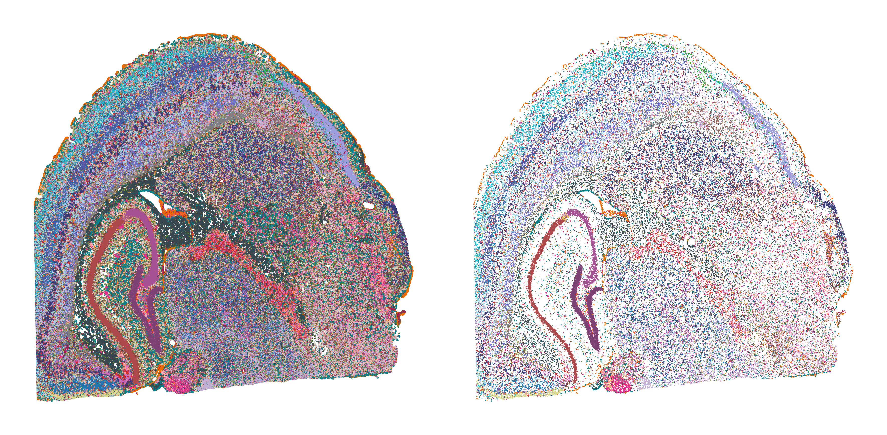

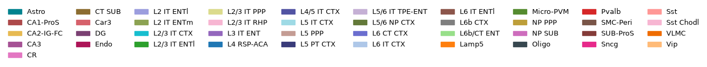

7.2 Niche clustering (UMAP + spatial map)
~~~~~~~~~~~~~~~~~~~~~~~~~~~~~~~~~~~~~~~~~~~~~~~~~~~~~~~~~~~~~~~~~~~~~~~~~~~~~~~~

.. code-block:: python
   :linenos:

   import torch
   torch.cuda.empty_cache()
   
   resolution = 0.5   # Leiden resolution; higher -> more clusters
   emb_k = 50
   
   # --- 1. Cluster niche embeddings (Leiden) + UMAP, sharing one neighbor graph ---
   adata_tmp = ad.AnnData(emb_all["niche"].numpy())
   rsc.pp.neighbors(adata_tmp, use_rep='X', n_neighbors=emb_k)
   rsc.tl.leiden(adata_tmp, resolution=resolution, random_state=seed)
   rsc.tl.umap(adata_tmp, random_state=seed)
   niche_label = adata_tmp.obs['leiden'].astype(int).values
   niche_umap = adata_tmp.obsm["X_umap"]
   clusters_id = {"niche": niche_label}
   n_clusters = len(np.unique(niche_label))
   print(f"niche: {n_clusters} clusters")
   
   # --- 2. Estimate each cell's position from S_s2c_updated (mean of its spots' coordinates) ---
   S = S_s2c_updated.coalesce()
   s_rows, c_cols = S.indices()
   n_cell = S.size(1)
   spatial = torch.as_tensor(adata.obsm["spatial_pixel"], dtype=torch.float32, device=S.device)
   
   cell_pos = torch.zeros((n_cell, 2), device=S.device).index_add_(0, c_cols, spatial[s_rows])
   cell_cnt = torch.zeros(n_cell, device=S.device).index_add_(0, c_cols, torch.ones_like(c_cols, dtype=torch.float32))
   cell_pos /= cell_cnt.clamp(min=1).unsqueeze(1)
   
   # --- 3. Map niche clusters back to cells ---
   cell_niche = torch.full((n_cell,), -1, dtype=torch.long, device=S.device)
   active = torch.as_tensor(active_niche_indices, device=S.device).long()
   cell_niche[active] = torch.as_tensor(niche_label, device=S.device).long()
   
   keep = (cell_niche >= 0) & (cell_cnt > 0)
   pos = cell_pos[keep].cpu().numpy()
   ids = cell_niche[keep].cpu().numpy()
   
   # --- 4. Left: niche UMAP; right: niche spatial distribution at cell level (umap_40 colors) ---
   fig, axes = plt.subplots(1, 2, figsize=(11, 5), dpi=600)
   
   axes[0].scatter(niche_umap[:, 0], niche_umap[:, 1],
                   c=[umap_color[f"Cluster_{v}"] for v in niche_label], s=2, linewidths=0)
   axes[0].set_title(f"niche UMAP (n={n_clusters})")
   axes[0].set_xticks([]); axes[0].set_yticks([])
   axes[0].set_xlabel("UMAP1"); axes[0].set_ylabel("UMAP2")
   
   axes[1].scatter(pos[:, 0], pos[:, 1],
                   c=[umap_color[f"Cluster_{v}"] for v in ids], s=2, marker='.', linewidths=0)
   axes[1].set_title("niche spatial distribution")
   axes[1].invert_yaxis(); axes[1].axis("off")
   
   plt.tight_layout()
   plt.show()

.. container:: cell-output

   .. code-block:: text

      niche: 22 clusters

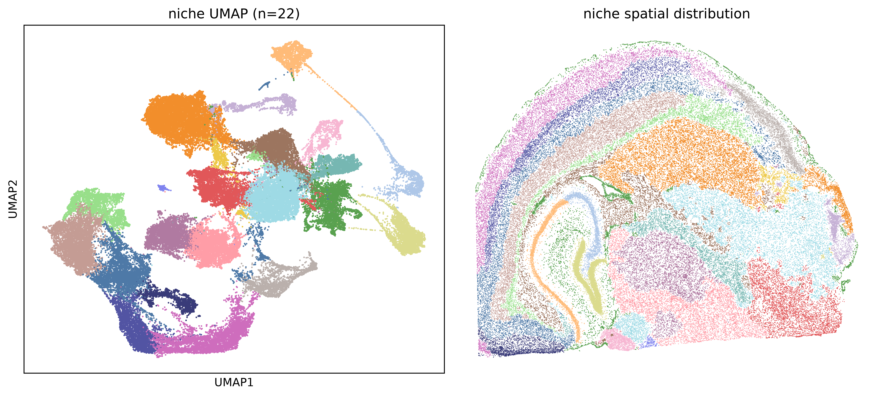

7.3 Merge niches by cell-type composition
~~~~~~~~~~~~~~~~~~~~~~~~~~~~~~~~~~~~~~~~~~~~~~~~~~~~~~~~~~~~~~~~~~~~~~~~~~~~~~~~

.. code-block:: python
   :linenos:

   # ---- Cell-type prediction (softmax temperature does not affect argmax, so it is comparable before/after) ----
   cell_type = np.asarray(celltypes)[F.softmax(emb_all["cell"], dim=1).argmax(1).cpu().numpy()]
   
   # ---- Composition table (before merge) ----
   df_counts = pd.crosstab(np.asarray(clusters_id["niche"]), cell_type)
   
   # ---- Hierarchical clustering + merge ----
   comp = df_counts.div(df_counts.sum(1), axis=0)              # row-normalized composition
   Z = linkage(comp.values, method="average", metric="cosine")
   #Z = linkage(comp.values, method="ward", metric="euclidean")
   
   merge_thresh = 0.05
   merged = fcluster(Z, t=merge_thresh, criterion="distance")
   group_members = {}
   for old, g in zip(comp.index, merged):
       group_members.setdefault(g, []).append(int(old))
   old2new = {o: min(members) for members in group_members.values() for o in members}   # smallest id in each group becomes the new label
   
   print(f"{len(comp)} niche clusters -> {len(set(old2new.values()))} merged")
   for rep in sorted(set(old2new.values())):
       members = sorted(o for o, r in old2new.items() if r == rep)
       if len(members) > 1:
           print(f"  {members} -> {rep}")
   
   niche_merged = np.array([old2new[l] for l in clusters_id["niche"]])
   clusters_id["niche_merged"] = niche_merged
   
   # ---- Composition table (after merge) ----
   dfm = pd.crosstab(niche_merged, cell_type)
   
   # ---- Convert to proportions (row-normalized, each bar stacks to 1) ----
   comp_before = df_counts.div(df_counts.sum(1), axis=0)      # same as comp
   comp_after  = dfm.div(dfm.sum(1), axis=0)
   
   # ================= Layout: top row before/after merge, bottom row full-width dendrogram =================
   fig = plt.figure(figsize=(12, 9))
   gs = fig.add_gridspec(2, 2, height_ratios=[2, 1], hspace=0.45, wspace=0.3)
   ax_before = fig.add_subplot(gs[0, 0])
   ax_after  = fig.add_subplot(gs[0, 1])
   ax_dendro = fig.add_subplot(gs[1, :])
   
   def stacked(ax, df, title, xlabel):
       """Stacked bar chart of cell-type proportions per niche; x tick labels colored by niche."""
       df.plot(kind="bar", stacked=True, ax=ax,
               color=[celltype_color[c] for c in df.columns], width=0.9, legend=False)
       for tick, nid in zip(ax.get_xticklabels(), df.index):
           tick.set_color(umap_color[f"Cluster_{nid % 40}"]); tick.set_fontweight("bold")
       ax.set_title(title); ax.set_xlabel(xlabel); ax.set_ylabel("cell type proportion")
       ax.set_ylim(0, 1)
   
   stacked(ax_before, comp_before, "Before merge", "niche")
   stacked(ax_after,  comp_after,  "After merge",  "merged niche (min id)")
   
   # Single legend on the right (the before-merge panel has the most complete set of types)
   handles, labels = ax_before.get_legend_handles_labels()
   fig.legend(handles, labels, bbox_to_anchor=(1.0, 0.92), loc="upper left",
              title="Cell Type", prop={"size": 8})
   
   # Bottom row: dendrogram + merge threshold line
   dendrogram(Z, labels=comp.index.tolist(), ax=ax_dendro)
   ax_dendro.axhline(merge_thresh, ls="--", c="r")
   ax_dendro.set_ylabel("1 - cosine")
   ax_dendro.set_title("Niche similarity (average linkage, cosine)")
   
   fig.suptitle("Cell-type composition of niches: before vs after merge", fontsize=14)
   plt.show()

.. container:: cell-output

   .. code-block:: text

      22 niche clusters -> 22 merged

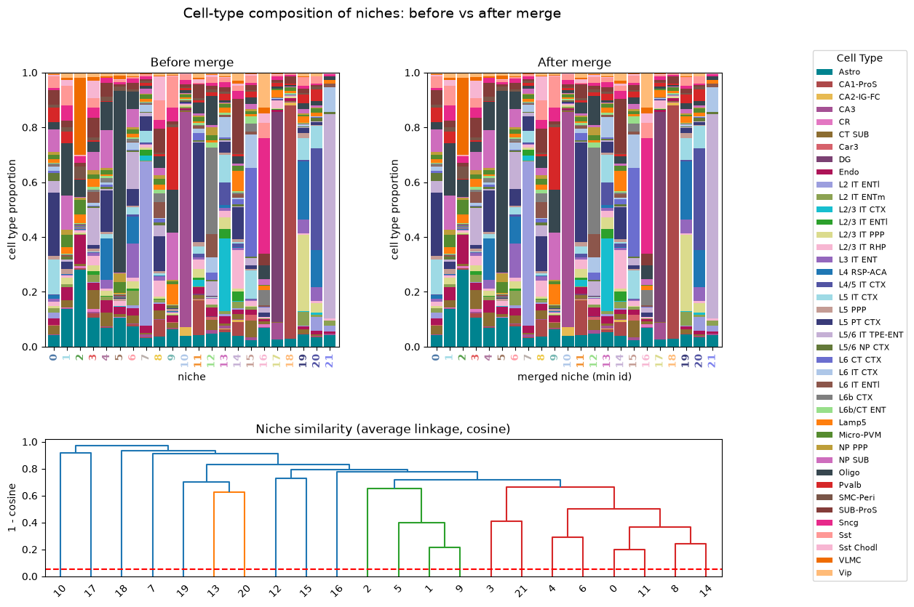

7.4 Niche spatial map before vs. after merge
~~~~~~~~~~~~~~~~~~~~~~~~~~~~~~~~~~~~~~~~~~~~~~~~~~~~~~~~~~~~~~~~~~~~~~~~~~~~~~~~

.. code-block:: python
   :linenos:

   # Merged niche label for each cell (remapped with old2new from the merge step)
   ids_merged = np.array([old2new[i] for i in ids])
   
   fig, axes = plt.subplots(1, 2, figsize=(11, 5), dpi=200)
   
   # Left: before merge
   axes[0].scatter(pos[:, 0], pos[:, 1],
                   c=[umap_color[f"Cluster_{v % 40}"] for v in ids], s=3, marker='.', linewidths=0)
   axes[0].set_title(f"before merge (n={len(np.unique(ids))})")
   
   # Right: after merge
   axes[1].scatter(pos[:, 0], pos[:, 1],
                   c=[umap_color[f"Cluster_{v % 40}"] for v in ids_merged], s=3, marker='.', linewidths=0)
   axes[1].set_title(f"after merge (n={len(np.unique(ids_merged))})")
   
   for a in axes:
       a.invert_yaxis(); a.set_aspect("equal"); a.axis("off")
   plt.tight_layout()
   plt.show()

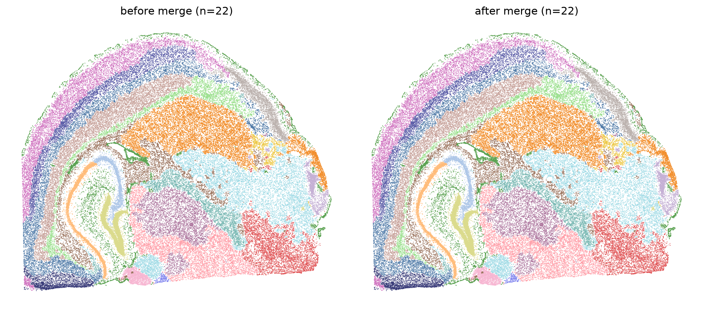

.. code-block:: python
   :linenos:

   # --- Save niche cluster ids (before / after merge) and niche UMAP coordinates ---
   # One row per niche (row order = rows of emb_all["niche"])
   niche_out = pd.DataFrame({
       "center_cell":        torch.as_tensor(active_niche_indices).cpu().numpy(),   # cell index of the niche center
       "niche_before_merge": np.asarray(clusters_id["niche"]),
       "niche_after_merge":  np.asarray(clusters_id["niche_merged"]),
       "UMAP1":              niche_umap[:, 0],
       "UMAP2":              niche_umap[:, 1],
   })
   niche_out.index.name = "niche"
   niche_out_path = f"DATA/{SAMPLE}/niche_clusters.csv"
   niche_out.to_csv(niche_out_path)
   print(f"[Log] saved {len(niche_out)} niches -> {niche_out_path}")
   niche_out.head()

7.5 Cell embedding UMAP and spatial cell-type map
~~~~~~~~~~~~~~~~~~~~~~~~~~~~~~~~~~~~~~~~~~~~~~~~~~~~~~~~~~~~~~~~~~~~~~~~~~~~~~~~

.. code-block:: python
   :linenos:

   # --- 1. Cell embedding -> UMAP ---
   adata_cell = ad.AnnData(emb_all["cell"].numpy())
   sc.pp.neighbors(adata_cell, use_rep='X', n_neighbors=emb_k)
   sc.tl.umap(adata_cell, random_state=seed)
   cell_umap = adata_cell.obsm["X_umap"]
   
   # --- 2. Cell type per cell (argmax) ---
   cell_type = np.asarray(celltypes)[F.softmax(emb_all["cell"], dim=1).argmax(1).cpu().numpy()]
   col = lambda arr: [celltype_color.get(c, "#cccccc") for c in arr]
   
   # --- 3. Cell coordinates (mean of its spots) ---
   S = S_s2c_updated.coalesce()
   s_rows, c_cols = S.indices()
   n_cell = S.size(1)
   spatial = torch.as_tensor(adata.obsm["spatial_pixel"], dtype=torch.float32, device=S.device)
   cell_pos = torch.zeros((n_cell, 2), device=S.device).index_add_(0, c_cols, spatial[s_rows])
   cell_cnt = torch.zeros(n_cell, device=S.device).index_add_(0, c_cols, torch.ones_like(c_cols, dtype=torch.float32))
   cell_pos = (cell_pos / cell_cnt.clamp(min=1).unsqueeze(1)).cpu().numpy()
   keep = cell_cnt.cpu().numpy() > 0
   
   # --- 4. Left: cell UMAP colored by type; right: spatial map colored by type ---
   fig, axes = plt.subplots(1, 2, figsize=(11, 5), dpi=600)
   axes[0].scatter(cell_umap[:, 0], cell_umap[:, 1], c=col(cell_type), s=2, linewidths=0)
   axes[0].set_title(f"cell UMAP by cell type (n={len(np.unique(cell_type))})")
   axes[0].set_xticks([]); axes[0].set_yticks([]); axes[0].set_xlabel("UMAP1"); axes[0].set_ylabel("UMAP2")
   
   axes[1].scatter(cell_pos[keep, 0], cell_pos[keep, 1], c=col(cell_type[keep]), s=2, marker='.', linewidths=0)
   axes[1].set_title("cell spatial distribution")
   axes[1].invert_yaxis(); axes[1].axis("off")
   plt.tight_layout(); plt.show()
   #plt.savefig("cell_type.png")
   
   # --- Legend ---
   handles = [mpatches.Patch(color=celltype_color.get(c, "#cccccc"), label=c) for c in np.unique(cell_type)]
   figL, axL = plt.subplots(figsize=(11, 0.6)); axL.axis("off")
   axL.legend(handles=handles, ncol=7, frameon=False, loc="center", fontsize=9)
   plt.show()

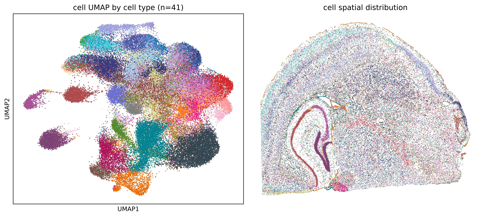

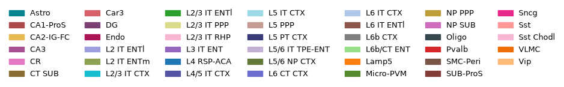

8. ROI case studies
--------------------------------------------------------------------------------

8.1 Cortex ROI: L5 PT CTX on H&E
~~~~~~~~~~~~~~~~~~~~~~~~~~~~~~~~~~~~~~~~~~~~~~~~~~~~~~~~~~~~~~~~~~~~~~~~~~~~~~~~

.. code-block:: python
   :linenos:

   target_ct = "L5 PT CTX"
   
   # labels_all["cell"] is already spot-level (each spot = predicted type of its cell), use it directly
   spot_ct = np.asarray(labels_all["cell"])
   
   # ---- ROI + filter by target cell type ----
   sxy = np.asarray(adata.obsm["spatial_pixel"]); xs, ys = sxy[:, 0], sxy[:, 1]
   x_min, x_max, y_min, y_max = 10344-4000+500+1000, 16760-4000+500-1000-1000-1000-1000, 4700-2000+2000, 11116-2000-2000-1000
   x_min, x_max, y_min, y_max = int(x_min), int(x_max), int(y_min), int(y_max)
   extent = [x_min, x_max, y_min, y_max]
   roi = (xs >= x_min) & (xs < x_max) & (ys >= y_min) & (ys < y_max)
   m = roi & (spot_ct == target_ct)
   
   col = celltype_color.get(target_ct, "#e6194b") if "celltype_color" in dir() else "#e6194b"
   
   # H&E crop of the ROI
   fig, ax = plt.subplots(figsize=(7, 7), dpi=600)
   ax.imshow(full_res[y_min:y_max, x_min:x_max], extent=extent, origin="lower", zorder=0)
   
   ax.set_xlim(x_min, x_max); ax.set_ylim(y_min, y_max)
   ax.set_aspect("equal"); ax.invert_yaxis(); ax.axis("off")
   ax.set_title(f"{target_ct} (cell→spot) on H&E (ROI)")
   #plt.savefig("HE.png")
   plt.show()
   print(f"{m.sum()} spots (cell type = '{target_ct}') in ROI")

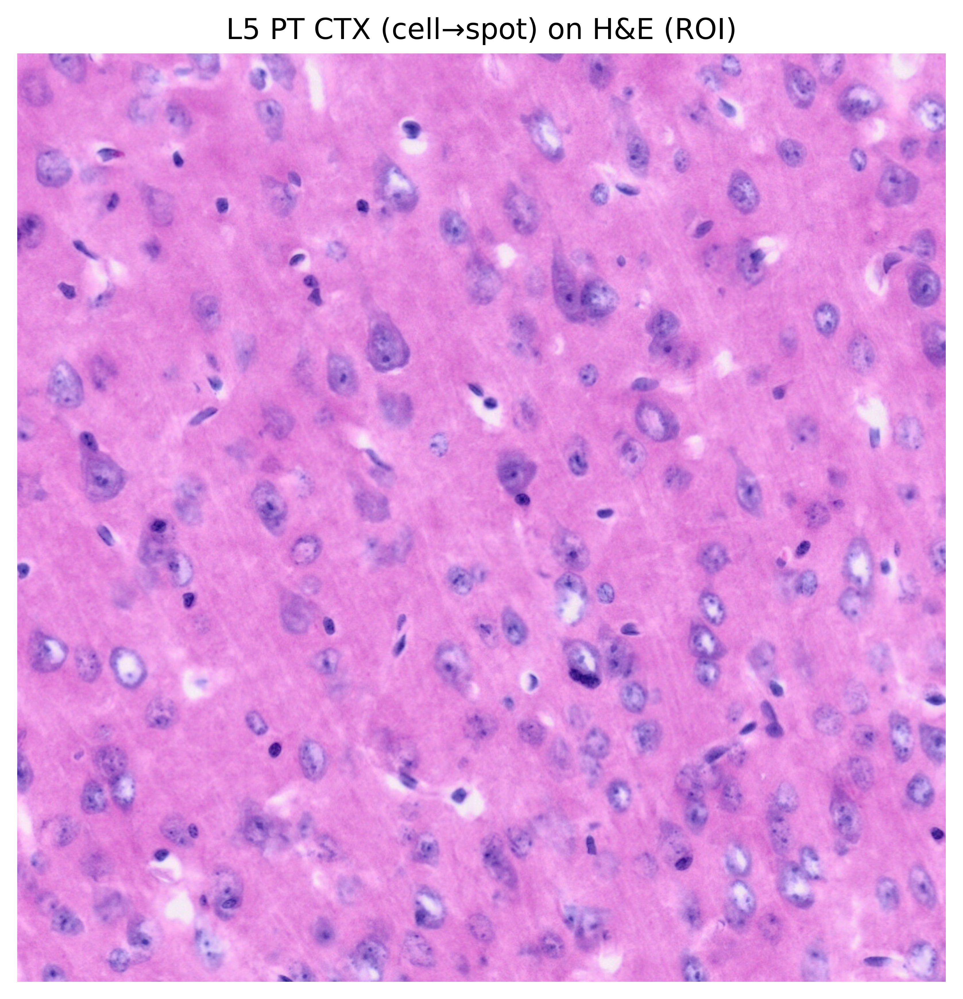

.. container:: cell-output

   .. code-block:: text

      3054 spots (cell type = 'L5 PT CTX') in ROI

8.2 Cortex ROI: multi-panel view (cell types, H&E, niches, marker genes)
~~~~~~~~~~~~~~~~~~~~~~~~~~~~~~~~~~~~~~~~~~~~~~~~~~~~~~~~~~~~~~~~~~~~~~~~~~~~~~~~

.. code-block:: python
   :linenos:

   # ============================================================
   # 0. ROI / colors / data preparation
   # ============================================================
   x_min, x_max, y_min, y_max = 10344-4000+500+1000, 16760-4000+500-1000, 4700-2000+1000, 11116-2000-2000-1000
   #x_min, y_min, x_max, y_max = 12844 - 500 - 500 -500, 7700-500, 13760 -500 + 500, 8664 + 500 + 500
   
   extent = [x_min, x_max, y_min, y_max]
   # Marker genes shown in the pseudo-fluorescence panel
   gene_colors = {
       'Bcl11b':  '#00E676',   # green
       'Fezf2':  '#2979FF',   # blue
       'Vat1l':   '#FFEA00',   # yellow
   }
   
   xs = adata.obsm['spatial_pixel'][:, 0]
   ys = adata.obsm['spatial_pixel'][:, 1]
   in_roi = (xs >= x_min) & (xs < x_max) & (ys >= y_min) & (ys < y_max)
   
   spot_cell_types = [celltype_color[ct]
                      for i, ct in enumerate(labels_all["spot"]) if in_roi[i]]
   
   # --- Broadcast niche clusters to spots: spot -> cell -> cell_niche_merged ---
   S = S_s2c_updated.coalesce()
   srow, scol = S.indices()
   n_cell = S.size(1)
   
   # Active niche (cell index) -> niche label
   # NOTE: uses clusters_id["niche"] (pre-merge labels), not clusters_id["niche_merged"]
   cell_niche_merged = torch.full((n_cell,), -1, dtype=torch.long)
   active = torch.as_tensor(active_niche_indices).long()
   cell_niche_merged[active] = torch.as_tensor(np.asarray(clusters_id["niche"])).long()
   
   # spot -> its cell -> niche label
   spot2cell = torch.full((S.size(0),), -1, dtype=torch.long)
   spot2cell[srow] = scol
   has_cell = (spot2cell >= 0).numpy()
   spot_niche_label = np.full(S.size(0), -1, dtype=int)
   spot_niche_label[has_cell] = cell_niche_merged[spot2cell.clamp(min=0)].numpy()[has_cell]
   
   grey = "#e8e8e8"   # spots without a cell
   spot_niche_color = np.array([grey] * len(spot_niche_label), dtype=object)
   valid = spot_niche_label >= 0
   spot_niche_color[valid] = [umap_color[f"Cluster_{v}"] for v in spot_niche_label[valid]]
   
   
   # ============================================================
   # Major cell types: only types with fraction >= MIN_FRAC go into the legend
   # ============================================================
   MIN_FRAC = 0.0001   # 0.01%
   TOP_N    = 12       # upper bound: show at most the top N types
   
   def major_cell_types(label_list, min_frac=MIN_FRAC, top_n=TOP_N):
       """Return the most frequent labels whose fraction >= min_frac (at most top_n)."""
       cnt = Counter(label_list)
       total = sum(cnt.values())
       if total == 0:
           return []
       ranked = sorted(cnt.items(), key=lambda kv: -kv[1])
       keep = [ct for ct, n in ranked if (n / total) >= min_frac]
       return keep[:top_n] if keep else [ct for ct, _ in ranked[:top_n]]
   
   
   # ============================================================
   # Shared legend style
   # ============================================================
   def _make_legend(ax, handles, labelcolor='black', loc='lower right',
                    frame=True, fontsize=8):
       """Draw a compact legend with a semi-transparent white frame."""
       if not handles:
           return
       leg = ax.legend(handles=handles, loc=loc, fontsize=fontsize,
                       frameon=frame, labelcolor=labelcolor,
                       handlelength=1.0, handletextpad=0.5, borderpad=0.5)
       if frame:
           leg.get_frame().set_facecolor('white')
           leg.get_frame().set_alpha(0.7)
           leg.get_frame().set_edgecolor('none')
   
   
   # ============================================================
   # 4 x 1 figure
   # ============================================================
   fig, axes = plt.subplots(4, 1, figsize=(24, 24), dpi=300)
   
   # -------- Row 3: niche clusters (spot level, white background, no legend) --------
   ax = axes[2]
   ax.set_facecolor("white")
   ax.scatter(xs[in_roi], ys[in_roi],
              c=spot_niche_color[in_roi], s=4, alpha=1.0, marker="s",
              edgecolors='none', rasterized=True, zorder=2)
   ax.set_xlim(x_min, x_max); ax.set_ylim(y_min, y_max)
   ax.set_aspect("equal"); ax.set_xticks([]); ax.set_yticks([])
   axes[2].invert_yaxis()
   
   # -------- Row 1: spot-level cell types (white background + major cell type legend) --------
   ax = axes[0]
   ax.set_facecolor("white")
   ax.scatter(xs[in_roi], ys[in_roi],
              c=spot_cell_types, s=4, alpha=1.0, marker="s",
              edgecolors='none', rasterized=True, zorder=2)
   ax.set_xlim(x_min, x_max); ax.set_ylim(y_min, y_max)
   ax.set_aspect("equal"); ax.set_xticks([]); ax.set_yticks([])
   axes[0].invert_yaxis()
   spot_ct_in_roi = np.asarray(labels_all["spot"])[in_roi].tolist()
   major_p2 = major_cell_types(spot_ct_in_roi)
   handles_p2 = [
       Line2D([0], [0], marker='s', linestyle='', markersize=8,
              markerfacecolor=celltype_color[ct], markeredgecolor='none', label=str(ct))
       for ct in major_p2 if ct in celltype_color
   ]
   _make_legend(ax, handles_p2, labelcolor='black')
   
   # -------- Row 2: H&E + cell-level segmentation overlay (+ major cell type legend) --------
   ax = axes[1]
   ax.imshow(full_res[y_min:y_max, x_min:x_max], extent=extent, origin="lower")
   utils.plot_roi_by_xy(ax, x_min, x_max, y_min, y_max,
                        adata, S_s2c_updated, labels_all["cell"], celltype_color,
                        fill_alpha=0.8, contour_lw=1)
   
   ax.set_title("H&E + cells", color='white', fontsize=14, pad=8)
   
   # Only count cells inside the ROI (filtering by cell center coordinates is more accurate)
   cell_labels_all = np.asarray(labels_all["cell"]).tolist()
   try:
       cell_xy = np.asarray(adata.uns.get("cell_xy", None))
       if cell_xy is not None and len(cell_xy) == len(cell_labels_all):
           in_roi_cell = ((cell_xy[:, 0] >= x_min) & (cell_xy[:, 0] < x_max) &
                          (cell_xy[:, 1] >= y_min) & (cell_xy[:, 1] < y_max))
           cell_labels_roi = [cell_labels_all[i] for i in np.where(in_roi_cell)[0]]
       else:
           cell_labels_roi = cell_labels_all
   except Exception:
       cell_labels_roi = cell_labels_all
   
   major_p3 = major_cell_types(cell_labels_roi)
   handles_p3 = [
       Line2D([0], [0], marker='o', linestyle='', markersize=8,
              markerfacecolor=celltype_color[ct], markeredgecolor='none', label=str(ct))
       for ct in major_p3 if ct in celltype_color
   ]
   _make_legend(ax, handles_p2, labelcolor='black')   # TODO: probably meant handles_p3
   
   # -------- Row 4: pseudo-fluorescence (marker genes) + cell overlay (keeps gene legend) --------
   utils.plot_fluorescent_roi(
       axes[3],
       x_min, x_max, y_min, y_max,
       full_res, adata,
       gene_colors=gene_colors,
       background="dim_he",
       bg_alpha=0.8, bg_brightness=0.30,
       gaussian_sigma=10, blur_intensity=4.0,
       cell_overlay_fn=lambda ax: utils.plot_roi_by_xy(
           ax, x_min, x_max, y_min, y_max,
           adata, S_s2c_updated, labels_all["cell"], celltype_color,
           fill_alpha=0.8, contour_lw=0.5,
       ),
   )
   
   # ============================================================
   # Save
   # ============================================================
   plt.tight_layout()
   #plt.savefig("Fig_CRC.png", dpi=600, facecolor=fig.get_facecolor())
   plt.show()

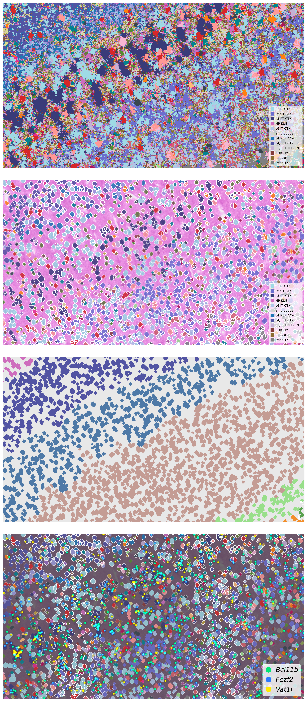

8.3 Hippocampus ROI: CA2-IG-FC on H&E
~~~~~~~~~~~~~~~~~~~~~~~~~~~~~~~~~~~~~~~~~~~~~~~~~~~~~~~~~~~~~~~~~~~~~~~~~~~~~~~~

.. code-block:: python
   :linenos:

   target_ct = "CA2-IG-FC"
   
   # labels_all["cell"] is already spot-level (each spot = predicted type of its cell), use it directly
   spot_ct = np.asarray(labels_all["cell"])
   
   # ---- ROI + filter by target cell type ----
   sxy = np.asarray(adata.obsm["spatial_pixel"]); xs, ys = sxy[:, 0], sxy[:, 1]
   x_min, x_max, y_min, y_max = 10344-4000-1000, 16760-4000-2000-1000, 4700+4000, 11116+2000
   x_min, x_max, y_min, y_max = int(x_min), int(x_max), int(y_min), int(y_max)
   extent = [x_min, x_max, y_min, y_max]
   roi = (xs >= x_min) & (xs < x_max) & (ys >= y_min) & (ys < y_max)
   m = roi & (spot_ct == target_ct)
   
   col = celltype_color.get(target_ct, "#e6194b") if "celltype_color" in dir() else "#e6194b"
   
   # H&E crop of the ROI
   fig, ax = plt.subplots(figsize=(7, 7), dpi=600)
   ax.imshow(full_res[y_min:y_max, x_min:x_max], extent=extent, origin="lower", zorder=0)
   
   ax.set_xlim(x_min, x_max); ax.set_ylim(y_min, y_max)
   ax.set_aspect("equal"); ax.invert_yaxis(); ax.axis("off")
   ax.set_title(f"{target_ct} (cell→spot) on H&E (ROI)")
   plt.show()
   print(f"{m.sum()} spots (cell type = '{target_ct}') in ROI")

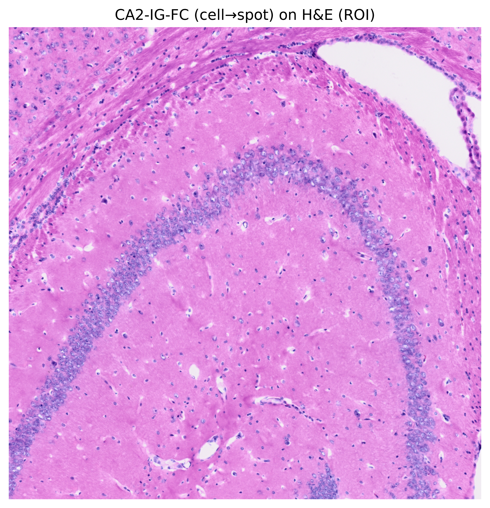

.. container:: cell-output

   .. code-block:: text

      1682 spots (cell type = 'CA2-IG-FC') in ROI

8.4 Hippocampus ROI: multi-panel view (cell types, H&E, niches, marker genes)
~~~~~~~~~~~~~~~~~~~~~~~~~~~~~~~~~~~~~~~~~~~~~~~~~~~~~~~~~~~~~~~~~~~~~~~~~~~~~~~~

.. code-block:: python
   :linenos:

   # ============================================================
   # 0. ROI / colors / data preparation
   # ============================================================
   x_min, x_max, y_min, y_max = 10344-4000-1000, 16760-4000-2000-1000, 4700+4000, 11116+2000
   #x_min, y_min, x_max, y_max = 12844 - 500 - 500 -500, 7700-500, 13760 -500 + 500, 8664 + 500 + 500
   
   extent = [x_min, x_max, y_min, y_max]
   # Marker genes shown in the pseudo-fluorescence panel
   gene_colors = {
       'Wfs1':  '#00E676',   # green
       'Rgs14':  '#2979FF',   # blue
       'Grik4':   '#FFEA00',   # yellow
   }
   
   xs = adata.obsm['spatial_pixel'][:, 0]
   ys = adata.obsm['spatial_pixel'][:, 1]
   in_roi = (xs >= x_min) & (xs < x_max) & (ys >= y_min) & (ys < y_max)
   
   spot_cell_types = [celltype_color[ct]
                      for i, ct in enumerate(labels_all["spot"]) if in_roi[i]]
   
   # --- Broadcast niche clusters to spots: spot -> cell -> cell_niche_merged ---
   S = S_s2c_updated.coalesce()
   srow, scol = S.indices()
   n_cell = S.size(1)
   
   # Active niche (cell index) -> niche label
   # NOTE: uses clusters_id["niche"] (pre-merge labels), not clusters_id["niche_merged"]
   cell_niche_merged = torch.full((n_cell,), -1, dtype=torch.long)
   active = torch.as_tensor(active_niche_indices).long()
   cell_niche_merged[active] = torch.as_tensor(np.asarray(clusters_id["niche"])).long()
   
   # spot -> its cell -> niche label
   spot2cell = torch.full((S.size(0),), -1, dtype=torch.long)
   spot2cell[srow] = scol
   has_cell = (spot2cell >= 0).numpy()
   spot_niche_label = np.full(S.size(0), -1, dtype=int)
   spot_niche_label[has_cell] = cell_niche_merged[spot2cell.clamp(min=0)].numpy()[has_cell]
   
   grey = "#e8e8e8"   # spots without a cell
   spot_niche_color = np.array([grey] * len(spot_niche_label), dtype=object)
   valid = spot_niche_label >= 0
   spot_niche_color[valid] = [umap_color[f"Cluster_{v}"] for v in spot_niche_label[valid]]
   
   
   # ============================================================
   # Major cell types: only types with fraction >= MIN_FRAC go into the legend
   # ============================================================
   MIN_FRAC = 0.0001   # 0.01%
   TOP_N    = 12       # upper bound: show at most the top N types
   
   def major_cell_types(label_list, min_frac=MIN_FRAC, top_n=TOP_N):
       """Return the most frequent labels whose fraction >= min_frac (at most top_n)."""
       cnt = Counter(label_list)
       total = sum(cnt.values())
       if total == 0:
           return []
       ranked = sorted(cnt.items(), key=lambda kv: -kv[1])
       keep = [ct for ct, n in ranked if (n / total) >= min_frac]
       return keep[:top_n] if keep else [ct for ct, _ in ranked[:top_n]]
   
   
   # ============================================================
   # Shared legend style
   # ============================================================
   def _make_legend(ax, handles, labelcolor='black', loc='lower right',
                    frame=True, fontsize=8):
       """Draw a compact legend with a semi-transparent white frame."""
       if not handles:
           return
       leg = ax.legend(handles=handles, loc=loc, fontsize=fontsize,
                       frameon=frame, labelcolor=labelcolor,
                       handlelength=1.0, handletextpad=0.5, borderpad=0.5)
       if frame:
           leg.get_frame().set_facecolor('white')
           leg.get_frame().set_alpha(0.7)
           leg.get_frame().set_edgecolor('none')
   
   
   # ============================================================
   # 4 x 1 figure
   # ============================================================
   fig, axes = plt.subplots(4, 1, figsize=(24, 24), dpi=300)
   
   # -------- Row 3: niche clusters (spot level, white background, no legend) --------
   ax = axes[2]
   ax.set_facecolor("white")
   ax.scatter(xs[in_roi], ys[in_roi],
              c=spot_niche_color[in_roi], s=4, alpha=1.0, marker="s",
              edgecolors='none', rasterized=True, zorder=2)
   ax.set_xlim(x_min, x_max); ax.set_ylim(y_min, y_max)
   ax.set_aspect("equal"); ax.set_xticks([]); ax.set_yticks([])
   axes[2].invert_yaxis()
   
   # -------- Row 1: spot-level cell types (white background + major cell type legend) --------
   ax = axes[0]
   ax.set_facecolor("white")
   ax.scatter(xs[in_roi], ys[in_roi],
              c=spot_cell_types, s=4, alpha=1.0, marker="s",
              edgecolors='none', rasterized=True, zorder=2)
   ax.set_xlim(x_min, x_max); ax.set_ylim(y_min, y_max)
   ax.set_aspect("equal"); ax.set_xticks([]); ax.set_yticks([])
   axes[0].invert_yaxis()
   spot_ct_in_roi = np.asarray(labels_all["spot"])[in_roi].tolist()
   major_p2 = major_cell_types(spot_ct_in_roi)
   handles_p2 = [
       Line2D([0], [0], marker='s', linestyle='', markersize=8,
              markerfacecolor=celltype_color[ct], markeredgecolor='none', label=str(ct))
       for ct in major_p2 if ct in celltype_color
   ]
   _make_legend(ax, handles_p2, labelcolor='black')
   
   # -------- Row 2: H&E + cell-level segmentation overlay (+ major cell type legend) --------
   ax = axes[1]
   ax.imshow(full_res[y_min:y_max, x_min:x_max], extent=extent, origin="lower")
   utils.plot_roi_by_xy(ax, x_min, x_max, y_min, y_max,
                        adata, S_s2c_updated, labels_all["cell"], celltype_color,
                        fill_alpha=0.8, contour_lw=1)
   
   ax.set_title("H&E + cells", color='white', fontsize=14, pad=8)
   
   # Only count cells inside the ROI (filtering by cell center coordinates is more accurate)
   cell_labels_all = np.asarray(labels_all["cell"]).tolist()
   try:
       cell_xy = np.asarray(adata.uns.get("cell_xy", None))
       if cell_xy is not None and len(cell_xy) == len(cell_labels_all):
           in_roi_cell = ((cell_xy[:, 0] >= x_min) & (cell_xy[:, 0] < x_max) &
                          (cell_xy[:, 1] >= y_min) & (cell_xy[:, 1] < y_max))
           cell_labels_roi = [cell_labels_all[i] for i in np.where(in_roi_cell)[0]]
       else:
           cell_labels_roi = cell_labels_all
   except Exception:
       cell_labels_roi = cell_labels_all
   
   major_p3 = major_cell_types(cell_labels_roi)
   handles_p3 = [
       Line2D([0], [0], marker='o', linestyle='', markersize=8,
              markerfacecolor=celltype_color[ct], markeredgecolor='none', label=str(ct))
       for ct in major_p3 if ct in celltype_color
   ]
   _make_legend(ax, handles_p2, labelcolor='black')   # TODO: probably meant handles_p3
   
   # -------- Row 4: pseudo-fluorescence (marker genes) + cell overlay (keeps gene legend) --------
   utils.plot_fluorescent_roi(
       axes[3],
       x_min, x_max, y_min, y_max,
       full_res, adata,
       gene_colors=gene_colors,
       background="dim_he",
       bg_alpha=0.8, bg_brightness=0.30,
       gaussian_sigma=10, blur_intensity=4.0,
       cell_overlay_fn=lambda ax: utils.plot_roi_by_xy(
           ax, x_min, x_max, y_min, y_max,
           adata, S_s2c_updated, labels_all["cell"], celltype_color,
           fill_alpha=0.8, contour_lw=0.5,
       ),
   )
   
   # ============================================================
   # Save
   # ============================================================
   plt.tight_layout()
   #plt.savefig("Fig_CRC.png", dpi=600, facecolor=fig.get_facecolor())
   plt.show()

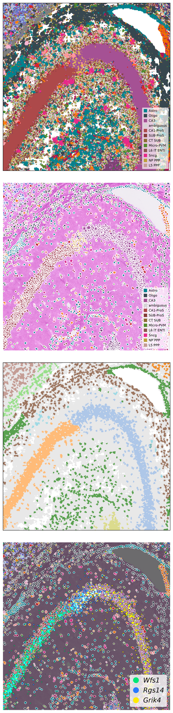

