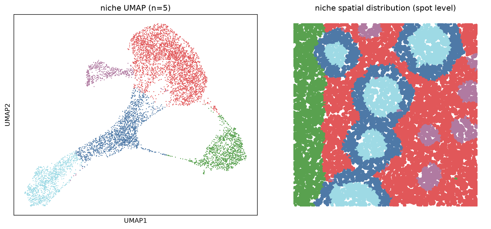

Simulated tumor microenvironment (no ref.)
================================================================================

:download:`Download notebook <examples/hiNiche_sim_TME_run_hiNiche_noref.ipynb>`

.. rubric:: hiNiche: Simulated colorectal cancer TME (no reference, top-5000 HVG input)

.. raw:: html

   
Same pipeline as <code>HDST_sim_TME_run_hiNiche.ipynb</code>, with two differences in the input:

.. raw:: html

   
- <strong>No reference</strong>: <code>ref_matrix=None</code>, so the loss contains only the contrastive term (no Poisson NLL / entropy).

.. raw:: html

   
- <strong>Input genes = top 5000 highly variable genes (HVG)</strong> instead of the genes shared with the reference.

.. raw:: html

   
The simulated AnnData provides the ground truth used for evaluation:

.. raw:: html

   
- <code>obsm[&quot;S_s2c&quot;]</code>: spot-to-cell assignment

.. raw:: html

   
- <code>obs[&quot;niche_id&quot;]</code>: ground-truth niche of each spot

1. Setup and imports
--------------------------------------------------------------------------------

.. code-block:: python
   :linenos:

   import os
   import sys
   # cupy (used by rapids_singlecell) compiles GPU kernels at runtime and needs the CUDA headers shipped inside the conda environment
   os.environ.setdefault("CUDA_PATH", os.path.join(sys.prefix, "targets", "x86_64-linux"))
   
   # --- Project modules ---
   import config
   import utils
   from train import run_train_seq
   
   # --- Standard library ---
   import warnings
   
   # --- Data handling ---
   import numpy as np
   import pandas as pd
   import anndata as ad
   import scanpy as sc
   
   # --- Deep learning ---
   import torch
   
   # --- Clustering and evaluation ---
   import rapids_singlecell as rsc     # GPU-accelerated neighbors / UMAP
   from sklearn.cluster import KMeans
   from sklearn.metrics import normalized_mutual_info_score as NMI, adjusted_rand_score as ARI
   
   # --- Plotting ---
   import matplotlib.pyplot as plt
   
   %load_ext autoreload
   %autoreload 2
   
   warnings.filterwarnings("ignore")

.. container:: cell-output

   .. code-block:: text

      /hpc/home/wz220/miniconda3/envs/hiNiche/lib/python3.12/site-packages/tqdm/auto.py:21: TqdmWarning: IProgress not found. Please update jupyter and ipywidgets. See https://ipywidgets.readthedocs.io/en/stable/user_install.html
        from .autonotebook import tqdm as notebook_tqdm

2. Parameter configuration
--------------------------------------------------------------------------------

.. code-block:: python
   :linenos:

   SAMPLE = "Simulation1_HD"
   
   # Data path (no reference file is used)
   h5_path = f"DATA/{SAMPLE}/sim_TME.h5ad"
   
   # Patch save path (separate from the reference-based run)
   PATCH_LOC = f"DATA/{SAMPLE}/mini_batch_cache_hvg5000"
   
   # Model save path (an existing checkpoint is loaded instead of retraining)
   MODEL_SAVE_DIR = f"DATA/{SAMPLE}/checkpoint_hvg5000_noref.pt"
   
   # Color map defined in config.py
   umap_color = getattr(config, "umap_40")
   
   # Input genes
   N_HVG = 5000      # number of highly variable genes used as model input
   
   # Model / training hyperparameters
   graph_knn   = 12
   niche_knn   = 20
   lr          = 0.005
   hidden_dim  = 32  # embedding dimension (free to choose without a reference)
   num_epochs  = 100
   edge_drop   = 0.5
   member_drop = 0.5
   neg_samples = 5
   tau         = 1
   alpha       = 1
   beta        = 1
   seed        = 42
   device      = "cuda:0"
   
   # Niche clustering
   n_clusters = 5    # number of KMeans clusters (= number of simulated niches)
   emb_k      = 50   # n_neighbors of the kNN graph used for UMAP only

3. Data loading and preprocessing
--------------------------------------------------------------------------------

3.1 Load simulated data
~~~~~~~~~~~~~~~~~~~~~~~~~~~~~~~~~~~~~~~~~~~~~~~~~~~~~~~~~~~~~~~~~~~~~~~~~~~~~~~~

.. code-block:: python
   :linenos:

   # Simulated spot-level counts
   adata = sc.read(h5_path)
   print(adata)

.. container:: cell-output

   .. code-block:: text

      AnnData object with n_obs × n_vars = 360000 × 6008
          obs: 'spotid', 'celltype', 'x', 'y', 'cell_id', 'niche_id', 'niche_name'
          uns: 'cells', 'celltype_names', 'niche_compositions', 'niche_names', 'pattern', 'spatial_neighbors'
          obsm: 'S_s2c', 'spatial_grid'
          layers: 'counts_clean'
          obsp: 'spatial_connectivities', 'spatial_distances'

3.2 Normalization
~~~~~~~~~~~~~~~~~~~~~~~~~~~~~~~~~~~~~~~~~~~~~~~~~~~~~~~~~~~~~~~~~~~~~~~~~~~~~~~~

.. code-block:: python
   :linenos:

   # Keep raw counts before normalization
   adata.layers["counts"] = adata.X.copy()
   adata.var_names_make_unique()
   
   # Library-size normalization + log transform
   sc.pp.normalize_total(adata, target_sum=1e4)
   sc.pp.log1p(adata)

3.3 Select highly variable genes
~~~~~~~~~~~~~~~~~~~~~~~~~~~~~~~~~~~~~~~~~~~~~~~~~~~~~~~~~~~~~~~~~~~~~~~~~~~~~~~~

.. code-block:: python
   :linenos:

   # Top-N HVG on the log-normalized data (replaces the intersection with the reference)
   sc.pp.highly_variable_genes(adata, n_top_genes=N_HVG, flavor="seurat")
   hvg_mask = adata.var["highly_variable"].values
   n_hvg = int(hvg_mask.sum())
   print(f"[Log] input gene number is {n_hvg}")
   
   adata.obsm["X_mle"] = adata.layers["counts"][:, hvg_mask]   # raw counts (unused in the loss without a reference)
   adata.obsm["X_input"] = adata[:, hvg_mask].X                # normalized model input
   
   # No reference: contrastive loss only
   ref_matrix = None

.. container:: cell-output

   .. code-block:: text

      [Log] input gene number is 5000

4. Build the spot / cell / niche hierarchy
--------------------------------------------------------------------------------

4.1 Spot-to-cell and spot-to-niche assignment
~~~~~~~~~~~~~~~~~~~~~~~~~~~~~~~~~~~~~~~~~~~~~~~~~~~~~~~~~~~~~~~~~~~~~~~~~~~~~~~~

.. code-block:: python
   :linenos:

   # Spot -> cell assignment taken from the simulation (ground-truth cell segmentation)
   S_s2c_all, cell_background_mask = utils.spot2cell_from_assignment(adata.obsm["S_s2c"], max_spots_per_cell=200, min_spots_per_cell=1)
   print(f"[Log] {S_s2c_all.shape[1]} cells are detected")
   
   # Spot -> niche assignment: each niche is a cell plus its nearest neighbors (including itself)
   S_s2n_all, niche_background_mask, active_niche_indices, S_c2n_all = utils.spot2niche_by_cell_knn(adata.obsm["spatial_grid"], S_s2c_all, k_niche=niche_knn)
   background_mask = {"cell": cell_background_mask, "niche": niche_background_mask}

.. container:: cell-output

   .. code-block:: text

      [Log] Active Cells (before filtering): 8030
      [Log] Valid Cells (1 <= spots <= 200): 8030
      [Log] Filtered Cells (< 1 spots): 0
      [Log] Filtered Cells (> 200 spots): 0
      [Log] 8030 cells are detected
      [Log] Active Niches: 8030, Cells per Niche (k): 20

4.2 Spatial KNN graphs
~~~~~~~~~~~~~~~~~~~~~~~~~~~~~~~~~~~~~~~~~~~~~~~~~~~~~~~~~~~~~~~~~~~~~~~~~~~~~~~~

.. code-block:: python
   :linenos:

   # Spatial KNN graphs at spot and cell level
   spot_edges = utils.build_spot_knn_graph(adata.obsm["spatial_grid"], graph_knn)
   cell_edges = utils.build_cell_knn_graph(adata.obsm["spatial_grid"], S_s2c_all, graph_knn)
   # Niche graph: reuses the cell KNN graph (one niche per cell), same k as spot/cell graphs
   niche_edges = cell_edges

.. container:: cell-output

   .. code-block:: text

      [Log] 4330462 edges generated from 360000 nodes (k=12)
      [Log] 107126 edges generated from 8030 nodes (k=12)

4.3 Spatial blocking and subgraph caching
~~~~~~~~~~~~~~~~~~~~~~~~~~~~~~~~~~~~~~~~~~~~~~~~~~~~~~~~~~~~~~~~~~~~~~~~~~~~~~~~

.. code-block:: python
   :linenos:

   # Split the slide into overlapping spatial blocks (core + halo) for mini-batch training
   batch_mask, block_ids = utils.make_block_masks(adata.obsm["spatial_grid"], S_s2c=S_s2c_all, S_s2n=S_s2n_all, single_patch = True)
   
   # Build and cache per-block subgraph data to disk (ref_matrix=None skips likelihood precomputation)
   utils.build_subgraph_data(adata, ref_matrix, spot_edges, cell_edges, niche_edges,
                             S_s2c_all, S_s2n_all, S_c2n_all, background_mask, batch_mask, block_ids, PATCH_LOC)
   print(f"[Log] Original ST is patchfied to {len(block_ids)} blocks with avg {batch_mask['spot_level_core'].sum(dim=1).float().mean().item():.0f} spots, {batch_mask['cell_level_core'].sum(dim=1).float().mean().item():.0f} cells and {batch_mask['niche_level_core'].sum(dim=1).float().mean().item():.0f} niches per block")

.. container:: cell-output

   .. code-block:: text

      [Log] Single-patch mode: the whole slide is one block

.. container:: cell-output

   .. code-block:: text

      [Log] Building & saving mini-batches: 100%|██████████| 1/1 [00:06<00:00,  6.42s/it]

.. container:: cell-output

   .. code-block:: text

      [Log] Saved 1 blocks → DATA/Simulation1_HD/mini_batch_cache_hvg5000
      [Log] Original ST is patchfied to 1 blocks with avg 360000 spots, 8030 cells and 8030 niches per block

5. Model training
--------------------------------------------------------------------------------

.. code-block:: python
   :linenos:

   emb_all, slice_id = run_train_seq(total_unit_number_per_level = {"spot": S_s2c_all.shape[0], "cell": S_s2c_all.shape[1], "niche": S_s2n_all.shape[1]},
                                     PATCH_LOC = PATCH_LOC,
                                     MODEL_SAVE_DIR = MODEL_SAVE_DIR,
                                     ref_matrix = ref_matrix,
                                     lr = lr,
                                     in_dim = n_hvg,
                                     hidden_dim = hidden_dim,
                                     num_epochs = num_epochs,
                                     edge_drop = edge_drop,
                                     member_drop = member_drop,
                                     neg_samples = neg_samples,
                                     tau = tau,
                                     alpha = alpha,
                                     beta = beta,
                                     seed = seed,
                                     device = device)

.. container:: cell-output

   .. code-block:: text

      Epoch 1: 100%|██████████| 1/1 [00:01<00:00,  1.05s/it, cl=5.2265, nll=0.0000, entp=0.0000]
      Epoch 2: 100%|██████████| 1/1 [00:00<00:00,  2.04it/s, cl=5.4824, nll=0.0000, entp=0.0000]
      Epoch 3: 100%|██████████| 1/1 [00:00<00:00,  2.16it/s, cl=5.3584, nll=0.0000, entp=0.0000]
      Epoch 4: 100%|██████████| 1/1 [00:00<00:00,  2.20it/s, cl=5.2095, nll=0.0000, entp=0.0000]
      Epoch 5: 100%|██████████| 1/1 [00:00<00:00,  2.21it/s, cl=5.0755, nll=0.0000, entp=0.0000]
      Epoch 6: 100%|██████████| 1/1 [00:00<00:00,  2.20it/s, cl=4.9913, nll=0.0000, entp=0.0000]
      Epoch 7: 100%|██████████| 1/1 [00:00<00:00,  2.20it/s, cl=4.9279, nll=0.0000, entp=0.0000]
      Epoch 8: 100%|██████████| 1/1 [00:00<00:00,  2.21it/s, cl=4.8763, nll=0.0000, entp=0.0000]
      Epoch 9: 100%|██████████| 1/1 [00:00<00:00,  2.20it/s, cl=4.8358, nll=0.0000, entp=0.0000]
      Epoch 10: 100%|██████████| 1/1 [00:00<00:00,  2.19it/s, cl=4.7921, nll=0.0000, entp=0.0000]
      Epoch 11: 100%|██████████| 1/1 [00:00<00:00,  2.21it/s, cl=4.7547, nll=0.0000, entp=0.0000]
      Epoch 12: 100%|██████████| 1/1 [00:00<00:00,  2.21it/s, cl=4.7237, nll=0.0000, entp=0.0000]
      Epoch 13: 100%|██████████| 1/1 [00:00<00:00,  2.19it/s, cl=4.6937, nll=0.0000, entp=0.0000]
      Epoch 14: 100%|██████████| 1/1 [00:00<00:00,  2.21it/s, cl=4.6763, nll=0.0000, entp=0.0000]
      Epoch 15: 100%|██████████| 1/1 [00:00<00:00,  2.21it/s, cl=4.6637, nll=0.0000, entp=0.0000]
      Epoch 16: 100%|██████████| 1/1 [00:00<00:00,  2.12it/s, cl=4.6523, nll=0.0000, entp=0.0000]
      Epoch 17: 100%|██████████| 1/1 [00:00<00:00,  2.13it/s, cl=4.6380, nll=0.0000, entp=0.0000]
      Epoch 18: 100%|██████████| 1/1 [00:00<00:00,  2.13it/s, cl=4.6203, nll=0.0000, entp=0.0000]
      Epoch 19: 100%|██████████| 1/1 [00:00<00:00,  2.14it/s, cl=4.6118, nll=0.0000, entp=0.0000]
      Epoch 20: 100%|██████████| 1/1 [00:00<00:00,  2.13it/s, cl=4.5998, nll=0.0000, entp=0.0000]
      Epoch 21: 100%|██████████| 1/1 [00:00<00:00,  2.12it/s, cl=4.5902, nll=0.0000, entp=0.0000]
      Epoch 22: 100%|██████████| 1/1 [00:00<00:00,  2.10it/s, cl=4.5798, nll=0.0000, entp=0.0000]
      Epoch 23: 100%|██████████| 1/1 [00:00<00:00,  2.13it/s, cl=4.5722, nll=0.0000, entp=0.0000]
      Epoch 24: 100%|██████████| 1/1 [00:00<00:00,  2.14it/s, cl=4.5678, nll=0.0000, entp=0.0000]
      Epoch 25: 100%|██████████| 1/1 [00:00<00:00,  2.12it/s, cl=4.5595, nll=0.0000, entp=0.0000]
      Epoch 26: 100%|██████████| 1/1 [00:00<00:00,  2.12it/s, cl=4.5514, nll=0.0000, entp=0.0000]
      Epoch 27: 100%|██████████| 1/1 [00:00<00:00,  2.14it/s, cl=4.5458, nll=0.0000, entp=0.0000]
      Epoch 28: 100%|██████████| 1/1 [00:00<00:00,  2.14it/s, cl=4.5364, nll=0.0000, entp=0.0000]
      Epoch 29: 100%|██████████| 1/1 [00:00<00:00,  2.12it/s, cl=4.5299, nll=0.0000, entp=0.0000]
      Epoch 30: 100%|██████████| 1/1 [00:00<00:00,  2.13it/s, cl=4.5256, nll=0.0000, entp=0.0000]
      Epoch 31: 100%|██████████| 1/1 [00:00<00:00,  2.12it/s, cl=4.5186, nll=0.0000, entp=0.0000]
      Epoch 32: 100%|██████████| 1/1 [00:00<00:00,  2.12it/s, cl=4.5167, nll=0.0000, entp=0.0000]
      Epoch 33: 100%|██████████| 1/1 [00:00<00:00,  2.12it/s, cl=4.5138, nll=0.0000, entp=0.0000]
      Epoch 34: 100%|██████████| 1/1 [00:00<00:00,  2.12it/s, cl=4.5094, nll=0.0000, entp=0.0000]
      Epoch 35: 100%|██████████| 1/1 [00:00<00:00,  2.12it/s, cl=4.5088, nll=0.0000, entp=0.0000]
      Epoch 36: 100%|██████████| 1/1 [00:00<00:00,  2.13it/s, cl=4.5090, nll=0.0000, entp=0.0000]
      Epoch 37: 100%|██████████| 1/1 [00:00<00:00,  2.12it/s, cl=4.5047, nll=0.0000, entp=0.0000]
      Epoch 38: 100%|██████████| 1/1 [00:00<00:00,  2.14it/s, cl=4.5066, nll=0.0000, entp=0.0000]
      Epoch 39: 100%|██████████| 1/1 [00:00<00:00,  2.13it/s, cl=4.5023, nll=0.0000, entp=0.0000]
      Epoch 40: 100%|██████████| 1/1 [00:00<00:00,  2.13it/s, cl=4.4992, nll=0.0000, entp=0.0000]
      Epoch 41: 100%|██████████| 1/1 [00:00<00:00,  2.14it/s, cl=4.4973, nll=0.0000, entp=0.0000]
      Epoch 42: 100%|██████████| 1/1 [00:00<00:00,  2.13it/s, cl=4.4962, nll=0.0000, entp=0.0000]
      Epoch 43: 100%|██████████| 1/1 [00:00<00:00,  2.10it/s, cl=4.4924, nll=0.0000, entp=0.0000]
      Epoch 44: 100%|██████████| 1/1 [00:00<00:00,  2.14it/s, cl=4.4898, nll=0.0000, entp=0.0000]
      Epoch 45: 100%|██████████| 1/1 [00:00<00:00,  2.14it/s, cl=4.4870, nll=0.0000, entp=0.0000]
      Epoch 46: 100%|██████████| 1/1 [00:00<00:00,  2.14it/s, cl=4.4864, nll=0.0000, entp=0.0000]
      Epoch 47: 100%|██████████| 1/1 [00:00<00:00,  2.13it/s, cl=4.4836, nll=0.0000, entp=0.0000]
      Epoch 48: 100%|██████████| 1/1 [00:00<00:00,  2.13it/s, cl=4.4852, nll=0.0000, entp=0.0000]
      Epoch 49: 100%|██████████| 1/1 [00:00<00:00,  2.13it/s, cl=4.4817, nll=0.0000, entp=0.0000]
      Epoch 50: 100%|██████████| 1/1 [00:00<00:00,  2.13it/s, cl=4.4783, nll=0.0000, entp=0.0000]
      Epoch 51: 100%|██████████| 1/1 [00:00<00:00,  2.14it/s, cl=4.4784, nll=0.0000, entp=0.0000]
      Epoch 52: 100%|██████████| 1/1 [00:00<00:00,  2.13it/s, cl=4.4789, nll=0.0000, entp=0.0000]
      Epoch 53: 100%|██████████| 1/1 [00:00<00:00,  2.14it/s, cl=4.4730, nll=0.0000, entp=0.0000]
      Epoch 54: 100%|██████████| 1/1 [00:00<00:00,  2.15it/s, cl=4.4747, nll=0.0000, entp=0.0000]
      Epoch 55: 100%|██████████| 1/1 [00:00<00:00,  2.13it/s, cl=4.4729, nll=0.0000, entp=0.0000]
      Epoch 56: 100%|██████████| 1/1 [00:00<00:00,  2.13it/s, cl=4.4749, nll=0.0000, entp=0.0000]
      Epoch 57: 100%|██████████| 1/1 [00:00<00:00,  2.13it/s, cl=4.4733, nll=0.0000, entp=0.0000]
      Epoch 58: 100%|██████████| 1/1 [00:00<00:00,  2.13it/s, cl=4.4703, nll=0.0000, entp=0.0000]
      Epoch 59: 100%|██████████| 1/1 [00:00<00:00,  2.13it/s, cl=4.4700, nll=0.0000, entp=0.0000]
      Epoch 60: 100%|██████████| 1/1 [00:00<00:00,  2.12it/s, cl=4.4660, nll=0.0000, entp=0.0000]
      Epoch 61: 100%|██████████| 1/1 [00:00<00:00,  2.13it/s, cl=4.4683, nll=0.0000, entp=0.0000]
      Epoch 62: 100%|██████████| 1/1 [00:00<00:00,  2.12it/s, cl=4.4678, nll=0.0000, entp=0.0000]
      Epoch 63: 100%|██████████| 1/1 [00:00<00:00,  2.13it/s, cl=4.4671, nll=0.0000, entp=0.0000]
      Epoch 64: 100%|██████████| 1/1 [00:00<00:00,  2.14it/s, cl=4.4633, nll=0.0000, entp=0.0000]
      Epoch 65: 100%|██████████| 1/1 [00:00<00:00,  2.13it/s, cl=4.4641, nll=0.0000, entp=0.0000]
      Epoch 66: 100%|██████████| 1/1 [00:00<00:00,  2.13it/s, cl=4.4630, nll=0.0000, entp=0.0000]
      Epoch 67: 100%|██████████| 1/1 [00:00<00:00,  2.13it/s, cl=4.4606, nll=0.0000, entp=0.0000]
      Epoch 68: 100%|██████████| 1/1 [00:00<00:00,  2.14it/s, cl=4.4615, nll=0.0000, entp=0.0000]
      Epoch 69: 100%|██████████| 1/1 [00:00<00:00,  2.13it/s, cl=4.4599, nll=0.0000, entp=0.0000]
      Epoch 70: 100%|██████████| 1/1 [00:00<00:00,  2.14it/s, cl=4.4581, nll=0.0000, entp=0.0000]
      Epoch 71: 100%|██████████| 1/1 [00:00<00:00,  2.13it/s, cl=4.4585, nll=0.0000, entp=0.0000]
      Epoch 72: 100%|██████████| 1/1 [00:00<00:00,  2.14it/s, cl=4.4556, nll=0.0000, entp=0.0000]
      Epoch 73: 100%|██████████| 1/1 [00:00<00:00,  2.14it/s, cl=4.4568, nll=0.0000, entp=0.0000]
      Epoch 74: 100%|██████████| 1/1 [00:00<00:00,  2.13it/s, cl=4.4540, nll=0.0000, entp=0.0000]
      Epoch 75: 100%|██████████| 1/1 [00:00<00:00,  2.14it/s, cl=4.4544, nll=0.0000, entp=0.0000]
      Epoch 76: 100%|██████████| 1/1 [00:00<00:00,  2.13it/s, cl=4.4547, nll=0.0000, entp=0.0000]
      Epoch 77: 100%|██████████| 1/1 [00:00<00:00,  2.14it/s, cl=4.4527, nll=0.0000, entp=0.0000]
      Epoch 78: 100%|██████████| 1/1 [00:00<00:00,  2.14it/s, cl=4.4527, nll=0.0000, entp=0.0000]
      Epoch 79: 100%|██████████| 1/1 [00:00<00:00,  2.14it/s, cl=4.4515, nll=0.0000, entp=0.0000]
      Epoch 80: 100%|██████████| 1/1 [00:00<00:00,  2.11it/s, cl=4.4509, nll=0.0000, entp=0.0000]
      Epoch 81: 100%|██████████| 1/1 [00:00<00:00,  2.14it/s, cl=4.4500, nll=0.0000, entp=0.0000]
      Epoch 82: 100%|██████████| 1/1 [00:00<00:00,  2.14it/s, cl=4.4513, nll=0.0000, entp=0.0000]
      Epoch 83: 100%|██████████| 1/1 [00:00<00:00,  2.13it/s, cl=4.4508, nll=0.0000, entp=0.0000]
      Epoch 84: 100%|██████████| 1/1 [00:00<00:00,  2.13it/s, cl=4.4459, nll=0.0000, entp=0.0000]
      Epoch 85: 100%|██████████| 1/1 [00:00<00:00,  2.14it/s, cl=4.4450, nll=0.0000, entp=0.0000]
      Epoch 86: 100%|██████████| 1/1 [00:00<00:00,  2.14it/s, cl=4.4461, nll=0.0000, entp=0.0000]
      Epoch 87: 100%|██████████| 1/1 [00:00<00:00,  2.13it/s, cl=4.4461, nll=0.0000, entp=0.0000]
      Epoch 88: 100%|██████████| 1/1 [00:00<00:00,  2.14it/s, cl=4.4454, nll=0.0000, entp=0.0000]
      Epoch 89: 100%|██████████| 1/1 [00:00<00:00,  2.13it/s, cl=4.4444, nll=0.0000, entp=0.0000]
      Epoch 90: 100%|██████████| 1/1 [00:00<00:00,  2.14it/s, cl=4.4421, nll=0.0000, entp=0.0000]
      Epoch 91: 100%|██████████| 1/1 [00:00<00:00,  2.15it/s, cl=4.4426, nll=0.0000, entp=0.0000]
      Epoch 92: 100%|██████████| 1/1 [00:00<00:00,  2.15it/s, cl=4.4408, nll=0.0000, entp=0.0000]
      Epoch 93: 100%|██████████| 1/1 [00:00<00:00,  2.21it/s, cl=4.4392, nll=0.0000, entp=0.0000]
      Epoch 94: 100%|██████████| 1/1 [00:00<00:00,  2.14it/s, cl=4.4405, nll=0.0000, entp=0.0000]
      Epoch 95: 100%|██████████| 1/1 [00:00<00:00,  2.14it/s, cl=4.4396, nll=0.0000, entp=0.0000]
      Epoch 96: 100%|██████████| 1/1 [00:00<00:00,  2.15it/s, cl=4.4400, nll=0.0000, entp=0.0000]
      Epoch 97: 100%|██████████| 1/1 [00:00<00:00,  2.15it/s, cl=4.4374, nll=0.0000, entp=0.0000]
      Epoch 98: 100%|██████████| 1/1 [00:00<00:00,  2.14it/s, cl=4.4369, nll=0.0000, entp=0.0000]
      Epoch 99: 100%|██████████| 1/1 [00:00<00:00,  2.13it/s, cl=4.4352, nll=0.0000, entp=0.0000]
      Epoch 100: 100%|██████████| 1/1 [00:00<00:00,  2.14it/s, cl=4.4353, nll=0.0000, entp=0.0000]

.. container:: cell-output

   .. code-block:: text

      Training finished!
      Model saved to DATA/Simulation1_HD/checkpoint_hvg5000_noref.pt

.. container:: cell-output

   .. code-block:: text

      generating embeddings (slice 0)...: 100%|██████████| 1/1 [00:00<00:00,  2.01it/s]

6. Niche detection
--------------------------------------------------------------------------------

6.1 Niche clustering (UMAP + spatial map) and NMI / ARI
~~~~~~~~~~~~~~~~~~~~~~~~~~~~~~~~~~~~~~~~~~~~~~~~~~~~~~~~~~~~~~~~~~~~~~~~~~~~~~~~

.. code-block:: python
   :linenos:

   torch.cuda.empty_cache()
   
   # --- 1. Niche embedding: KMeans clustering + UMAP ---
   X_niche = emb_all["niche"].numpy()
   niche_label = KMeans(n_clusters=n_clusters, random_state=seed, n_init=20).fit_predict(X_niche)
   
   adata_tmp = ad.AnnData(X_niche)
   rsc.pp.neighbors(adata_tmp, use_rep='X', n_neighbors=emb_k)
   rsc.tl.umap(adata_tmp, random_state=seed)
   niche_umap = adata_tmp.obsm["X_umap"]
   
   clusters_id = {"niche": niche_label}
   print(f"niche: {len(np.unique(niche_label))} clusters")
   
   # --- 2. Map niche clusters back to their center cells ---
   S = S_s2c_all.coalesce()
   rows, cols = S.indices()[0], S.indices()[1]
   n_cell = S.size(1)
   
   cell_niche = torch.full((n_cell,), -1, dtype=torch.long, device=S.device)
   active = torch.as_tensor(active_niche_indices, device=S.device).long()
   cell_niche[active] = torch.as_tensor(niche_label, device=S.device).long()
   
   # --- 3. Broadcast to spots (each spot takes the niche of its cell) ---
   spot2cell = torch.full((S.size(0),), -1, dtype=torch.long, device=S.device)
   spot2cell[rows] = cols
   spot_niche = torch.where(spot2cell >= 0,
                            cell_niche[spot2cell],
                            torch.tensor(-1, dtype=torch.long, device=S.device)).cpu().numpy()
   
   xy = np.asarray(adata.obsm["spatial_grid"])
   keep_spot = spot_niche >= 0
   print(f"spots with a niche label: {keep_spot.sum()} / {len(xy)}")
   
   # --- 4. Left: niche UMAP; right: spot-level niche spatial distribution ---
   fig, axes = plt.subplots(1, 2, figsize=(11, 5), dpi=200)
   
   axes[0].scatter(niche_umap[:, 0], niche_umap[:, 1],
                   c=[umap_color[f"Cluster_{v % 40}"] for v in niche_label], s=2, linewidths=0)
   axes[0].set_title(f"niche UMAP (n={n_clusters})")
   axes[0].set_xticks([]); axes[0].set_yticks([])
   axes[0].set_xlabel("UMAP1"); axes[0].set_ylabel("UMAP2")
   
   axes[1].scatter(xy[keep_spot, 0], xy[keep_spot, 1],
                   c=[umap_color[f"Cluster_{v % 40}"] for v in spot_niche[keep_spot]],
                   s=5, marker='.', linewidths=0)
   axes[1].set_title("niche spatial distribution (spot level)")
   axes[1].invert_yaxis(); axes[1].set_aspect("equal"); axes[1].axis("off")
   
   plt.tight_layout()
   plt.show()
   
   # ==================== NMI / ARI (cell-level evaluation) ====================
   s_rows = S.indices()[0].cpu().numpy()
   c_cols = S.indices()[1].cpu().numpy()
   
   # --- Ground truth: spot niche -> majority vote per cell ---
   gt_spot = pd.factorize(adata.obs["niche_id"].values)[0]          # integer labels
   maj = pd.DataFrame({"cell": c_cols, "gt": gt_spot[s_rows]}).groupby("cell")["gt"].agg(lambda x: np.bincount(x).argmax())
   gt_cell = np.full(n_cell, -1, dtype=np.int64)
   gt_cell[maj.index.values] = maj.values
   
   # --- Prediction: niche cluster of each cell ---
   pred_cell = cell_niche.cpu().numpy()
   
   mask = (pred_cell >= 0) & (gt_cell >= 0)
   print(f"evaluated cells: {mask.sum()} / {n_cell}")
   print(f"GT niches: {len(np.unique(gt_cell[mask]))},  pred niches: {len(np.unique(pred_cell[mask]))}")
   print(f"NMI = {NMI(gt_cell[mask], pred_cell[mask]):.4f}")
   print(f"ARI = {ARI(gt_cell[mask], pred_cell[mask]):.4f}")

.. container:: cell-output

   .. code-block:: text

      niche: 5 clusters
      spots with a niche label: 320110 / 360000

.. container:: cell-output

   .. code-block:: text

      evaluated cells: 8030 / 8030
      GT niches: 5,  pred niches: 5
      NMI = 0.8383
      ARI = 0.8689

