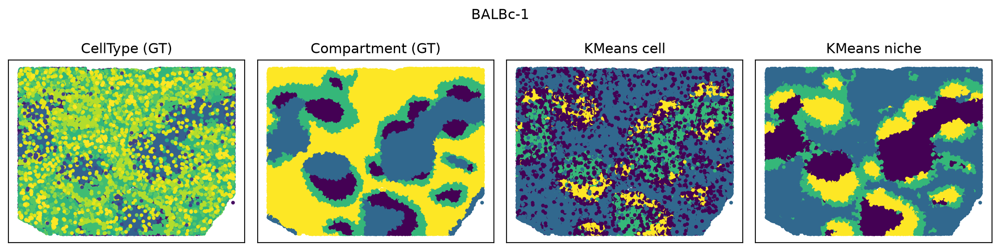
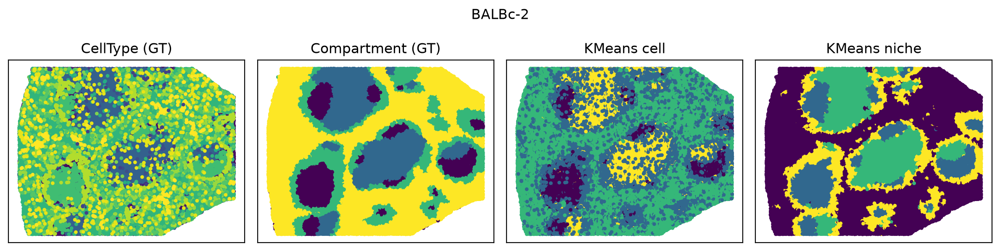
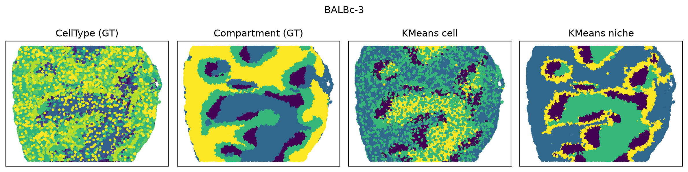
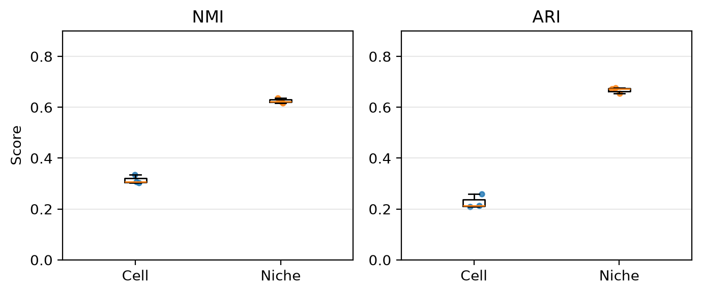

CODEX
================================================================================

:download:`Download original notebook <examples/CODEX_run_hiNiche.ipynb>`

Code and saved outputs are reproduced from this notebook. No cells are executed during documentation builds.

CODEX measures proteins rather than RNA. It is grouped here because it uses the same cell-level, multi-slice workflow.

.. rubric:: hiNiche on single-cell spatial data (multi-slice)

.. raw:: html

   
<strong>Environment:</strong> run this notebook in the main <strong><code>hiNiche</code></strong> environment (<code>environment.yml</code>).

.. raw:: html

   
This notebook applies hiNiche (<code>hiNiche_img</code>, cell → niche) to single-cell resolution spatial data, using the mouse spleen CODEX dataset (three BALBc slices) as an example.

.. raw:: html

   
All slices are stored in <strong>one AnnData</strong>; <code>adata.obs[SAMPLE_KEY]</code> identifies the slice of each cell. Graphs and niches are built <strong>within each slice</strong>, all slices are <strong>trained jointly</strong>, and the resulting cell / niche embeddings are written back to the same AnnData.

1. Imports
--------------------------------------------------------------------------------

.. code-block:: python
   :linenos:

   import config
   import utils
   import model
   from train import run_train_img
   
   import anndata as ad
   import scanpy as sc
   import numpy as np
   import pandas as pd
   
   import matplotlib.pyplot as plt
   
   import os
   import glob
   import warnings
   import json
   from tqdm import tqdm
   
   from sklearn.metrics import normalized_mutual_info_score, adjusted_rand_score
   from sklearn.cluster import KMeans
   
   %load_ext autoreload
   %autoreload 2
   
   warnings.filterwarnings("ignore")

.. container:: cell-output

   .. code-block:: text

      The autoreload extension is already loaded. To reload it, use:
        %reload_ext autoreload

2. Configuration
--------------------------------------------------------------------------------

.. raw:: html

   
Data paths, the slice column (<code>SAMPLE_KEY</code>), the ground-truth columns (<code>LABEL_KEY</code>, <code>CELLTYPE_KEY</code>), the patch root directory (<code>PATCH_ROOT</code>) and model / training hyperparameters.

.. code-block:: python
   :linenos:

   SAMPLE = "Mouse_spleen_CODEX_multi_slices"
   
   # Data paths: a single AnnData containing all slices
   h5_path    = f"DATA/{SAMPLE}/BALBc.h5ad"
   SAMPLE_KEY   = "sample"        # adata.obs column identifying the slice of each cell
   LABEL_KEY    = "Compartment"   # ground-truth spleen compartment (used for evaluation)
   CELLTYPE_KEY = "CellType"      # cell-type annotation (used for visualization)
   
   # Patch root directory: each slice is cached in its own sub-directory PATCH_ROOT/<slice name>
   PATCH_ROOT = f"DATA/{SAMPLE}/mini_batch_cache"
   
   # Model save path (if the file exists, the model is loaded and training is skipped)
   MODEL_SAVE_DIR = f"DATA/{SAMPLE}/checkpoint.pt"
   
   # Model / training hyperparameters
   single_patch  = True    # each slice is used as a single patch
   graph_knn   = 12
   niche_knn   = 20
   hidden_dim  = 32
   lr          = 0.005
   num_epochs  = 100
   edge_drop   = 0.5
   member_drop = 0.5
   neg_samples = 5
   tau         = 1
   seed        = 42
   n_clusters  = 4
   device      = "cuda:0"

3. Load data
--------------------------------------------------------------------------------

.. raw:: html

   
Read the AnnData containing all slices. The slices (<code>SAMPLES</code>) are taken from <code>adata.obs[SAMPLE_KEY]</code>, and each slice gets its own patch directory (<code>PATCH_LOC</code>).

.. code-block:: python
   :linenos:

   adata = sc.read(h5_path)
   adata.var_names_make_unique()
   
   # Slices read from adata.obs[SAMPLE_KEY] (in order of appearance); training slice index i <-> SAMPLES[i]
   SAMPLES = list(pd.unique(adata.obs[SAMPLE_KEY]))
   
   # Patch save paths: one directory per slice, aligned with SAMPLES
   PATCH_LOC = [os.path.join(PATCH_ROOT, str(s)) for s in SAMPLES]
   
   print(adata.obs[SAMPLE_KEY].value_counts().loc[SAMPLES])
   print(PATCH_LOC)

.. container:: cell-output

   .. code-block:: text

      sample
      BALBc-1    82251
      BALBc-2    81346
      BALBc-3    80636
      Name: count, dtype: int64
      ['DATA/Mouse_spleen_CODEX_multi_slices/mini_batch_cache/BALBc-1', 'DATA/Mouse_spleen_CODEX_multi_slices/mini_batch_cache/BALBc-2', 'DATA/Mouse_spleen_CODEX_multi_slices/mini_batch_cache/BALBc-3']

4. Build graphs, niches and mini-batches per slice
--------------------------------------------------------------------------------

.. code-block:: python
   :linenos:

   # ===== Per-slice preprocessing + block construction =====
   # Graphs and niches are built within each slice (no cross-slice edges);
   # slice SAMPLES[i] is cached in PATCH_LOC[i].
   sample_number_list = []
   
   for s, save_dir in zip(SAMPLES, PATCH_LOC):
       adata_s = adata[adata.obs[SAMPLE_KEY] == s].copy()
       adata_s.layers["counts"] = adata_s.X.copy()
   
       X_backup = adata_s.X.copy()
       sc.pp.scale(adata_s)
       sc.tl.pca(adata_s, n_comps=25)
       adata_s.X = X_backup
   
       adata_s.obsm["X_input"] = adata_s.X
       adata_s.obsm["X_mle"] = adata_s.layers["counts"]
       spatial_coords_px = adata_s.obsm["spatial"]
   
       # Each niche = a center cell and its niche_knn nearest cells (including itself)
       S_c2n_all, _, _ = utils.build_cell_niche_mapping_knn(spatial_coords_px, k_niche = niche_knn)
   
       cell_edges = utils.build_spot_knn_graph(adata_s.obsm["X_pca"], graph_knn)    # cell graph: expression (PCA) KNN
       niche_edges = utils.build_spot_knn_graph(spatial_coords_px, graph_knn)       # niche graph: spatial KNN
       batch_mask, block_ids = utils.make_cell_block_masks(spatial_coords_px, S_c2n = S_c2n_all, single_patch = single_patch)
   
       # Remove old blocks, otherwise the loader would also read leftovers from a previous run
       for f in glob.glob(os.path.join(save_dir, "block_*.pt")):
           os.remove(f)
       utils.build_cell_subgraph_data(adata_s, ref_matrix = None,
                                  cell_edges = cell_edges,
                                  niche_edges = niche_edges,
                                  S_c2n_all = S_c2n_all,
                                  batch_mask = batch_mask,
                                  block_ids = block_ids,
                                  save_dir = save_dir)
   
       sample_number_list.append({"cell": S_c2n_all.shape[0], "niche": S_c2n_all.shape[1]})
       del adata_s

.. container:: cell-output

   .. code-block:: text

      [Log] Active niches: 82251, Cells per niche (k): 20
      [Log] 1626368 edges generated from 82251 nodes (k=12)
      [Log] 1077382 edges generated from 82251 nodes (k=12)

.. container:: cell-output

   .. code-block:: text

      [Log] Building & saving cell mini-batches: 100%|██████████| 1/1 [00:01<00:00,  1.67s/it]

.. container:: cell-output

   .. code-block:: text

      [Log] saved 1 cell blocks → DATA/Mouse_spleen_CODEX_multi_slices/mini_batch_cache/BALBc-1
      [Log] Active niches: 81346, Cells per niche (k): 20
      [Log] 1597830 edges generated from 81346 nodes (k=12)
      [Log] 1066190 edges generated from 81346 nodes (k=12)

.. container:: cell-output

   .. code-block:: text

      [Log] Building & saving cell mini-batches: 100%|██████████| 1/1 [00:01<00:00,  1.70s/it]

.. container:: cell-output

   .. code-block:: text

      [Log] saved 1 cell blocks → DATA/Mouse_spleen_CODEX_multi_slices/mini_batch_cache/BALBc-2
      [Log] Active niches: 80636, Cells per niche (k): 20
      [Log] 1576092 edges generated from 80636 nodes (k=12)
      [Log] 1058806 edges generated from 80636 nodes (k=12)

.. container:: cell-output

   .. code-block:: text

      [Log] Building & saving cell mini-batches: 100%|██████████| 1/1 [00:01<00:00,  1.69s/it]

.. container:: cell-output

   .. code-block:: text

      [Log] saved 1 cell blocks → DATA/Mouse_spleen_CODEX_multi_slices/mini_batch_cache/BALBc-3

5. Joint multi-slice training
--------------------------------------------------------------------------------

.. raw:: html

   
All slices are trained together. If <code>MODEL_SAVE_DIR</code> already exists, the model is loaded and training is skipped. Embeddings are written to <code>adata.obsm[&quot;X_cell_emb&quot;]</code> and <code>adata.obsm[&quot;X_niche_emb&quot;]</code>.

.. code-block:: python
   :linenos:

   # ===== Joint multi-slice training: sample_number_list and PATCH_LOC are lists aligned with SAMPLES =====
   emb_all, slice_ids = run_train_img(sample_number_list,
                                      PATCH_LOC = PATCH_LOC,
                                      MODEL_SAVE_DIR = MODEL_SAVE_DIR,
                                      ref_matrix = None,
                                      lr = lr,
                                      in_dim = adata.n_vars,
                                      hidden_dim = hidden_dim,
                                      num_epochs = num_epochs,
                                      edge_drop = edge_drop,
                                      member_drop = member_drop,
                                      neg_samples = neg_samples,
                                      tau = tau,
                                      seed = seed,
                                      device = device)
   
   # Write the embeddings back to the single adata (rows of slice i -> cells of SAMPLES[i], same order).
   # With KNN niches every cell is a niche center, so niche embeddings are aligned with cells as well.
   adata.obsm["X_cell_emb"]  = np.zeros((adata.n_obs, hidden_dim), dtype=np.float32)
   adata.obsm["X_niche_emb"] = np.zeros((adata.n_obs, hidden_dim), dtype=np.float32)
   for i, s in enumerate(SAMPLES):
       mask = (adata.obs[SAMPLE_KEY] == s).values
       adata.obsm["X_cell_emb"][mask]  = emb_all["cell"][slice_ids["cell"] == i].detach().cpu().numpy()
       adata.obsm["X_niche_emb"][mask] = emb_all["niche"][slice_ids["niche"] == i].detach().cpu().numpy()

.. container:: cell-output

   .. code-block:: text

      Epoch 1: 100%|██████████| 3/3 [00:00<00:00,  4.23it/s, cl=3.5738]
      Epoch 2: 100%|██████████| 3/3 [00:00<00:00,  8.58it/s, cl=3.2311]
      Epoch 3: 100%|██████████| 3/3 [00:00<00:00,  8.61it/s, cl=3.0262]
      Epoch 4: 100%|██████████| 3/3 [00:00<00:00,  8.68it/s, cl=2.9473]
      Epoch 5: 100%|██████████| 3/3 [00:00<00:00,  8.67it/s, cl=2.9137]
      Epoch 6: 100%|██████████| 3/3 [00:00<00:00,  8.68it/s, cl=2.8884]
      Epoch 7: 100%|██████████| 3/3 [00:00<00:00,  8.69it/s, cl=2.8742]
      Epoch 8: 100%|██████████| 3/3 [00:00<00:00,  8.66it/s, cl=2.8622]
      Epoch 9: 100%|██████████| 3/3 [00:00<00:00,  8.67it/s, cl=2.8516]
      Epoch 10: 100%|██████████| 3/3 [00:00<00:00,  8.65it/s, cl=2.8416]
      Epoch 11: 100%|██████████| 3/3 [00:00<00:00,  8.65it/s, cl=2.8354]
      Epoch 12: 100%|██████████| 3/3 [00:00<00:00,  8.62it/s, cl=2.8283]
      Epoch 13: 100%|██████████| 3/3 [00:00<00:00,  8.67it/s, cl=2.8241]
      Epoch 14: 100%|██████████| 3/3 [00:00<00:00,  8.60it/s, cl=2.8223]
      Epoch 15: 100%|██████████| 3/3 [00:00<00:00,  8.64it/s, cl=2.8195]
      Epoch 16: 100%|██████████| 3/3 [00:00<00:00,  8.68it/s, cl=2.8145]
      Epoch 17: 100%|██████████| 3/3 [00:00<00:00,  8.66it/s, cl=2.8133]
      Epoch 18: 100%|██████████| 3/3 [00:00<00:00,  8.64it/s, cl=2.8104]
      Epoch 19: 100%|██████████| 3/3 [00:00<00:00,  8.70it/s, cl=2.8065]
      Epoch 20: 100%|██████████| 3/3 [00:00<00:00,  8.66it/s, cl=2.8043]
      Epoch 21: 100%|██████████| 3/3 [00:00<00:00,  8.70it/s, cl=2.8043]
      Epoch 22: 100%|██████████| 3/3 [00:00<00:00,  8.66it/s, cl=2.8024]
      Epoch 23: 100%|██████████| 3/3 [00:00<00:00,  8.60it/s, cl=2.7997]
      Epoch 24: 100%|██████████| 3/3 [00:00<00:00,  8.65it/s, cl=2.7984]
      Epoch 25: 100%|██████████| 3/3 [00:00<00:00,  8.64it/s, cl=2.7975]
      Epoch 26: 100%|██████████| 3/3 [00:00<00:00,  8.67it/s, cl=2.7955]
      Epoch 27: 100%|██████████| 3/3 [00:00<00:00,  8.67it/s, cl=2.7961]
      Epoch 28: 100%|██████████| 3/3 [00:00<00:00,  8.68it/s, cl=2.7927]
      Epoch 29: 100%|██████████| 3/3 [00:00<00:00,  8.68it/s, cl=2.7914]
      Epoch 30: 100%|██████████| 3/3 [00:00<00:00,  8.66it/s, cl=2.7903]
      Epoch 31: 100%|██████████| 3/3 [00:00<00:00,  8.66it/s, cl=2.7912]
      Epoch 32: 100%|██████████| 3/3 [00:00<00:00,  8.63it/s, cl=2.7896]
      Epoch 33: 100%|██████████| 3/3 [00:00<00:00,  8.62it/s, cl=2.7873]
      Epoch 34: 100%|██████████| 3/3 [00:00<00:00,  8.67it/s, cl=2.7868]
      Epoch 35: 100%|██████████| 3/3 [00:00<00:00,  8.65it/s, cl=2.7870]
      Epoch 36: 100%|██████████| 3/3 [00:00<00:00,  8.63it/s, cl=2.7867]
      Epoch 37: 100%|██████████| 3/3 [00:00<00:00,  8.66it/s, cl=2.7852]
      Epoch 38: 100%|██████████| 3/3 [00:00<00:00,  8.65it/s, cl=2.7852]
      Epoch 39: 100%|██████████| 3/3 [00:00<00:00,  8.54it/s, cl=2.7848]
      Epoch 40: 100%|██████████| 3/3 [00:00<00:00,  8.59it/s, cl=2.7833]
      Epoch 41: 100%|██████████| 3/3 [00:00<00:00,  8.53it/s, cl=2.7836]
      Epoch 42: 100%|██████████| 3/3 [00:00<00:00,  8.63it/s, cl=2.7830]
      Epoch 43: 100%|██████████| 3/3 [00:00<00:00,  8.60it/s, cl=2.7821]
      Epoch 44: 100%|██████████| 3/3 [00:00<00:00,  8.64it/s, cl=2.7811]
      Epoch 45: 100%|██████████| 3/3 [00:00<00:00,  8.59it/s, cl=2.7805]
      Epoch 46: 100%|██████████| 3/3 [00:00<00:00,  8.58it/s, cl=2.7802]
      Epoch 47: 100%|██████████| 3/3 [00:00<00:00,  8.60it/s, cl=2.7799]
      Epoch 48: 100%|██████████| 3/3 [00:00<00:00,  8.59it/s, cl=2.7799]
      Epoch 49: 100%|██████████| 3/3 [00:00<00:00,  8.65it/s, cl=2.7790]
      Epoch 50: 100%|██████████| 3/3 [00:00<00:00,  8.63it/s, cl=2.7792]
      Epoch 51: 100%|██████████| 3/3 [00:00<00:00,  8.53it/s, cl=2.7778]
      Epoch 52: 100%|██████████| 3/3 [00:00<00:00,  8.55it/s, cl=2.7772]
      Epoch 53: 100%|██████████| 3/3 [00:00<00:00,  8.60it/s, cl=2.7779]
      Epoch 54: 100%|██████████| 3/3 [00:00<00:00,  8.55it/s, cl=2.7766]
      Epoch 55: 100%|██████████| 3/3 [00:00<00:00,  8.63it/s, cl=2.7766]
      Epoch 56: 100%|██████████| 3/3 [00:00<00:00,  8.63it/s, cl=2.7766]
      Epoch 57: 100%|██████████| 3/3 [00:00<00:00,  8.61it/s, cl=2.7765]
      Epoch 58: 100%|██████████| 3/3 [00:00<00:00,  8.65it/s, cl=2.7762]
      Epoch 59: 100%|██████████| 3/3 [00:00<00:00,  8.45it/s, cl=2.7753]
      Epoch 60: 100%|██████████| 3/3 [00:00<00:00,  8.58it/s, cl=2.7745]
      Epoch 61: 100%|██████████| 3/3 [00:00<00:00,  8.59it/s, cl=2.7745]
      Epoch 62: 100%|██████████| 3/3 [00:00<00:00,  8.60it/s, cl=2.7741]
      Epoch 63: 100%|██████████| 3/3 [00:00<00:00,  8.60it/s, cl=2.7745]
      Epoch 64: 100%|██████████| 3/3 [00:00<00:00,  8.64it/s, cl=2.7739]
      Epoch 65: 100%|██████████| 3/3 [00:00<00:00,  8.63it/s, cl=2.7727]
      Epoch 66: 100%|██████████| 3/3 [00:00<00:00,  8.62it/s, cl=2.7725]
      Epoch 67: 100%|██████████| 3/3 [00:00<00:00,  8.63it/s, cl=2.7725]
      Epoch 68: 100%|██████████| 3/3 [00:00<00:00,  8.62it/s, cl=2.7720]
      Epoch 69: 100%|██████████| 3/3 [00:00<00:00,  8.62it/s, cl=2.7716]
      Epoch 70: 100%|██████████| 3/3 [00:00<00:00,  8.54it/s, cl=2.7720]
      Epoch 71: 100%|██████████| 3/3 [00:00<00:00,  8.61it/s, cl=2.7719]
      Epoch 72: 100%|██████████| 3/3 [00:00<00:00,  8.66it/s, cl=2.7715]
      Epoch 73: 100%|██████████| 3/3 [00:00<00:00,  8.62it/s, cl=2.7708]
      Epoch 74: 100%|██████████| 3/3 [00:00<00:00,  8.60it/s, cl=2.7708]
      Epoch 75: 100%|██████████| 3/3 [00:00<00:00,  8.59it/s, cl=2.7694]
      Epoch 76: 100%|██████████| 3/3 [00:00<00:00,  8.60it/s, cl=2.7702]
      Epoch 77: 100%|██████████| 3/3 [00:00<00:00,  8.60it/s, cl=2.7693]
      Epoch 78: 100%|██████████| 3/3 [00:00<00:00,  8.59it/s, cl=2.7683]
      Epoch 79: 100%|██████████| 3/3 [00:00<00:00,  8.61it/s, cl=2.7689]
      Epoch 80: 100%|██████████| 3/3 [00:00<00:00,  8.63it/s, cl=2.7702]
      Epoch 81: 100%|██████████| 3/3 [00:00<00:00,  8.60it/s, cl=2.7685]
      Epoch 82: 100%|██████████| 3/3 [00:00<00:00,  8.59it/s, cl=2.7689]
      Epoch 83: 100%|██████████| 3/3 [00:00<00:00,  8.57it/s, cl=2.7683]
      Epoch 84: 100%|██████████| 3/3 [00:00<00:00,  8.65it/s, cl=2.7679]
      Epoch 85: 100%|██████████| 3/3 [00:00<00:00,  7.51it/s, cl=2.7678]
      Epoch 86: 100%|██████████| 3/3 [00:00<00:00,  8.61it/s, cl=2.7677]
      Epoch 87: 100%|██████████| 3/3 [00:00<00:00,  8.61it/s, cl=2.7677]
      Epoch 88: 100%|██████████| 3/3 [00:00<00:00,  8.62it/s, cl=2.7679]
      Epoch 89: 100%|██████████| 3/3 [00:00<00:00,  8.60it/s, cl=2.7664]
      Epoch 90: 100%|██████████| 3/3 [00:00<00:00,  8.57it/s, cl=2.7657]
      Epoch 91: 100%|██████████| 3/3 [00:00<00:00,  8.57it/s, cl=2.7656]
      Epoch 92: 100%|██████████| 3/3 [00:00<00:00,  8.58it/s, cl=2.7664]
      Epoch 93: 100%|██████████| 3/3 [00:00<00:00,  8.60it/s, cl=2.7658]
      Epoch 94: 100%|██████████| 3/3 [00:00<00:00,  8.60it/s, cl=2.7657]
      Epoch 95: 100%|██████████| 3/3 [00:00<00:00,  8.58it/s, cl=2.7661]
      Epoch 96: 100%|██████████| 3/3 [00:00<00:00,  8.61it/s, cl=2.7651]
      Epoch 97: 100%|██████████| 3/3 [00:00<00:00,  8.62it/s, cl=2.7651]
      Epoch 98: 100%|██████████| 3/3 [00:00<00:00,  8.60it/s, cl=2.7651]
      Epoch 99: 100%|██████████| 3/3 [00:00<00:00,  8.55it/s, cl=2.7653]
      Epoch 100: 100%|██████████| 3/3 [00:00<00:00,  8.53it/s, cl=2.7646]

.. container:: cell-output

   .. code-block:: text

      Training finished!
      Model saved to DATA/Mouse_spleen_CODEX_multi_slices/checkpoint_42.pt

.. container:: cell-output

   .. code-block:: text

      generating embeddings (slice 0)...: 100%|██████████| 1/1 [00:00<00:00,  7.31it/s]
      generating embeddings (slice 1)...: 100%|██████████| 1/1 [00:00<00:00,  7.62it/s]
      generating embeddings (slice 2)...: 100%|██████████| 1/1 [00:00<00:00,  7.70it/s]

6. Clustering and visualization
--------------------------------------------------------------------------------

.. raw:: html

   
KMeans on the cell and niche embeddings within each slice, plotted next to the ground-truth cell types (<code>CELLTYPE_KEY</code>) and compartments (<code>LABEL_KEY</code>). Labels are stored in <code>adata.obs[&quot;kmeans_cell&quot;]</code> / <code>adata.obs[&quot;kmeans_niche&quot;]</code> (comparable only within a slice).

.. code-block:: python
   :linenos:

   results_cell = {}
   results_niche = {}
   niche_save = {}
   
   kmeans_cell  = np.empty(adata.n_obs, dtype=object)
   kmeans_niche = np.empty(adata.n_obs, dtype=object)
   
   for i, s in enumerate(SAMPLES):
       mask = (adata.obs[SAMPLE_KEY] == s).values
       sub = adata[mask]
       spatial = sub.obsm["spatial"]
       x, y = spatial[:, 0], spatial[:, 1]
   
       X_cell  = np.asarray(sub.obsm["X_cell_emb"])
       X_niche = np.asarray(sub.obsm["X_niche_emb"])
   
       # KMeans is run separately within each slice
       labels_cell  = KMeans(n_clusters=n_clusters, random_state=42, n_init=20).fit_predict(X_cell)
       labels_niche = KMeans(n_clusters=n_clusters, random_state=42, n_init=20).fit_predict(X_niche)
   
       kmeans_cell[mask]  = labels_cell.astype(str)
       kmeans_niche[mask] = labels_niche.astype(str)
   
       # Ground-truth labels
       point_size = 10
       celltype = sub.obs[CELLTYPE_KEY].astype("category")
       comp = sub.obs[LABEL_KEY].astype("category")
   
       fig, axes = plt.subplots(1, 4, figsize=(12, 3), dpi=200)
       panels = [(celltype.cat.codes, f"{CELLTYPE_KEY} (GT)"),
                 (comp.cat.codes,     f"{LABEL_KEY} (GT)"),
                 (labels_cell,        "KMeans cell"),
                 (labels_niche,       "KMeans niche")]
       for ax, (c, title) in zip(axes, panels):
           ax.scatter(x, y, c=c, s=point_size, linewidths=0)
           ax.set_xticks([]); ax.set_yticks([])
           ax.set_title(title)
       fig.suptitle(s)
       plt.tight_layout()
       plt.show()
   
       true_labels = sub.obs[LABEL_KEY]
       nmi_cell  = normalized_mutual_info_score(true_labels, labels_cell)
       ari_cell  = adjusted_rand_score(true_labels, labels_cell)
       nmi_niche = normalized_mutual_info_score(true_labels, labels_niche)
       ari_niche = adjusted_rand_score(true_labels, labels_niche)
   
       results_cell[s]  = [nmi_cell, ari_cell]
       results_niche[s] = [nmi_niche, ari_niche]
       niche_save[s]    = labels_niche.astype(str)
   
   # Per-slice cluster labels stored in the single adata (labels are only comparable within a slice)
   adata.obs["kmeans_cell"]  = pd.Categorical(kmeans_cell)
   adata.obs["kmeans_niche"] = pd.Categorical(kmeans_niche)

7. Evaluation (NMI / ARI)
--------------------------------------------------------------------------------

.. raw:: html

   
Agreement of the cell and niche clusters with the ground-truth compartments (<code>LABEL_KEY</code>), per slice and averaged.

.. code-block:: python
   :linenos:

   slice_list = SAMPLES
   
   # Per-slice results
   for s in slice_list:
       nmi_c, ari_c = results_cell[s]
       nmi_n, ari_n = results_niche[s]
       print(s)
       print(f"Cell:  NMI: {nmi_c:.4f}, ARI: {ari_c:.4f}")
       print(f"Niche: NMI: {nmi_n:.4f}, ARI: {ari_n:.4f}")
   
   cell_arr  = np.array([results_cell[s]  for s in slice_list], dtype=float)   # [S, 2]
   niche_arr = np.array([results_niche[s] for s in slice_list], dtype=float)   # [S, 2]
   
   cell_mean_nmi,  cell_mean_ari  = cell_arr.mean(axis=0)
   niche_mean_nmi, niche_mean_ari = niche_arr.mean(axis=0)
   
   print(f"Cell (mean):  NMI: {cell_mean_nmi:.4f}, ARI: {cell_mean_ari:.4f}")
   print(f"Niche(mean): NMI: {niche_mean_nmi:.4f}, ARI: {niche_mean_ari:.4f}")

.. container:: cell-output

   .. code-block:: text

      BALBc-1
      Cell:  NMI: 0.3064, ARI: 0.2585
      Niche: NMI: 0.6233, ARI: 0.6719
      BALBc-2
      Cell:  NMI: 0.3344, ARI: 0.2139
      Niche: NMI: 0.6367, ARI: 0.6765
      BALBc-3
      Cell:  NMI: 0.3030, ARI: 0.2098
      Niche: NMI: 0.6163, ARI: 0.6535
      Cell (mean):  NMI: 0.3146, ARI: 0.2274
      Niche(mean): NMI: 0.6254, ARI: 0.6673

8. Summary plot
--------------------------------------------------------------------------------

.. code-block:: python
   :linenos:

   cell_nmi, cell_ari   = cell_arr[:, 0], cell_arr[:, 1]
   niche_nmi, niche_ari = niche_arr[:, 0], niche_arr[:, 1]
   
   fig, axes = plt.subplots(1, 2, figsize=(7, 3), dpi=200)
   rng = np.random.default_rng(0)
   
   for ax, (c_vals, n_vals, title) in zip(axes, [(cell_nmi, niche_nmi, "NMI"),
                                                (cell_ari, niche_ari, "ARI")]):
       ax.boxplot([c_vals, n_vals], tick_labels=["Cell", "Niche"], showfliers=False)
       ax.scatter(1 + rng.normal(0, 0.04, size=len(c_vals)), c_vals, s=12, alpha=0.8)
       ax.scatter(2 + rng.normal(0, 0.04, size=len(n_vals)), n_vals, s=12, alpha=0.8)
       ax.set_title(title)
       ax.grid(True, axis="y", alpha=0.3)
       ax.set_ylim(0, 0.9)
       ax.set_yticks(np.arange(0, 0.9 + 1e-9, 0.2))
   axes[0].set_ylabel("Score")
   
   plt.tight_layout()
   plt.show()

