MERFISH
================================================================================

:download:`Download original notebook <examples/MERFISH_run_hiNiche.ipynb>`

Code and saved outputs are reproduced from this notebook. No cells are executed during documentation builds.

.. rubric:: hiNiche on single-cell spatial data (multi-slice): mouse brain MERFISH

.. raw:: html

   
<strong>Environment:</strong> run this notebook in the main <strong><code>hiNiche</code></strong> environment (<code>environment.yml</code>).

.. raw:: html

   
This notebook applies hiNiche (<code>hiNiche_img</code>, cell → niche) to the MERFISH mouse brain aging dataset, which contains many coronal slices.

.. raw:: html

   
All slices are stored in <strong>one AnnData</strong>; <code>adata.obs[SAMPLE_KEY]</code> identifies the slice of each cell. Graphs and niches are built <strong>within each slice</strong>, all slices are <strong>trained jointly</strong>, and the resulting cell / niche embeddings are written back to the same AnnData. Niche clusters are evaluated against the annotated brain regions (<code>adata.obs[LABEL_KEY]</code>).

1. Imports
--------------------------------------------------------------------------------

.. code-block:: python
   :linenos:

   import config
   import utils
   import model
   from train import run_train_img
   
   import anndata as ad
   import scanpy as sc
   import numpy as np
   import pandas as pd
   
   import matplotlib.pyplot as plt
   
   import os
   import glob
   import warnings
   import json
   from tqdm import tqdm
   
   from sklearn.metrics import normalized_mutual_info_score, adjusted_rand_score
   from sklearn.cluster import KMeans
   
   %load_ext autoreload
   %autoreload 2
   
   warnings.filterwarnings("ignore")

.. container:: cell-output

   .. code-block:: text

      The autoreload extension is already loaded. To reload it, use:
        %reload_ext autoreload

2. Configuration
--------------------------------------------------------------------------------

.. raw:: html

   
Data paths, the slice column (<code>SAMPLE_KEY</code>), the ground-truth columns, the patch root directory (<code>PATCH_ROOT</code>) and model / training hyperparameters.

.. code-block:: python
   :linenos:

   SAMPLE = "Mouse_brain_merfish_multi_slices"
   
   # Data paths: a single AnnData containing all slices (raw counts in adata.raw)
   h5_path      = f"DATA/{SAMPLE}/MERFISH_Aging.h5ad"
   SAMPLE_KEY   = "slice_id"      # adata.obs column identifying the slice of each cell
   LABEL_KEY    = "tissue"        # ground-truth brain region (used for evaluation)
   CELLTYPE_KEY = "cell_type"     # cell-type annotation (used for visualization)
   
   # Patch root directory: each slice is cached in its own sub-directory PATCH_ROOT/<slice name>
   PATCH_ROOT = f"DATA/{SAMPLE}/mini_batch_cache"
   
   # Model save path (if the file exists, the model is loaded and training is skipped)
   MODEL_SAVE_DIR = f"DATA/{SAMPLE}/checkpoint.pt"
   
   # Model / training hyperparameters
   single_patch = True    # each slice is used as a single patch
   n_pcs       = 30
   graph_knn   = 12
   niche_knn   = 20
   hidden_dim  = 32
   lr          = 0.005
   num_epochs  = 100
   edge_drop   = 0.5
   member_drop = 0.5
   neg_samples = 5
   tau         = 1
   seed        = 42
   n_clusters  = 7        # number of annotated regions in LABEL_KEY
   device      = "cuda:0"

3. Load data
--------------------------------------------------------------------------------

.. raw:: html

   
Read the AnnData containing all slices. The slices (<code>SAMPLES</code>) are taken from <code>adata.obs[SAMPLE_KEY]</code>, and each slice gets its own patch directory (<code>PATCH_LOC</code>).

.. code-block:: python
   :linenos:

   adata = sc.read(h5_path)
   adata.var_names_make_unique()
   
   # Slices read from adata.obs[SAMPLE_KEY] (in order of appearance); training slice index i <-> SAMPLES[i]
   SAMPLES = list(pd.unique(adata.obs[SAMPLE_KEY]))
   
   # Patch save paths: one directory per slice, aligned with SAMPLES
   PATCH_LOC = [os.path.join(PATCH_ROOT, str(s)) for s in SAMPLES]
   
   print(f"{len(SAMPLES)} slices, {adata.n_obs} cells, {adata.n_vars} genes")
   print(adata.obs[SAMPLE_KEY].value_counts().loc[SAMPLES])

.. container:: cell-output

   .. code-block:: text

      31 slices, 376107 cells, 374 genes
      slice_id
      MsBrainAgingSpatialDonor_1-0     21000
      MsBrainAgingSpatialDonor_2-1     24408
      MsBrainAgingSpatialDonor_2-0     15522
      MsBrainAgingSpatialDonor_3-1     15492
      MsBrainAgingSpatialDonor_3-0     19093
      MsBrainAgingSpatialDonor_4-1     11035
      MsBrainAgingSpatialDonor_4-2     10853
      MsBrainAgingSpatialDonor_4-0      9570
      MsBrainAgingSpatialDonor_5-0     10612
      MsBrainAgingSpatialDonor_5-2      8830
      MsBrainAgingSpatialDonor_5-1      9644
      MsBrainAgingSpatialDonor_6-0      9462
      MsBrainAgingSpatialDonor_6-1      8014
      MsBrainAgingSpatialDonor_6-2      8145
      MsBrainAgingSpatialDonor_7-2     11316
      MsBrainAgingSpatialDonor_7-1     10604
      MsBrainAgingSpatialDonor_7-0     10733
      MsBrainAgingSpatialDonor_8-0     14043
      MsBrainAgingSpatialDonor_8-1     12110
      MsBrainAgingSpatialDonor_8-2     12014
      MsBrainAgingSpatialDonor_9-2     10215
      MsBrainAgingSpatialDonor_9-1     12292
      MsBrainAgingSpatialDonor_9-0     11115
      MsBrainAgingSpatialDonor_10-0     9577
      MsBrainAgingSpatialDonor_10-1     9617
      MsBrainAgingSpatialDonor_10-2     8722
      MsBrainAgingSpatialDonor_11-0     7470
      MsBrainAgingSpatialDonor_11-1    14151
      MsBrainAgingSpatialDonor_11-2     7215
      MsBrainAgingSpatialDonor_12-1    15731
      MsBrainAgingSpatialDonor_12-0    17502
      Name: count, dtype: int64

4. Build graphs, niches and mini-batches per slice
--------------------------------------------------------------------------------

.. raw:: html

   
For each slice: normalize + log1p the raw counts, scale + PCA, build KNN niches (<code>niche_knn</code> cells per niche), the cell graph (expression PCA KNN) and the niche graph (spatial KNN), then cache the slice as a single block in its own directory <code>PATCH_LOC[i]</code>.

.. code-block:: python
   :linenos:

   # ===== Per-slice preprocessing + block construction =====
   # Graphs and niches are built within each slice (no cross-slice edges);
   # slice SAMPLES[i] is cached in PATCH_LOC[i].
   sample_number_list = []
   
   for s, save_dir in zip(SAMPLES, PATCH_LOC):
       adata_s = adata[adata.obs[SAMPLE_KEY] == s].copy()
       adata_s.layers["counts"] = adata_s.raw.X.copy()
       adata_s.X = adata_s.raw.X.copy()
       sc.pp.normalize_total(adata_s, target_sum=1e4)
       sc.pp.log1p(adata_s)
   
       X_backup = adata_s.X.copy()
       sc.pp.scale(adata_s)
       sc.tl.pca(adata_s, n_comps=n_pcs)
       adata_s.X = X_backup
   
       adata_s.obsm["X_input"] = adata_s.X
       adata_s.obsm["X_mle"] = adata_s.layers["counts"]
       spatial_coords_px = adata_s.obsm["spatial"]
   
       # Each niche = a center cell and its niche_knn nearest cells (including itself)
       S_c2n_all, _, _ = utils.build_cell_niche_mapping_knn(spatial_coords_px, k_niche = niche_knn)
   
       cell_edges = utils.build_spot_knn_graph(adata_s.obsm["X_pca"], graph_knn)    # cell graph: expression (PCA) KNN
       niche_edges = utils.build_spot_knn_graph(spatial_coords_px, graph_knn)       # niche graph: spatial KNN
       batch_mask, block_ids = utils.make_cell_block_masks(spatial_coords_px, S_c2n = S_c2n_all, single_patch = single_patch)
   
       # Remove old blocks, otherwise the loader would also read leftovers from a previous run
       for f in glob.glob(os.path.join(save_dir, "block_*.pt")):
           os.remove(f)
       utils.build_cell_subgraph_data(adata_s, ref_matrix = None,
                                  cell_edges = cell_edges,
                                  niche_edges = niche_edges,
                                  S_c2n_all = S_c2n_all,
                                  batch_mask = batch_mask,
                                  block_ids = block_ids,
                                  save_dir = save_dir)
   
       sample_number_list.append({"cell": S_c2n_all.shape[0], "niche": S_c2n_all.shape[1]})
       del adata_s

.. container:: cell-output

   .. code-block:: text

      [Log] Active niches: 21000, Cells per niche (k): 20
      [Log] 411274 edges generated from 21000 nodes (k=12)
      [Log] 280964 edges generated from 21000 nodes (k=12)

.. container:: cell-output

   .. code-block:: text

      [Log] Building & saving cell mini-batches: 100%|██████████| 1/1 [00:00<00:00,  1.71it/s]

.. container:: cell-output

   .. code-block:: text

      [Log] saved 1 cell blocks → DATA/Mouse_brain_merfish_multi_slices/mini_batch_cache/MsBrainAgingSpatialDonor_1-0
      [Log] Active niches: 24408, Cells per niche (k): 20
      [Log] 492900 edges generated from 24408 nodes (k=12)
      [Log] 328768 edges generated from 24408 nodes (k=12)

.. container:: cell-output

   .. code-block:: text

      [Log] Building & saving cell mini-batches: 100%|██████████| 1/1 [00:00<00:00,  1.68it/s]

.. container:: cell-output

   .. code-block:: text

      [Log] saved 1 cell blocks → DATA/Mouse_brain_merfish_multi_slices/mini_batch_cache/MsBrainAgingSpatialDonor_2-1
      [Log] Active niches: 15522, Cells per niche (k): 20
      [Log] 311920 edges generated from 15522 nodes (k=12)
      [Log] 208420 edges generated from 15522 nodes (k=12)

.. container:: cell-output

   .. code-block:: text

      [Log] Building & saving cell mini-batches: 100%|██████████| 1/1 [00:00<00:00,  2.59it/s]

.. container:: cell-output

   .. code-block:: text

      [Log] saved 1 cell blocks → DATA/Mouse_brain_merfish_multi_slices/mini_batch_cache/MsBrainAgingSpatialDonor_2-0
      [Log] Active niches: 15492, Cells per niche (k): 20
      [Log] 301468 edges generated from 15492 nodes (k=12)
      [Log] 208796 edges generated from 15492 nodes (k=12)

.. container:: cell-output

   .. code-block:: text

      [Log] Building & saving cell mini-batches: 100%|██████████| 1/1 [00:00<00:00,  2.20it/s]

.. container:: cell-output

   .. code-block:: text

      [Log] saved 1 cell blocks → DATA/Mouse_brain_merfish_multi_slices/mini_batch_cache/MsBrainAgingSpatialDonor_3-1
      [Log] Active niches: 19093, Cells per niche (k): 20
      [Log] 373702 edges generated from 19093 nodes (k=12)
      [Log] 256472 edges generated from 19093 nodes (k=12)

.. container:: cell-output

   .. code-block:: text

      [Log] Building & saving cell mini-batches: 100%|██████████| 1/1 [00:00<00:00,  1.75it/s]

.. container:: cell-output

   .. code-block:: text

      [Log] saved 1 cell blocks → DATA/Mouse_brain_merfish_multi_slices/mini_batch_cache/MsBrainAgingSpatialDonor_3-0
      [Log] Active niches: 11035, Cells per niche (k): 20
      [Log] 213960 edges generated from 11035 nodes (k=12)
      [Log] 148048 edges generated from 11035 nodes (k=12)

.. container:: cell-output

   .. code-block:: text

      [Log] Building & saving cell mini-batches: 100%|██████████| 1/1 [00:00<00:00,  2.90it/s]

.. container:: cell-output

   .. code-block:: text

      [Log] saved 1 cell blocks → DATA/Mouse_brain_merfish_multi_slices/mini_batch_cache/MsBrainAgingSpatialDonor_4-1
      [Log] Active niches: 10853, Cells per niche (k): 20
      [Log] 211714 edges generated from 10853 nodes (k=12)
      [Log] 145626 edges generated from 10853 nodes (k=12)

.. container:: cell-output

   .. code-block:: text

      [Log] Building & saving cell mini-batches: 100%|██████████| 1/1 [00:00<00:00,  3.03it/s]

.. container:: cell-output

   .. code-block:: text

      [Log] saved 1 cell blocks → DATA/Mouse_brain_merfish_multi_slices/mini_batch_cache/MsBrainAgingSpatialDonor_4-2
      [Log] Active niches: 9570, Cells per niche (k): 20
      [Log] 186608 edges generated from 9570 nodes (k=12)
      [Log] 127856 edges generated from 9570 nodes (k=12)

.. container:: cell-output

   .. code-block:: text

      [Log] Building & saving cell mini-batches: 100%|██████████| 1/1 [00:00<00:00,  3.22it/s]

.. container:: cell-output

   .. code-block:: text

      [Log] saved 1 cell blocks → DATA/Mouse_brain_merfish_multi_slices/mini_batch_cache/MsBrainAgingSpatialDonor_4-0
      [Log] Active niches: 10612, Cells per niche (k): 20
      [Log] 212218 edges generated from 10612 nodes (k=12)
      [Log] 142892 edges generated from 10612 nodes (k=12)

.. container:: cell-output

   .. code-block:: text

      [Log] Building & saving cell mini-batches: 100%|██████████| 1/1 [00:00<00:00,  3.42it/s]

.. container:: cell-output

   .. code-block:: text

      [Log] saved 1 cell blocks → DATA/Mouse_brain_merfish_multi_slices/mini_batch_cache/MsBrainAgingSpatialDonor_5-0
      [Log] Active niches: 8830, Cells per niche (k): 20
      [Log] 178508 edges generated from 8830 nodes (k=12)
      [Log] 118564 edges generated from 8830 nodes (k=12)

.. container:: cell-output

   .. code-block:: text

      [Log] Building & saving cell mini-batches: 100%|██████████| 1/1 [00:00<00:00,  4.14it/s]

.. container:: cell-output

   .. code-block:: text

      [Log] saved 1 cell blocks → DATA/Mouse_brain_merfish_multi_slices/mini_batch_cache/MsBrainAgingSpatialDonor_5-2
      [Log] Active niches: 9644, Cells per niche (k): 20
      [Log] 194008 edges generated from 9644 nodes (k=12)
      [Log] 129202 edges generated from 9644 nodes (k=12)

.. container:: cell-output

   .. code-block:: text

      [Log] Building & saving cell mini-batches: 100%|██████████| 1/1 [00:00<00:00,  2.70it/s]

.. container:: cell-output

   .. code-block:: text

      [Log] saved 1 cell blocks → DATA/Mouse_brain_merfish_multi_slices/mini_batch_cache/MsBrainAgingSpatialDonor_5-1
      [Log] Active niches: 9462, Cells per niche (k): 20
      [Log] 187964 edges generated from 9462 nodes (k=12)
      [Log] 126900 edges generated from 9462 nodes (k=12)

.. container:: cell-output

   .. code-block:: text

      [Log] Building & saving cell mini-batches: 100%|██████████| 1/1 [00:00<00:00,  3.80it/s]

.. container:: cell-output

   .. code-block:: text

      [Log] saved 1 cell blocks → DATA/Mouse_brain_merfish_multi_slices/mini_batch_cache/MsBrainAgingSpatialDonor_6-0
      [Log] Active niches: 8014, Cells per niche (k): 20
      [Log] 158300 edges generated from 8014 nodes (k=12)
      [Log] 108078 edges generated from 8014 nodes (k=12)

.. container:: cell-output

   .. code-block:: text

      [Log] Building & saving cell mini-batches: 100%|██████████| 1/1 [00:00<00:00,  4.16it/s]

.. container:: cell-output

   .. code-block:: text

      [Log] saved 1 cell blocks → DATA/Mouse_brain_merfish_multi_slices/mini_batch_cache/MsBrainAgingSpatialDonor_6-1
      [Log] Active niches: 8145, Cells per niche (k): 20
      [Log] 159148 edges generated from 8145 nodes (k=12)
      [Log] 109638 edges generated from 8145 nodes (k=12)

.. container:: cell-output

   .. code-block:: text

      [Log] Building & saving cell mini-batches: 100%|██████████| 1/1 [00:00<00:00,  4.19it/s]

.. container:: cell-output

   .. code-block:: text

      [Log] saved 1 cell blocks → DATA/Mouse_brain_merfish_multi_slices/mini_batch_cache/MsBrainAgingSpatialDonor_6-2
      [Log] Active niches: 11316, Cells per niche (k): 20
      [Log] 227642 edges generated from 11316 nodes (k=12)
      [Log] 152202 edges generated from 11316 nodes (k=12)

.. container:: cell-output

   .. code-block:: text

      [Log] Building & saving cell mini-batches: 100%|██████████| 1/1 [00:00<00:00,  3.80it/s]

.. container:: cell-output

   .. code-block:: text

      [Log] saved 1 cell blocks → DATA/Mouse_brain_merfish_multi_slices/mini_batch_cache/MsBrainAgingSpatialDonor_7-2
      [Log] Active niches: 10604, Cells per niche (k): 20
      [Log] 214048 edges generated from 10604 nodes (k=12)
      [Log] 142424 edges generated from 10604 nodes (k=12)

.. container:: cell-output

   .. code-block:: text

      [Log] Building & saving cell mini-batches: 100%|██████████| 1/1 [00:00<00:00,  3.92it/s]

.. container:: cell-output

   .. code-block:: text

      [Log] saved 1 cell blocks → DATA/Mouse_brain_merfish_multi_slices/mini_batch_cache/MsBrainAgingSpatialDonor_7-1
      [Log] Active niches: 10733, Cells per niche (k): 20
      [Log] 216528 edges generated from 10733 nodes (k=12)
      [Log] 144202 edges generated from 10733 nodes (k=12)

.. container:: cell-output

   .. code-block:: text

      [Log] Building & saving cell mini-batches: 100%|██████████| 1/1 [00:00<00:00,  3.35it/s]

.. container:: cell-output

   .. code-block:: text

      [Log] saved 1 cell blocks → DATA/Mouse_brain_merfish_multi_slices/mini_batch_cache/MsBrainAgingSpatialDonor_7-0
      [Log] Active niches: 14043, Cells per niche (k): 20
      [Log] 274950 edges generated from 14043 nodes (k=12)
      [Log] 188012 edges generated from 14043 nodes (k=12)

.. container:: cell-output

   .. code-block:: text

      [Log] Building & saving cell mini-batches: 100%|██████████| 1/1 [00:00<00:00,  2.63it/s]

.. container:: cell-output

   .. code-block:: text

      [Log] saved 1 cell blocks → DATA/Mouse_brain_merfish_multi_slices/mini_batch_cache/MsBrainAgingSpatialDonor_8-0
      [Log] Active niches: 12110, Cells per niche (k): 20
      [Log] 238596 edges generated from 12110 nodes (k=12)
      [Log] 162222 edges generated from 12110 nodes (k=12)

.. container:: cell-output

   .. code-block:: text

      [Log] Building & saving cell mini-batches: 100%|██████████| 1/1 [00:00<00:00,  2.75it/s]

.. container:: cell-output

   .. code-block:: text

      [Log] saved 1 cell blocks → DATA/Mouse_brain_merfish_multi_slices/mini_batch_cache/MsBrainAgingSpatialDonor_8-1
      [Log] Active niches: 12014, Cells per niche (k): 20
      [Log] 234912 edges generated from 12014 nodes (k=12)
      [Log] 161128 edges generated from 12014 nodes (k=12)

.. container:: cell-output

   .. code-block:: text

      [Log] Building & saving cell mini-batches: 100%|██████████| 1/1 [00:00<00:00,  2.71it/s]

.. container:: cell-output

   .. code-block:: text

      [Log] saved 1 cell blocks → DATA/Mouse_brain_merfish_multi_slices/mini_batch_cache/MsBrainAgingSpatialDonor_8-2
      [Log] Active niches: 10215, Cells per niche (k): 20
      [Log] 201078 edges generated from 10215 nodes (k=12)
      [Log] 137328 edges generated from 10215 nodes (k=12)

.. container:: cell-output

   .. code-block:: text

      [Log] Building & saving cell mini-batches: 100%|██████████| 1/1 [00:00<00:00,  2.84it/s]

.. container:: cell-output

   .. code-block:: text

      [Log] saved 1 cell blocks → DATA/Mouse_brain_merfish_multi_slices/mini_batch_cache/MsBrainAgingSpatialDonor_9-2
      [Log] Active niches: 12292, Cells per niche (k): 20
      [Log] 243086 edges generated from 12292 nodes (k=12)
      [Log] 164938 edges generated from 12292 nodes (k=12)

.. container:: cell-output

   .. code-block:: text

      [Log] Building & saving cell mini-batches: 100%|██████████| 1/1 [00:00<00:00,  2.69it/s]

.. container:: cell-output

   .. code-block:: text

      [Log] saved 1 cell blocks → DATA/Mouse_brain_merfish_multi_slices/mini_batch_cache/MsBrainAgingSpatialDonor_9-1
      [Log] Active niches: 11115, Cells per niche (k): 20
      [Log] 218756 edges generated from 11115 nodes (k=12)
      [Log] 149188 edges generated from 11115 nodes (k=12)

.. container:: cell-output

   .. code-block:: text

      [Log] Building & saving cell mini-batches: 100%|██████████| 1/1 [00:00<00:00,  2.99it/s]

.. container:: cell-output

   .. code-block:: text

      [Log] saved 1 cell blocks → DATA/Mouse_brain_merfish_multi_slices/mini_batch_cache/MsBrainAgingSpatialDonor_9-0
      [Log] Active niches: 9577, Cells per niche (k): 20
      [Log] 192650 edges generated from 9577 nodes (k=12)
      [Log] 129086 edges generated from 9577 nodes (k=12)

.. container:: cell-output

   .. code-block:: text

      [Log] Building & saving cell mini-batches: 100%|██████████| 1/1 [00:00<00:00,  4.09it/s]

.. container:: cell-output

   .. code-block:: text

      [Log] saved 1 cell blocks → DATA/Mouse_brain_merfish_multi_slices/mini_batch_cache/MsBrainAgingSpatialDonor_10-0
      [Log] Active niches: 9617, Cells per niche (k): 20
      [Log] 199528 edges generated from 9617 nodes (k=12)
      [Log] 129474 edges generated from 9617 nodes (k=12)

.. container:: cell-output

   .. code-block:: text

      [Log] Building & saving cell mini-batches: 100%|██████████| 1/1 [00:00<00:00,  4.79it/s]

.. container:: cell-output

   .. code-block:: text

      [Log] saved 1 cell blocks → DATA/Mouse_brain_merfish_multi_slices/mini_batch_cache/MsBrainAgingSpatialDonor_10-1
      [Log] Active niches: 8722, Cells per niche (k): 20
      [Log] 177758 edges generated from 8722 nodes (k=12)
      [Log] 117858 edges generated from 8722 nodes (k=12)

.. container:: cell-output

   .. code-block:: text

      [Log] Building & saving cell mini-batches: 100%|██████████| 1/1 [00:00<00:00,  4.20it/s]

.. container:: cell-output

   .. code-block:: text

      [Log] saved 1 cell blocks → DATA/Mouse_brain_merfish_multi_slices/mini_batch_cache/MsBrainAgingSpatialDonor_10-2
      [Log] Active niches: 7470, Cells per niche (k): 20
      [Log] 152422 edges generated from 7470 nodes (k=12)
      [Log] 100662 edges generated from 7470 nodes (k=12)

.. container:: cell-output

   .. code-block:: text

      [Log] Building & saving cell mini-batches: 100%|██████████| 1/1 [00:00<00:00,  5.47it/s]

.. container:: cell-output

   .. code-block:: text

      [Log] saved 1 cell blocks → DATA/Mouse_brain_merfish_multi_slices/mini_batch_cache/MsBrainAgingSpatialDonor_11-0
      [Log] Active niches: 14151, Cells per niche (k): 20
      [Log] 293638 edges generated from 14151 nodes (k=12)
      [Log] 190984 edges generated from 14151 nodes (k=12)

.. container:: cell-output

   .. code-block:: text

      [Log] Building & saving cell mini-batches: 100%|██████████| 1/1 [00:00<00:00,  2.38it/s]

.. container:: cell-output

   .. code-block:: text

      [Log] saved 1 cell blocks → DATA/Mouse_brain_merfish_multi_slices/mini_batch_cache/MsBrainAgingSpatialDonor_11-1
      [Log] Active niches: 7215, Cells per niche (k): 20
      [Log] 148694 edges generated from 7215 nodes (k=12)
      [Log] 97572 edges generated from 7215 nodes (k=12)

.. container:: cell-output

   .. code-block:: text

      [Log] Building & saving cell mini-batches: 100%|██████████| 1/1 [00:00<00:00,  4.92it/s]

.. container:: cell-output

   .. code-block:: text

      [Log] saved 1 cell blocks → DATA/Mouse_brain_merfish_multi_slices/mini_batch_cache/MsBrainAgingSpatialDonor_11-2
      [Log] Active niches: 15731, Cells per niche (k): 20
      [Log] 318968 edges generated from 15731 nodes (k=12)
      [Log] 211084 edges generated from 15731 nodes (k=12)

.. container:: cell-output

   .. code-block:: text

      [Log] Building & saving cell mini-batches: 100%|██████████| 1/1 [00:00<00:00,  2.57it/s]

.. container:: cell-output

   .. code-block:: text

      [Log] saved 1 cell blocks → DATA/Mouse_brain_merfish_multi_slices/mini_batch_cache/MsBrainAgingSpatialDonor_12-1
      [Log] Active niches: 17502, Cells per niche (k): 20
      [Log] 353282 edges generated from 17502 nodes (k=12)
      [Log] 234480 edges generated from 17502 nodes (k=12)

.. container:: cell-output

   .. code-block:: text

      [Log] Building & saving cell mini-batches: 100%|██████████| 1/1 [00:00<00:00,  2.04it/s]

.. container:: cell-output

   .. code-block:: text

      [Log] saved 1 cell blocks → DATA/Mouse_brain_merfish_multi_slices/mini_batch_cache/MsBrainAgingSpatialDonor_12-0

5. Joint multi-slice training
--------------------------------------------------------------------------------

.. raw:: html

   
All slices are trained together. If <code>MODEL_SAVE_DIR</code> already exists, the model is loaded and training is skipped. Embeddings are written to <code>adata.obsm[&quot;X_cell_emb&quot;]</code> and <code>adata.obsm[&quot;X_niche_emb&quot;]</code>.

.. code-block:: python
   :linenos:

   # ===== Joint multi-slice training: sample_number_list and PATCH_LOC are lists aligned with SAMPLES =====
   emb_all, slice_ids = run_train_img(sample_number_list,
                                      PATCH_LOC = PATCH_LOC,
                                      MODEL_SAVE_DIR = MODEL_SAVE_DIR,
                                      ref_matrix = None,
                                      lr = lr,
                                      in_dim = adata.n_vars,
                                      hidden_dim = hidden_dim,
                                      num_epochs = num_epochs,
                                      edge_drop = edge_drop,
                                      member_drop = member_drop,
                                      neg_samples = neg_samples,
                                      tau = tau,
                                      seed = seed,
                                      device = device)
   
   # Write the embeddings back to the single adata (rows of slice i -> cells of SAMPLES[i], same order).
   # With KNN niches every cell is a niche center, so niche embeddings are aligned with cells as well.
   adata.obsm["X_cell_emb"]  = np.zeros((adata.n_obs, hidden_dim), dtype=np.float32)
   adata.obsm["X_niche_emb"] = np.zeros((adata.n_obs, hidden_dim), dtype=np.float32)
   for i, s in enumerate(SAMPLES):
       mask = (adata.obs[SAMPLE_KEY] == s).values
       adata.obsm["X_cell_emb"][mask]  = emb_all["cell"][slice_ids["cell"] == i].detach().cpu().numpy()
       adata.obsm["X_niche_emb"][mask] = emb_all["niche"][slice_ids["niche"] == i].detach().cpu().numpy()

.. container:: cell-output

   .. code-block:: text

      Epoch 1: 100%|██████████| 31/31 [00:01<00:00, 18.72it/s, cl=3.0011]
      Epoch 2: 100%|██████████| 31/31 [00:00<00:00, 34.46it/s, cl=2.8450]
      Epoch 3: 100%|██████████| 31/31 [00:00<00:00, 34.73it/s, cl=2.8226]
      Epoch 4: 100%|██████████| 31/31 [00:00<00:00, 34.82it/s, cl=2.8119]
      Epoch 5: 100%|██████████| 31/31 [00:00<00:00, 35.54it/s, cl=2.8074]
      Epoch 6: 100%|██████████| 31/31 [00:00<00:00, 35.45it/s, cl=2.8024]
      Epoch 7: 100%|██████████| 31/31 [00:00<00:00, 35.45it/s, cl=2.7992]
      Epoch 8: 100%|██████████| 31/31 [00:00<00:00, 35.42it/s, cl=2.7973]
      Epoch 9: 100%|██████████| 31/31 [00:00<00:00, 34.74it/s, cl=2.7981]
      Epoch 10: 100%|██████████| 31/31 [00:00<00:00, 35.30it/s, cl=2.7982]
      Epoch 11: 100%|██████████| 31/31 [00:00<00:00, 35.25it/s, cl=2.7932]
      Epoch 12: 100%|██████████| 31/31 [00:00<00:00, 35.28it/s, cl=2.7912]
      Epoch 13: 100%|██████████| 31/31 [00:00<00:00, 35.73it/s, cl=2.7940]
      Epoch 14: 100%|██████████| 31/31 [00:00<00:00, 35.08it/s, cl=2.7901]
      Epoch 15: 100%|██████████| 31/31 [00:00<00:00, 33.57it/s, cl=2.7904]
      Epoch 16: 100%|██████████| 31/31 [00:00<00:00, 35.41it/s, cl=2.7877]
      Epoch 17: 100%|██████████| 31/31 [00:00<00:00, 35.15it/s, cl=2.7870]
      Epoch 18: 100%|██████████| 31/31 [00:00<00:00, 35.85it/s, cl=2.7893]
      Epoch 19: 100%|██████████| 31/31 [00:00<00:00, 35.47it/s, cl=2.7877]
      Epoch 20: 100%|██████████| 31/31 [00:00<00:00, 35.44it/s, cl=2.7848]
      Epoch 21: 100%|██████████| 31/31 [00:00<00:00, 35.17it/s, cl=2.7846]
      Epoch 22: 100%|██████████| 31/31 [00:00<00:00, 35.78it/s, cl=2.7819]
      Epoch 23: 100%|██████████| 31/31 [00:00<00:00, 35.14it/s, cl=2.7841]
      Epoch 24: 100%|██████████| 31/31 [00:00<00:00, 35.37it/s, cl=2.7840]
      Epoch 25: 100%|██████████| 31/31 [00:00<00:00, 34.98it/s, cl=2.7850]
      Epoch 26: 100%|██████████| 31/31 [00:00<00:00, 35.64it/s, cl=2.7837]
      Epoch 27: 100%|██████████| 31/31 [00:00<00:00, 35.56it/s, cl=2.7819]
      Epoch 28: 100%|██████████| 31/31 [00:00<00:00, 35.13it/s, cl=2.7788]
      Epoch 29: 100%|██████████| 31/31 [00:00<00:00, 35.16it/s, cl=2.7790]
      Epoch 30: 100%|██████████| 31/31 [00:00<00:00, 34.66it/s, cl=2.7787]
      Epoch 31: 100%|██████████| 31/31 [00:00<00:00, 35.49it/s, cl=2.7810]
      Epoch 32: 100%|██████████| 31/31 [00:00<00:00, 35.25it/s, cl=2.7789]
      Epoch 33: 100%|██████████| 31/31 [00:00<00:00, 35.77it/s, cl=2.7757]
      Epoch 34: 100%|██████████| 31/31 [00:00<00:00, 35.61it/s, cl=2.7766]
      Epoch 35: 100%|██████████| 31/31 [00:00<00:00, 35.09it/s, cl=2.7790]
      Epoch 36: 100%|██████████| 31/31 [00:00<00:00, 35.91it/s, cl=2.7776]
      Epoch 37: 100%|██████████| 31/31 [00:00<00:00, 35.20it/s, cl=2.7800]
      Epoch 38: 100%|██████████| 31/31 [00:00<00:00, 35.25it/s, cl=2.7761]
      Epoch 39: 100%|██████████| 31/31 [00:00<00:00, 35.60it/s, cl=2.7761]
      Epoch 40: 100%|██████████| 31/31 [00:00<00:00, 35.50it/s, cl=2.7769]
      Epoch 41: 100%|██████████| 31/31 [00:00<00:00, 33.67it/s, cl=2.7736]
      Epoch 42: 100%|██████████| 31/31 [00:00<00:00, 35.32it/s, cl=2.7738]
      Epoch 43: 100%|██████████| 31/31 [00:00<00:00, 33.92it/s, cl=2.7755]
      Epoch 44: 100%|██████████| 31/31 [00:00<00:00, 35.64it/s, cl=2.7743]
      Epoch 45: 100%|██████████| 31/31 [00:00<00:00, 35.72it/s, cl=2.7721]
      Epoch 46: 100%|██████████| 31/31 [00:00<00:00, 35.55it/s, cl=2.7721]
      Epoch 47: 100%|██████████| 31/31 [00:00<00:00, 35.56it/s, cl=2.7728]
      Epoch 48: 100%|██████████| 31/31 [00:00<00:00, 35.37it/s, cl=2.7734]
      Epoch 49: 100%|██████████| 31/31 [00:00<00:00, 35.26it/s, cl=2.7759]
      Epoch 50: 100%|██████████| 31/31 [00:00<00:00, 34.65it/s, cl=2.7725]
      Epoch 51: 100%|██████████| 31/31 [00:00<00:00, 34.77it/s, cl=2.7704]
      Epoch 52: 100%|██████████| 31/31 [00:00<00:00, 34.79it/s, cl=2.7699]
      Epoch 53: 100%|██████████| 31/31 [00:00<00:00, 35.47it/s, cl=2.7703]
      Epoch 54: 100%|██████████| 31/31 [00:00<00:00, 35.03it/s, cl=2.7708]
      Epoch 55: 100%|██████████| 31/31 [00:00<00:00, 35.00it/s, cl=2.7702]
      Epoch 56: 100%|██████████| 31/31 [00:00<00:00, 35.89it/s, cl=2.7711]
      Epoch 57: 100%|██████████| 31/31 [00:00<00:00, 35.21it/s, cl=2.7699]
      Epoch 58: 100%|██████████| 31/31 [00:00<00:00, 35.37it/s, cl=2.7694]
      Epoch 59: 100%|██████████| 31/31 [00:00<00:00, 35.35it/s, cl=2.7706]
      Epoch 60: 100%|██████████| 31/31 [00:00<00:00, 34.94it/s, cl=2.7730]
      Epoch 61: 100%|██████████| 31/31 [00:00<00:00, 35.20it/s, cl=2.7706]
      Epoch 62: 100%|██████████| 31/31 [00:00<00:00, 34.88it/s, cl=2.7693]
      Epoch 63: 100%|██████████| 31/31 [00:00<00:00, 34.84it/s, cl=2.7676]
      Epoch 64: 100%|██████████| 31/31 [00:00<00:00, 35.08it/s, cl=2.7671]
      Epoch 65: 100%|██████████| 31/31 [00:00<00:00, 33.71it/s, cl=2.7709]
      Epoch 66: 100%|██████████| 31/31 [00:00<00:00, 35.08it/s, cl=2.7694]
      Epoch 67: 100%|██████████| 31/31 [00:00<00:00, 35.35it/s, cl=2.7692]
      Epoch 68: 100%|██████████| 31/31 [00:00<00:00, 34.94it/s, cl=2.7716]
      Epoch 69: 100%|██████████| 31/31 [00:00<00:00, 35.60it/s, cl=2.7677]
      Epoch 70: 100%|██████████| 31/31 [00:00<00:00, 35.68it/s, cl=2.7671]
      Epoch 71: 100%|██████████| 31/31 [00:00<00:00, 35.10it/s, cl=2.7682]
      Epoch 72: 100%|██████████| 31/31 [00:00<00:00, 35.25it/s, cl=2.7682]
      Epoch 73: 100%|██████████| 31/31 [00:00<00:00, 35.53it/s, cl=2.7679]
      Epoch 74: 100%|██████████| 31/31 [00:00<00:00, 35.78it/s, cl=2.7662]
      Epoch 75: 100%|██████████| 31/31 [00:00<00:00, 35.82it/s, cl=2.7689]
      Epoch 76: 100%|██████████| 31/31 [00:00<00:00, 34.91it/s, cl=2.7669]
      Epoch 77: 100%|██████████| 31/31 [00:00<00:00, 35.42it/s, cl=2.7665]
      Epoch 78: 100%|██████████| 31/31 [00:00<00:00, 35.72it/s, cl=2.7676]
      Epoch 79: 100%|██████████| 31/31 [00:00<00:00, 36.00it/s, cl=2.7662]
      Epoch 80: 100%|██████████| 31/31 [00:00<00:00, 35.42it/s, cl=2.7667]
      Epoch 81: 100%|██████████| 31/31 [00:00<00:00, 35.47it/s, cl=2.7661]
      Epoch 82: 100%|██████████| 31/31 [00:00<00:00, 35.53it/s, cl=2.7664]
      Epoch 83: 100%|██████████| 31/31 [00:00<00:00, 35.40it/s, cl=2.7671]
      Epoch 84: 100%|██████████| 31/31 [00:00<00:00, 35.02it/s, cl=2.7687]
      Epoch 85: 100%|██████████| 31/31 [00:00<00:00, 33.62it/s, cl=2.7661]
      Epoch 86: 100%|██████████| 31/31 [00:00<00:00, 35.47it/s, cl=2.7675]
      Epoch 87: 100%|██████████| 31/31 [00:00<00:00, 35.29it/s, cl=2.7656]
      Epoch 88: 100%|██████████| 31/31 [00:00<00:00, 35.95it/s, cl=2.7667]
      Epoch 89: 100%|██████████| 31/31 [00:00<00:00, 35.79it/s, cl=2.7656]
      Epoch 90: 100%|██████████| 31/31 [00:00<00:00, 35.67it/s, cl=2.7652]
      Epoch 91: 100%|██████████| 31/31 [00:00<00:00, 35.53it/s, cl=2.7657]
      Epoch 92: 100%|██████████| 31/31 [00:00<00:00, 35.83it/s, cl=2.7651]
      Epoch 93: 100%|██████████| 31/31 [00:00<00:00, 35.43it/s, cl=2.7639]
      Epoch 94: 100%|██████████| 31/31 [00:00<00:00, 35.77it/s, cl=2.7656]
      Epoch 95: 100%|██████████| 31/31 [00:00<00:00, 35.89it/s, cl=2.7643]
      Epoch 96: 100%|██████████| 31/31 [00:00<00:00, 35.42it/s, cl=2.7655]
      Epoch 97: 100%|██████████| 31/31 [00:00<00:00, 35.55it/s, cl=2.7648]
      Epoch 98: 100%|██████████| 31/31 [00:00<00:00, 35.09it/s, cl=2.7661]
      Epoch 99: 100%|██████████| 31/31 [00:00<00:00, 35.62it/s, cl=2.7642]
      Epoch 100: 100%|██████████| 31/31 [00:00<00:00, 35.65it/s, cl=2.7640]

.. container:: cell-output

   .. code-block:: text

      Training finished!
      Model saved to DATA/Mouse_brain_merfish_multi_slices/checkpoint.pt

.. container:: cell-output

   .. code-block:: text

      generating embeddings (slice 0)...: 100%|██████████| 1/1 [00:00<00:00, 13.39it/s]
      generating embeddings (slice 1)...: 100%|██████████| 1/1 [00:00<00:00, 13.11it/s]
      generating embeddings (slice 2)...: 100%|██████████| 1/1 [00:00<00:00, 20.23it/s]
      generating embeddings (slice 3)...: 100%|██████████| 1/1 [00:00<00:00, 17.40it/s]
      generating embeddings (slice 4)...: 100%|██████████| 1/1 [00:00<00:00, 16.49it/s]
      generating embeddings (slice 5)...: 100%|██████████| 1/1 [00:00<00:00, 25.31it/s]
      generating embeddings (slice 6)...: 100%|██████████| 1/1 [00:00<00:00, 25.97it/s]
      generating embeddings (slice 7)...: 100%|██████████| 1/1 [00:00<00:00, 24.82it/s]
      generating embeddings (slice 8)...: 100%|██████████| 1/1 [00:00<00:00, 23.33it/s]
      generating embeddings (slice 9)...: 100%|██████████| 1/1 [00:00<00:00, 30.21it/s]
      generating embeddings (slice 10)...: 100%|██████████| 1/1 [00:00<00:00, 27.23it/s]
      generating embeddings (slice 11)...: 100%|██████████| 1/1 [00:00<00:00, 27.12it/s]
      generating embeddings (slice 12)...: 100%|██████████| 1/1 [00:00<00:00, 28.20it/s]
      generating embeddings (slice 13)...: 100%|██████████| 1/1 [00:00<00:00, 23.76it/s]
      generating embeddings (slice 14)...: 100%|██████████| 1/1 [00:00<00:00, 21.58it/s]
      generating embeddings (slice 15)...: 100%|██████████| 1/1 [00:00<00:00, 27.70it/s]
      generating embeddings (slice 16)...: 100%|██████████| 1/1 [00:00<00:00, 28.32it/s]
      generating embeddings (slice 17)...: 100%|██████████| 1/1 [00:00<00:00, 19.21it/s]
      generating embeddings (slice 18)...: 100%|██████████| 1/1 [00:00<00:00, 24.94it/s]
      generating embeddings (slice 19)...: 100%|██████████| 1/1 [00:00<00:00, 23.63it/s]
      generating embeddings (slice 20)...: 100%|██████████| 1/1 [00:00<00:00, 26.76it/s]
      generating embeddings (slice 21)...: 100%|██████████| 1/1 [00:00<00:00, 23.35it/s]
      generating embeddings (slice 22)...: 100%|██████████| 1/1 [00:00<00:00, 26.31it/s]
      generating embeddings (slice 23)...: 100%|██████████| 1/1 [00:00<00:00, 29.20it/s]
      generating embeddings (slice 24)...: 100%|██████████| 1/1 [00:00<00:00, 28.59it/s]
      generating embeddings (slice 25)...: 100%|██████████| 1/1 [00:00<00:00, 27.62it/s]
      generating embeddings (slice 26)...: 100%|██████████| 1/1 [00:00<00:00, 32.69it/s]
      generating embeddings (slice 27)...: 100%|██████████| 1/1 [00:00<00:00, 21.40it/s]
      generating embeddings (slice 28)...: 100%|██████████| 1/1 [00:00<00:00, 31.46it/s]
      generating embeddings (slice 29)...: 100%|██████████| 1/1 [00:00<00:00, 20.14it/s]
      generating embeddings (slice 30)...: 100%|██████████| 1/1 [00:00<00:00, 17.20it/s]

6. Clustering and visualization
--------------------------------------------------------------------------------

.. raw:: html

   
KMeans on the cell and niche embeddings within each slice, plotted next to the annotated cell types and brain regions. Labels are stored in <code>adata.obs[&quot;kmeans_cell&quot;]</code> / <code>adata.obs[&quot;kmeans_niche&quot;]</code> (comparable only within a slice).

.. code-block:: python
   :linenos:

   results_cell = {}
   results_niche = {}
   niche_save = {}
   
   kmeans_cell  = np.empty(adata.n_obs, dtype=object)
   kmeans_niche = np.empty(adata.n_obs, dtype=object)
   
   for i, s in enumerate(SAMPLES):
       mask = (adata.obs[SAMPLE_KEY] == s).values
       sub = adata[mask]
       spatial = sub.obsm["spatial"]
       x, y = spatial[:, 0], spatial[:, 1]
   
       X_cell  = np.asarray(sub.obsm["X_cell_emb"])
       X_niche = np.asarray(sub.obsm["X_niche_emb"])
   
       # KMeans is run separately within each slice
       labels_cell  = KMeans(n_clusters=n_clusters, random_state=42, n_init=20).fit_predict(X_cell)
       labels_niche = KMeans(n_clusters=n_clusters, random_state=42, n_init=20).fit_predict(X_niche)
   
       kmeans_cell[mask]  = labels_cell.astype(str)
       kmeans_niche[mask] = labels_niche.astype(str)
   
       # Ground-truth labels
       point_size = 3
       celltype = sub.obs[CELLTYPE_KEY].astype("category")
       region = sub.obs[LABEL_KEY].astype("category")
   
       fig, axes = plt.subplots(1, 4, figsize=(12, 3), dpi=200)
       panels = [(celltype.cat.codes, "Cell type (GT)"),
                 (region.cat.codes,   "Region (GT)"),
                 (labels_cell,        "KMeans cell"),
                 (labels_niche,       "KMeans niche")]
       for ax, (c, title) in zip(axes, panels):
           ax.scatter(x, y, c=c, s=point_size, linewidths=0)
           ax.set_xticks([]); ax.set_yticks([])
           ax.set_aspect("equal")
           ax.set_title(title)
       fig.suptitle(s)
       plt.tight_layout()
       plt.show()
   
       true_labels = sub.obs[LABEL_KEY]
       nmi_cell  = normalized_mutual_info_score(true_labels, labels_cell)
       ari_cell  = adjusted_rand_score(true_labels, labels_cell)
       nmi_niche = normalized_mutual_info_score(true_labels, labels_niche)
       ari_niche = adjusted_rand_score(true_labels, labels_niche)
   
       results_cell[s]  = [nmi_cell, ari_cell]
       results_niche[s] = [nmi_niche, ari_niche]
       niche_save[s]    = pd.Series(labels_niche.astype(str), index=sub.obs_names, dtype="category")
   
   # Per-slice cluster labels stored in the single adata (labels are only comparable within a slice)
   adata.obs["kmeans_cell"]  = pd.Categorical(kmeans_cell)
   adata.obs["kmeans_niche"] = pd.Categorical(kmeans_niche)

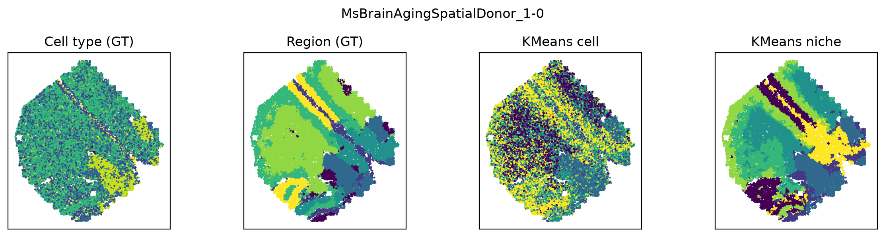

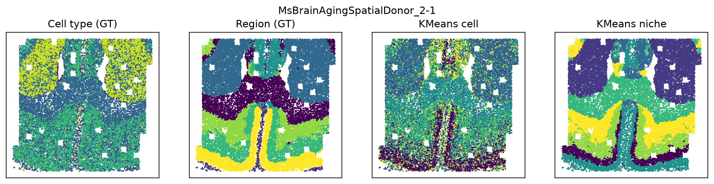

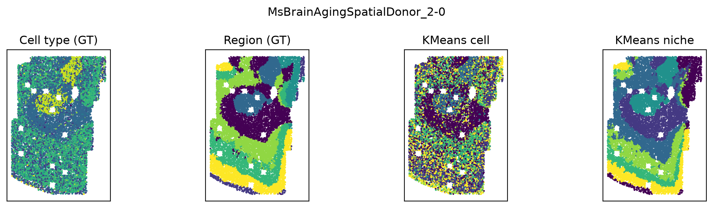

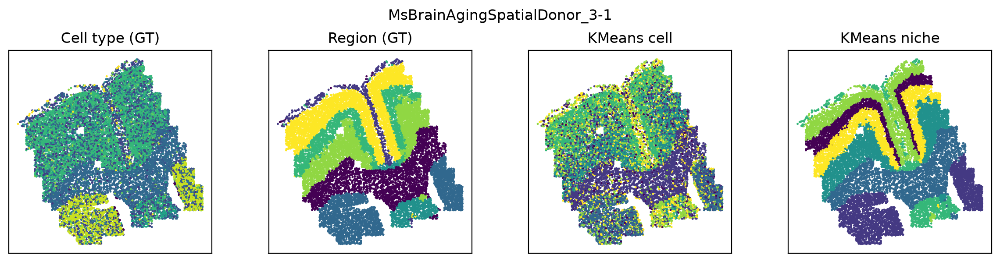

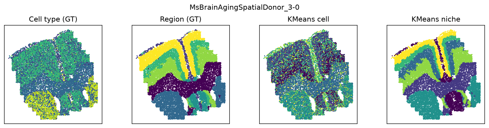

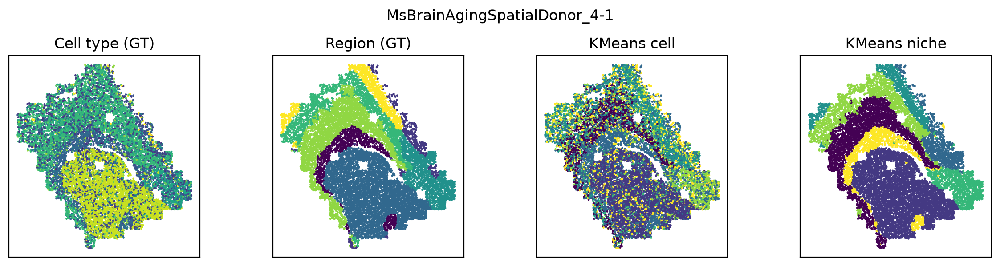

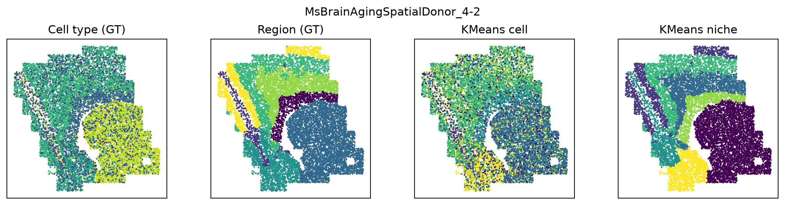

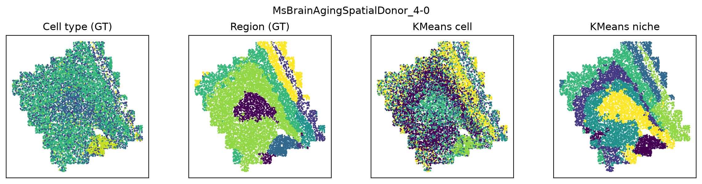

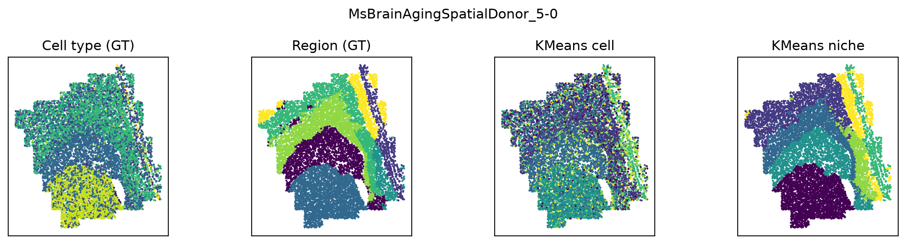

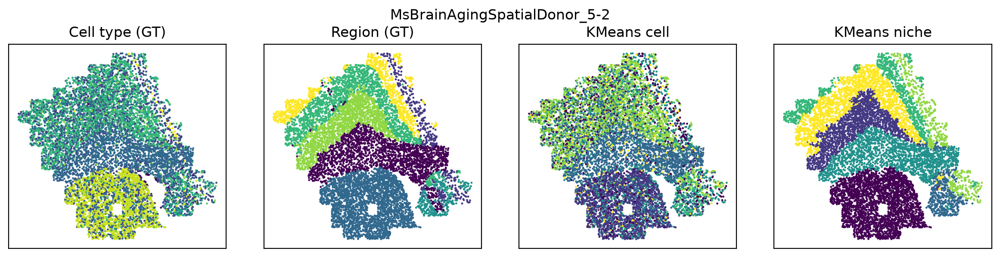

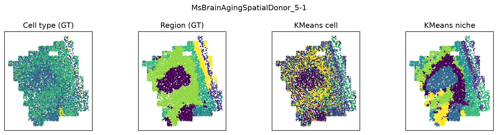

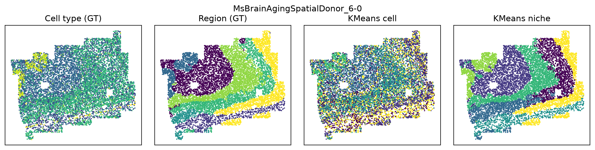

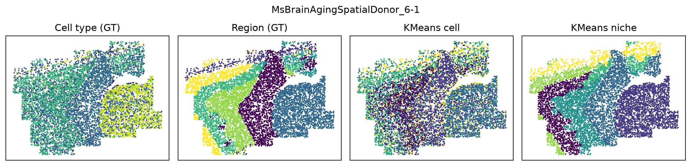

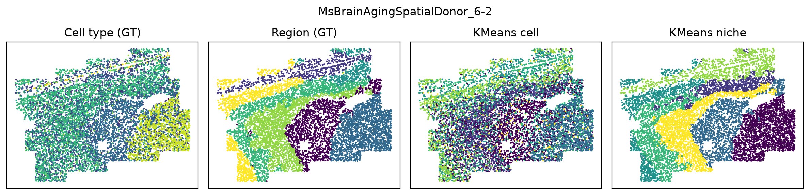

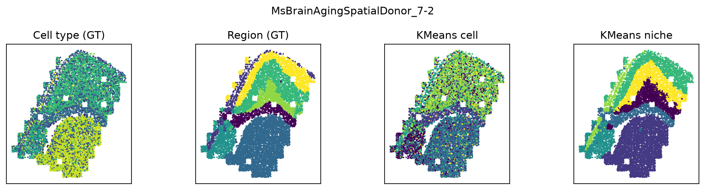

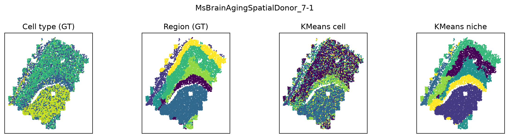

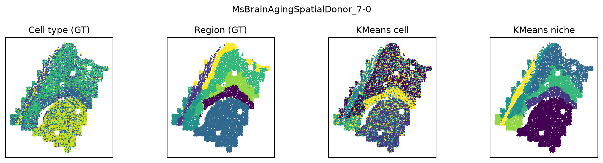

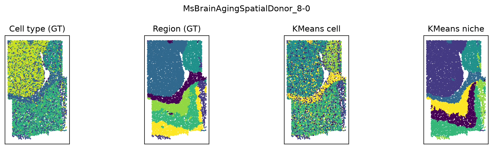

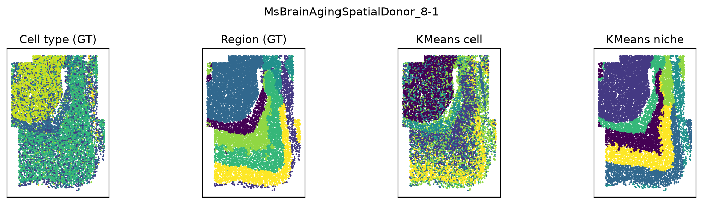

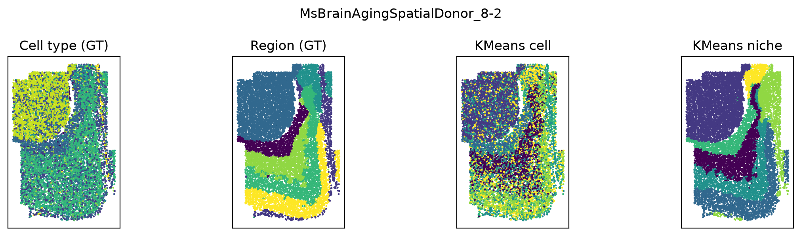

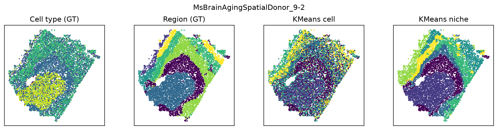

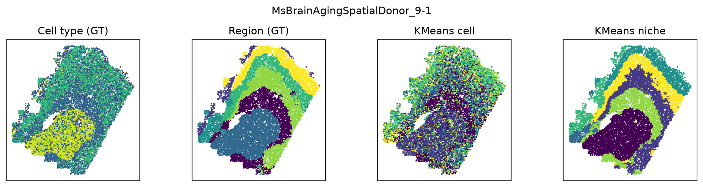

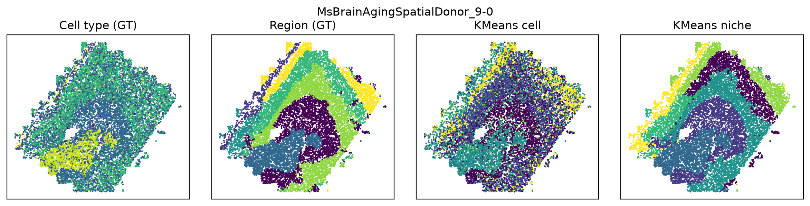

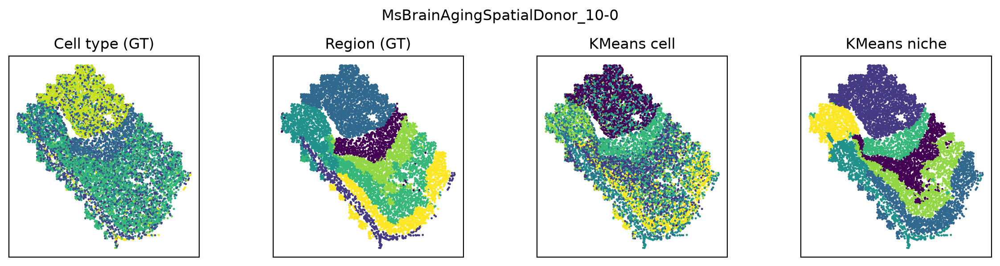

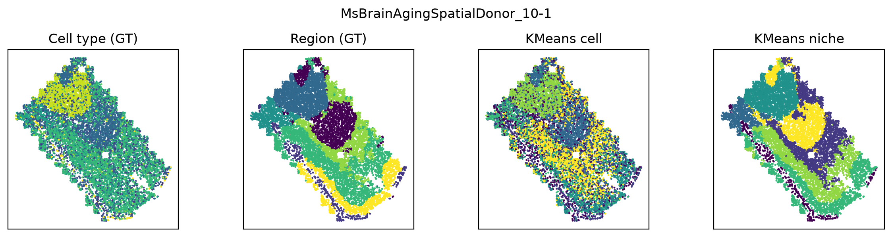

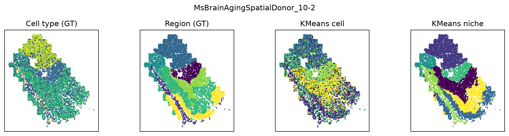

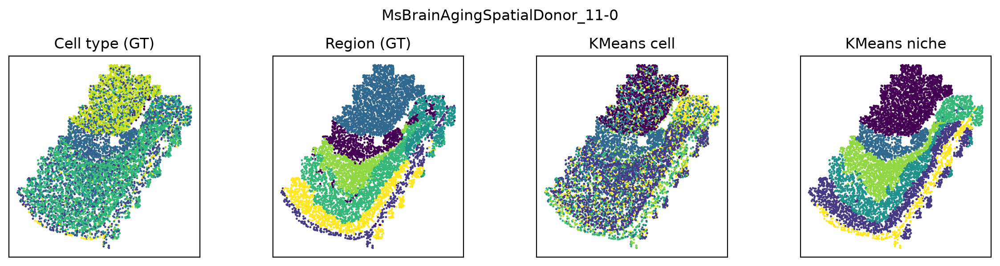

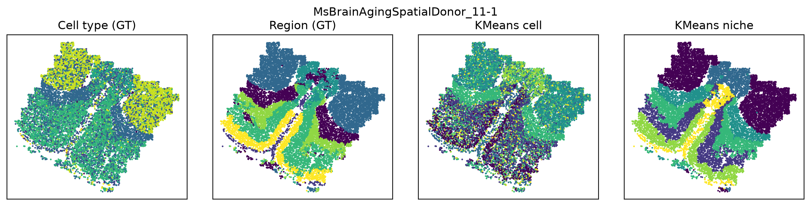

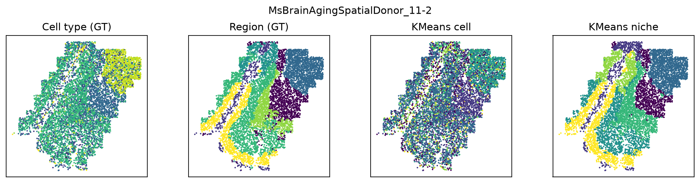

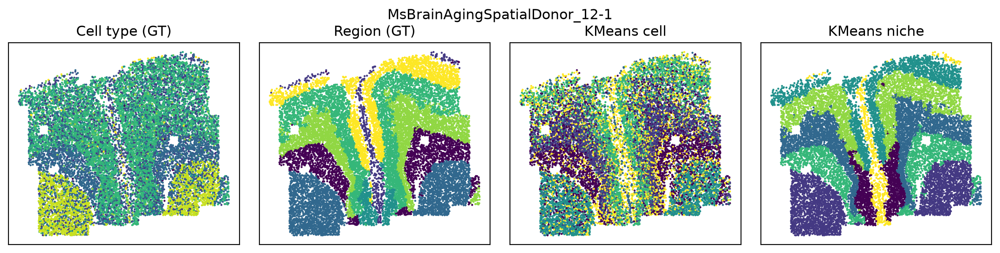

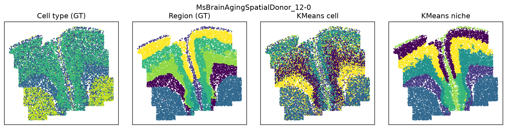

7. Evaluation (NMI / ARI)
--------------------------------------------------------------------------------

.. raw:: html

   
Agreement of the cell and niche clusters with the annotated brain regions, per slice and averaged.

.. code-block:: python
   :linenos:

   slice_list = SAMPLES
   
   # Per-slice results
   for s in slice_list:
       nmi_c, ari_c = results_cell[s]
       nmi_n, ari_n = results_niche[s]
       print(s)
       print(f"Cell:  NMI: {nmi_c:.4f}, ARI: {ari_c:.4f}")
       print(f"Niche: NMI: {nmi_n:.4f}, ARI: {ari_n:.4f}")
   
   cell_arr  = np.array([results_cell[s]  for s in slice_list], dtype=float)   # [S, 2]
   niche_arr = np.array([results_niche[s] for s in slice_list], dtype=float)   # [S, 2]
   
   cell_mean_nmi,  cell_mean_ari  = cell_arr.mean(axis=0)
   niche_mean_nmi, niche_mean_ari = niche_arr.mean(axis=0)
   
   print(f"Cell (mean):  NMI: {cell_mean_nmi:.4f}, ARI: {cell_mean_ari:.4f}")
   print(f"Niche(mean): NMI: {niche_mean_nmi:.4f}, ARI: {niche_mean_ari:.4f}")

.. container:: cell-output

   .. code-block:: text

      MsBrainAgingSpatialDonor_1-0
      Cell:  NMI: 0.2041, ARI: 0.1457
      Niche: NMI: 0.5927, ARI: 0.5155
      MsBrainAgingSpatialDonor_2-1
      Cell:  NMI: 0.3103, ARI: 0.3092
      Niche: NMI: 0.7569, ARI: 0.8070
      MsBrainAgingSpatialDonor_2-0
      Cell:  NMI: 0.2432, ARI: 0.2080
      Niche: NMI: 0.7043, ARI: 0.6450
      MsBrainAgingSpatialDonor_3-1
      Cell:  NMI: 0.3287, ARI: 0.2868
      Niche: NMI: 0.8076, ARI: 0.7755
      MsBrainAgingSpatialDonor_3-0
      Cell:  NMI: 0.3255, ARI: 0.2899
      Niche: NMI: 0.7883, ARI: 0.7719
      MsBrainAgingSpatialDonor_4-1
      Cell:  NMI: 0.3046, ARI: 0.3244
      Niche: NMI: 0.8098, ARI: 0.8823
      MsBrainAgingSpatialDonor_4-2
      Cell:  NMI: 0.2700, ARI: 0.2915
      Niche: NMI: 0.8070, ARI: 0.8641
      MsBrainAgingSpatialDonor_4-0
      Cell:  NMI: 0.1668, ARI: 0.1734
      Niche: NMI: 0.6007, ARI: 0.4120
      MsBrainAgingSpatialDonor_5-0
      Cell:  NMI: 0.2570, ARI: 0.2387
      Niche: NMI: 0.7409, ARI: 0.7587
      MsBrainAgingSpatialDonor_5-2
      Cell:  NMI: 0.2587, ARI: 0.2586
      Niche: NMI: 0.7794, ARI: 0.8264
      MsBrainAgingSpatialDonor_5-1
      Cell:  NMI: 0.1178, ARI: 0.1048
      Niche: NMI: 0.5543, ARI: 0.4118
      MsBrainAgingSpatialDonor_6-0
      Cell:  NMI: 0.2434, ARI: 0.1953
      Niche: NMI: 0.7294, ARI: 0.6920
      MsBrainAgingSpatialDonor_6-1
      Cell:  NMI: 0.2864, ARI: 0.2657
      Niche: NMI: 0.7695, ARI: 0.8078
      MsBrainAgingSpatialDonor_6-2
      Cell:  NMI: 0.2948, ARI: 0.2356
      Niche: NMI: 0.7685, ARI: 0.7524
      MsBrainAgingSpatialDonor_7-2
      Cell:  NMI: 0.2878, ARI: 0.3199
      Niche: NMI: 0.8093, ARI: 0.8787
      MsBrainAgingSpatialDonor_7-1
      Cell:  NMI: 0.2677, ARI: 0.2880
      Niche: NMI: 0.7455, ARI: 0.7824
      MsBrainAgingSpatialDonor_7-0
      Cell:  NMI: 0.2741, ARI: 0.2853
      Niche: NMI: 0.7567, ARI: 0.8073
      MsBrainAgingSpatialDonor_8-0
      Cell:  NMI: 0.3105, ARI: 0.3586
      Niche: NMI: 0.8426, ARI: 0.9193
      MsBrainAgingSpatialDonor_8-1
      Cell:  NMI: 0.3147, ARI: 0.3115
      Niche: NMI: 0.7766, ARI: 0.8311
      MsBrainAgingSpatialDonor_8-2
      Cell:  NMI: 0.3082, ARI: 0.3021
      Niche: NMI: 0.7773, ARI: 0.8348
      MsBrainAgingSpatialDonor_9-2
      Cell:  NMI: 0.2896, ARI: 0.2705
      Niche: NMI: 0.6770, ARI: 0.6841
      MsBrainAgingSpatialDonor_9-1
      Cell:  NMI: 0.2963, ARI: 0.2830
      Niche: NMI: 0.7878, ARI: 0.8174
      MsBrainAgingSpatialDonor_9-0
      Cell:  NMI: 0.2600, ARI: 0.2036
      Niche: NMI: 0.6999, ARI: 0.6728
      MsBrainAgingSpatialDonor_10-0
      Cell:  NMI: 0.2945, ARI: 0.2636
      Niche: NMI: 0.7817, ARI: 0.7955
      MsBrainAgingSpatialDonor_10-1
      Cell:  NMI: 0.2986, ARI: 0.2506
      Niche: NMI: 0.7444, ARI: 0.6784
      MsBrainAgingSpatialDonor_10-2
      Cell:  NMI: 0.3073, ARI: 0.2659
      Niche: NMI: 0.7297, ARI: 0.6688
      MsBrainAgingSpatialDonor_11-0
      Cell:  NMI: 0.2557, ARI: 0.2290
      Niche: NMI: 0.7627, ARI: 0.7737
      MsBrainAgingSpatialDonor_11-1
      Cell:  NMI: 0.2978, ARI: 0.2976
      Niche: NMI: 0.7299, ARI: 0.7821
      MsBrainAgingSpatialDonor_11-2
      Cell:  NMI: 0.2388, ARI: 0.2086
      Niche: NMI: 0.7149, ARI: 0.6617
      MsBrainAgingSpatialDonor_12-1
      Cell:  NMI: 0.2856, ARI: 0.2172
      Niche: NMI: 0.7620, ARI: 0.7332
      MsBrainAgingSpatialDonor_12-0
      Cell:  NMI: 0.2925, ARI: 0.2331
      Niche: NMI: 0.7597, ARI: 0.7353
      Cell (mean):  NMI: 0.2739, ARI: 0.2554
      Niche(mean): NMI: 0.7441, ARI: 0.7413

8. Summary plot
--------------------------------------------------------------------------------

.. code-block:: python
   :linenos:

   cell_nmi, cell_ari   = cell_arr[:, 0], cell_arr[:, 1]
   niche_nmi, niche_ari = niche_arr[:, 0], niche_arr[:, 1]
   
   fig, axes = plt.subplots(1, 2, figsize=(7, 3), dpi=200)
   rng = np.random.default_rng(0)
   
   for ax, (c_vals, n_vals, title) in zip(axes, [(cell_nmi, niche_nmi, "NMI"),
                                                (cell_ari, niche_ari, "ARI")]):
       ax.boxplot([c_vals, n_vals], tick_labels=["Cell", "Niche"], showfliers=False)
       ax.scatter(1 + rng.normal(0, 0.04, size=len(c_vals)), c_vals, s=12, alpha=0.8)
       ax.scatter(2 + rng.normal(0, 0.04, size=len(n_vals)), n_vals, s=12, alpha=0.8)
       ax.set_title(title)
       ax.grid(True, axis="y", alpha=0.3)
       ax.set_ylim(0, 0.9)
       ax.set_yticks(np.arange(0, 0.9 + 1e-9, 0.2))
   axes[0].set_ylabel("Score")
   
   plt.tight_layout()
   plt.show()

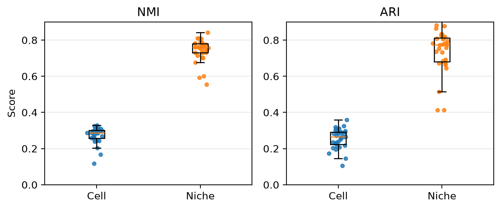

