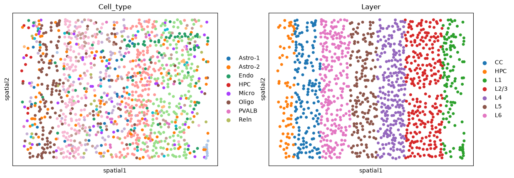
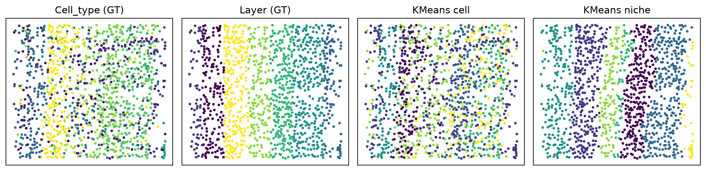

STARmap
================================================================================

:download:`Download original notebook <examples/STARmap_run_hiNiche.ipynb>`

Code and saved outputs are reproduced from this notebook. No cells are executed during documentation builds.

.. rubric:: hiNiche on single-cell spatial data (single slice): mouse V1 STARmap

.. raw:: html

   
<strong>Environment:</strong> run this notebook in the main <strong><code>hiNiche</code></strong> environment (<code>environment.yml</code>).

.. raw:: html

   
This notebook applies hiNiche (<code>hiNiche_img</code>, cell → niche) to a single STARmap slice of the mouse visual cortex (V1). The cell / niche embeddings are written to the AnnData, and niche clusters are evaluated against the annotated cortical layers (<code>adata.obs[LABEL_KEY]</code>).

1. Imports
--------------------------------------------------------------------------------

.. code-block:: python
   :linenos:

   import config
   import utils
   import model
   from train import run_train_img
   
   import anndata as ad
   import scanpy as sc
   import numpy as np
   import pandas as pd
   
   import matplotlib.pyplot as plt
   
   import os
   import glob
   import warnings
   import json
   from tqdm import tqdm
   
   from sklearn.metrics import normalized_mutual_info_score, adjusted_rand_score
   from sklearn.cluster import KMeans
   
   %load_ext autoreload
   %autoreload 2
   
   warnings.filterwarnings("ignore")

.. container:: cell-output

   .. code-block:: text

      The autoreload extension is already loaded. To reload it, use:
        %reload_ext autoreload

2. Configuration
--------------------------------------------------------------------------------

.. raw:: html

   
Data paths, the ground-truth columns (<code>LABEL_KEY</code>, <code>CELLTYPE_KEY</code>), the patch directory (<code>PATCH_LOC</code>) and model / training hyperparameters.

.. code-block:: python
   :linenos:

   SAMPLE = "Mouse_brain_STARmap_single_slice"
   
   # Data paths: a single-slice AnnData (raw counts in adata.X)
   h5_path      = f"DATA/{SAMPLE}/STARmap.h5ad"
   LABEL_KEY    = "Layer"         # ground-truth cortical layer (used for evaluation)
   CELLTYPE_KEY = "Cell_type"     # cell-type annotation (used for visualization)
   
   # Patch save path
   PATCH_LOC = f"DATA/{SAMPLE}/mini_batch_cache"
   
   # Model save path (if the file exists, the model is loaded and training is skipped)
   MODEL_SAVE_DIR = f"DATA/{SAMPLE}/checkpoint.pt"
   
   # Model / training hyperparameters
   single_patch = True    # the whole slice is used as a single patch
   n_pcs       = 30
   graph_knn   = 12
   niche_knn   = 20
   hidden_dim  = 32
   lr          = 0.005
   num_epochs  = 100
   edge_drop   = 0.5
   member_drop = 0.5
   neg_samples = 5
   tau         = 1
   seed        = 42
   n_clusters  = 7        # number of annotated layers in LABEL_KEY
   device      = "cuda:0"

3. Load data
--------------------------------------------------------------------------------

.. raw:: html

   
Read the AnnData and show the annotated cell types and cortical layers.

.. code-block:: python
   :linenos:

   adata = sc.read(h5_path)
   adata.var_names_make_unique()
   print(adata)
   
   sc.pl.embedding(adata, basis="spatial", color=[CELLTYPE_KEY, LABEL_KEY], s=100)

.. container:: cell-output

   .. code-block:: text

      AnnData object with n_obs × n_vars = 1207 × 1020
          obs: 'Cell', 'Cell_type', 'X', 'Y', 'Layer'
          obsm: 'spatial'

4. Build graphs, niches and mini-batch
--------------------------------------------------------------------------------

.. raw:: html

   
Normalize + log1p the raw counts, scale + PCA, build KNN niches (<code>niche_knn</code> cells per niche), the cell graph (expression PCA KNN) and the niche graph (spatial KNN), then cache the slice as a single block in <code>PATCH_LOC</code>.

.. code-block:: python
   :linenos:

   adata.layers["counts"] = adata.X.copy()
   sc.pp.normalize_total(adata, target_sum=1e4)
   sc.pp.log1p(adata)
   
   X_backup = adata.X.copy()
   sc.pp.scale(adata)
   sc.tl.pca(adata, n_comps=n_pcs)
   adata.X = X_backup
   
   adata.obsm["X_input"] = adata.X
   adata.obsm["X_mle"] = adata.layers["counts"]
   spatial_coords_px = adata.obsm["spatial"]
   
   # Each niche = a center cell and its niche_knn nearest cells (including itself)
   S_c2n_all, _, _ = utils.build_cell_niche_mapping_knn(spatial_coords_px, k_niche = niche_knn)
   
   cell_edges = utils.build_spot_knn_graph(adata.obsm["X_pca"], graph_knn)    # cell graph: expression (PCA) KNN
   niche_edges = utils.build_spot_knn_graph(spatial_coords_px, graph_knn)     # niche graph: spatial KNN
   batch_mask, block_ids = utils.make_cell_block_masks(spatial_coords_px, S_c2n = S_c2n_all, single_patch = single_patch)
   
   # Remove old blocks, otherwise the loader would also read leftovers from a previous run
   for f in glob.glob(os.path.join(PATCH_LOC, "block_*.pt")):
       os.remove(f)
   utils.build_cell_subgraph_data(adata, ref_matrix = None,
                                  cell_edges = cell_edges,
                                  niche_edges = niche_edges,
                                  S_c2n_all = S_c2n_all,
                                  batch_mask = batch_mask,
                                  block_ids = block_ids,
                                  save_dir = PATCH_LOC)
   
   sample_number = {"cell": S_c2n_all.shape[0], "niche": S_c2n_all.shape[1]}

.. container:: cell-output

   .. code-block:: text

      [Log] Active niches: 1207, Cells per niche (k): 20
      [Log] 22754 edges generated from 1207 nodes (k=12)
      [Log] 16398 edges generated from 1207 nodes (k=12)

.. container:: cell-output

   .. code-block:: text

      [Log] Building & saving cell mini-batches: 100%|██████████| 1/1 [00:00<00:00,  7.61it/s]

.. container:: cell-output

   .. code-block:: text

      [Log] saved 1 cell blocks → DATA/Mouse_brain_STARmap_single_slice/mini_batch_cache

5. Training
--------------------------------------------------------------------------------

.. raw:: html

   
Single slice: pass a dict of unit numbers and a single patch directory. If <code>MODEL_SAVE_DIR</code> already exists, the model is loaded and training is skipped. Embeddings are written to <code>adata.obsm[&quot;X_cell_emb&quot;]</code> and <code>adata.obsm[&quot;X_niche_emb&quot;]</code>.

.. code-block:: python
   :linenos:

   emb_all, _ = run_train_img(sample_number,
                              PATCH_LOC = PATCH_LOC,
                              MODEL_SAVE_DIR = MODEL_SAVE_DIR,
                              ref_matrix = None,
                              lr = lr,
                              in_dim = adata.n_vars,
                              hidden_dim = hidden_dim,
                              num_epochs = num_epochs,
                              edge_drop = edge_drop,
                              member_drop = member_drop,
                              neg_samples = neg_samples,
                              tau = tau,
                              seed = seed,
                              device = device)
   
   # With KNN niches every cell is a niche center, so niche embeddings are aligned with cells as well
   adata.obsm["X_cell_emb"]  = emb_all["cell"].detach().cpu().numpy()
   adata.obsm["X_niche_emb"] = emb_all["niche"].detach().cpu().numpy()

.. container:: cell-output

   .. code-block:: text

      Epoch 1: 100%|██████████| 1/1 [00:00<00:00,  1.20it/s, cl=3.7930]
      Epoch 2: 100%|██████████| 1/1 [00:00<00:00, 36.30it/s, cl=3.7899]
      Epoch 3: 100%|██████████| 1/1 [00:00<00:00, 43.51it/s, cl=3.6199]
      Epoch 4: 100%|██████████| 1/1 [00:00<00:00, 44.84it/s, cl=3.4801]
      Epoch 5: 100%|██████████| 1/1 [00:00<00:00, 46.13it/s, cl=3.3360]
      Epoch 6: 100%|██████████| 1/1 [00:00<00:00, 43.97it/s, cl=3.2604]
      Epoch 7: 100%|██████████| 1/1 [00:00<00:00, 46.08it/s, cl=3.2879]
      Epoch 8: 100%|██████████| 1/1 [00:00<00:00, 44.95it/s, cl=3.2387]
      Epoch 9: 100%|██████████| 1/1 [00:00<00:00, 44.31it/s, cl=3.2243]
      Epoch 10: 100%|██████████| 1/1 [00:00<00:00, 41.19it/s, cl=3.2145]
      Epoch 11: 100%|██████████| 1/1 [00:00<00:00, 44.18it/s, cl=3.2013]
      Epoch 12: 100%|██████████| 1/1 [00:00<00:00, 43.91it/s, cl=3.1942]
      Epoch 13: 100%|██████████| 1/1 [00:00<00:00, 43.93it/s, cl=3.1865]
      Epoch 14: 100%|██████████| 1/1 [00:00<00:00, 44.17it/s, cl=3.1866]
      Epoch 15: 100%|██████████| 1/1 [00:00<00:00, 45.36it/s, cl=3.1690]
      Epoch 16: 100%|██████████| 1/1 [00:00<00:00, 45.64it/s, cl=3.1633]
      Epoch 17: 100%|██████████| 1/1 [00:00<00:00, 45.02it/s, cl=3.1594]
      Epoch 18: 100%|██████████| 1/1 [00:00<00:00, 46.96it/s, cl=3.1411]
      Epoch 19: 100%|██████████| 1/1 [00:00<00:00, 46.36it/s, cl=3.1257]
      Epoch 20: 100%|██████████| 1/1 [00:00<00:00, 42.81it/s, cl=3.1104]
      Epoch 21: 100%|██████████| 1/1 [00:00<00:00, 43.88it/s, cl=3.0833]
      Epoch 22: 100%|██████████| 1/1 [00:00<00:00, 44.80it/s, cl=3.0691]
      Epoch 23: 100%|██████████| 1/1 [00:00<00:00, 44.33it/s, cl=3.0410]
      Epoch 24: 100%|██████████| 1/1 [00:00<00:00, 43.38it/s, cl=3.0264]
      Epoch 25: 100%|██████████| 1/1 [00:00<00:00, 45.10it/s, cl=2.9957]
      Epoch 26: 100%|██████████| 1/1 [00:00<00:00, 44.37it/s, cl=2.9775]
      Epoch 27: 100%|██████████| 1/1 [00:00<00:00, 46.21it/s, cl=2.9652]
      Epoch 28: 100%|██████████| 1/1 [00:00<00:00, 45.74it/s, cl=2.9628]
      Epoch 29: 100%|██████████| 1/1 [00:00<00:00, 44.65it/s, cl=2.9480]
      Epoch 30: 100%|██████████| 1/1 [00:00<00:00, 45.11it/s, cl=2.9385]
      Epoch 31: 100%|██████████| 1/1 [00:00<00:00, 43.49it/s, cl=2.9334]
      Epoch 32: 100%|██████████| 1/1 [00:00<00:00, 41.96it/s, cl=2.9300]
      Epoch 33: 100%|██████████| 1/1 [00:00<00:00, 34.85it/s, cl=2.9242]
      Epoch 34: 100%|██████████| 1/1 [00:00<00:00, 46.32it/s, cl=2.9192]
      Epoch 35: 100%|██████████| 1/1 [00:00<00:00, 46.74it/s, cl=2.9147]
      Epoch 36: 100%|██████████| 1/1 [00:00<00:00, 44.49it/s, cl=2.9099]
      Epoch 37: 100%|██████████| 1/1 [00:00<00:00, 44.03it/s, cl=2.9065]
      Epoch 38: 100%|██████████| 1/1 [00:00<00:00, 44.33it/s, cl=2.9018]
      Epoch 39: 100%|██████████| 1/1 [00:00<00:00, 43.97it/s, cl=2.8960]
      Epoch 40: 100%|██████████| 1/1 [00:00<00:00, 42.36it/s, cl=2.8939]
      Epoch 41: 100%|██████████| 1/1 [00:00<00:00, 42.37it/s, cl=2.8881]
      Epoch 42: 100%|██████████| 1/1 [00:00<00:00, 44.14it/s, cl=2.8939]
      Epoch 43: 100%|██████████| 1/1 [00:00<00:00, 45.33it/s, cl=2.8798]
      Epoch 44: 100%|██████████| 1/1 [00:00<00:00, 46.36it/s, cl=2.8777]
      Epoch 45: 100%|██████████| 1/1 [00:00<00:00, 43.08it/s, cl=2.8794]
      Epoch 46: 100%|██████████| 1/1 [00:00<00:00, 43.12it/s, cl=2.8747]
      Epoch 47: 100%|██████████| 1/1 [00:00<00:00, 44.53it/s, cl=2.8699]
      Epoch 48: 100%|██████████| 1/1 [00:00<00:00, 43.82it/s, cl=2.8686]
      Epoch 49: 100%|██████████| 1/1 [00:00<00:00, 44.39it/s, cl=2.8689]
      Epoch 50: 100%|██████████| 1/1 [00:00<00:00, 45.01it/s, cl=2.8667]
      Epoch 51: 100%|██████████| 1/1 [00:00<00:00, 45.25it/s, cl=2.8628]
      Epoch 52: 100%|██████████| 1/1 [00:00<00:00, 45.57it/s, cl=2.8605]
      Epoch 53: 100%|██████████| 1/1 [00:00<00:00, 45.95it/s, cl=2.8634]
      Epoch 54: 100%|██████████| 1/1 [00:00<00:00, 47.13it/s, cl=2.8647]
      Epoch 55: 100%|██████████| 1/1 [00:00<00:00, 48.64it/s, cl=2.8640]
      Epoch 56: 100%|██████████| 1/1 [00:00<00:00, 47.17it/s, cl=2.8570]
      Epoch 57: 100%|██████████| 1/1 [00:00<00:00, 44.99it/s, cl=2.8611]
      Epoch 58: 100%|██████████| 1/1 [00:00<00:00, 44.99it/s, cl=2.8539]
      Epoch 59: 100%|██████████| 1/1 [00:00<00:00, 45.26it/s, cl=2.8572]
      Epoch 60: 100%|██████████| 1/1 [00:00<00:00, 45.72it/s, cl=2.8593]
      Epoch 61: 100%|██████████| 1/1 [00:00<00:00, 44.86it/s, cl=2.8506]
      Epoch 62: 100%|██████████| 1/1 [00:00<00:00, 45.49it/s, cl=2.8525]
      Epoch 63: 100%|██████████| 1/1 [00:00<00:00, 47.39it/s, cl=2.8506]
      Epoch 64: 100%|██████████| 1/1 [00:00<00:00, 44.07it/s, cl=2.8504]
      Epoch 65: 100%|██████████| 1/1 [00:00<00:00, 44.44it/s, cl=2.8479]
      Epoch 66: 100%|██████████| 1/1 [00:00<00:00, 43.24it/s, cl=2.8475]
      Epoch 67: 100%|██████████| 1/1 [00:00<00:00, 43.53it/s, cl=2.8504]
      Epoch 68: 100%|██████████| 1/1 [00:00<00:00, 43.04it/s, cl=2.8428]
      Epoch 69: 100%|██████████| 1/1 [00:00<00:00, 44.63it/s, cl=2.8466]
      Epoch 70: 100%|██████████| 1/1 [00:00<00:00, 45.50it/s, cl=2.8463]
      Epoch 71: 100%|██████████| 1/1 [00:00<00:00, 43.70it/s, cl=2.8463]
      Epoch 72: 100%|██████████| 1/1 [00:00<00:00, 43.05it/s, cl=2.8461]
      Epoch 73: 100%|██████████| 1/1 [00:00<00:00, 43.24it/s, cl=2.8431]
      Epoch 74: 100%|██████████| 1/1 [00:00<00:00, 44.17it/s, cl=2.8445]
      Epoch 75: 100%|██████████| 1/1 [00:00<00:00, 44.22it/s, cl=2.8444]
      Epoch 76: 100%|██████████| 1/1 [00:00<00:00, 44.46it/s, cl=2.8391]
      Epoch 77: 100%|██████████| 1/1 [00:00<00:00, 45.28it/s, cl=2.8390]
      Epoch 78: 100%|██████████| 1/1 [00:00<00:00, 45.29it/s, cl=2.8417]
      Epoch 79: 100%|██████████| 1/1 [00:00<00:00, 44.33it/s, cl=2.8397]
      Epoch 80: 100%|██████████| 1/1 [00:00<00:00, 45.99it/s, cl=2.8389]
      Epoch 81: 100%|██████████| 1/1 [00:00<00:00, 47.27it/s, cl=2.8396]
      Epoch 82: 100%|██████████| 1/1 [00:00<00:00, 46.94it/s, cl=2.8409]
      Epoch 83: 100%|██████████| 1/1 [00:00<00:00, 46.25it/s, cl=2.8369]
      Epoch 84: 100%|██████████| 1/1 [00:00<00:00, 43.97it/s, cl=2.8398]
      Epoch 85: 100%|██████████| 1/1 [00:00<00:00, 44.61it/s, cl=2.8359]
      Epoch 86: 100%|██████████| 1/1 [00:00<00:00, 44.31it/s, cl=2.8356]
      Epoch 87: 100%|██████████| 1/1 [00:00<00:00, 44.79it/s, cl=2.8352]
      Epoch 88: 100%|██████████| 1/1 [00:00<00:00, 43.54it/s, cl=2.8357]
      Epoch 89: 100%|██████████| 1/1 [00:00<00:00, 46.59it/s, cl=2.8318]
      Epoch 90: 100%|██████████| 1/1 [00:00<00:00, 45.44it/s, cl=2.8372]
      Epoch 91: 100%|██████████| 1/1 [00:00<00:00, 43.46it/s, cl=2.8347]
      Epoch 92: 100%|██████████| 1/1 [00:00<00:00, 43.25it/s, cl=2.8301]
      Epoch 93: 100%|██████████| 1/1 [00:00<00:00, 43.57it/s, cl=2.8286]
      Epoch 94: 100%|██████████| 1/1 [00:00<00:00, 44.37it/s, cl=2.8302]
      Epoch 95: 100%|██████████| 1/1 [00:00<00:00, 43.68it/s, cl=2.8335]
      Epoch 96: 100%|██████████| 1/1 [00:00<00:00, 43.21it/s, cl=2.8361]
      Epoch 97: 100%|██████████| 1/1 [00:00<00:00, 43.24it/s, cl=2.8280]
      Epoch 98: 100%|██████████| 1/1 [00:00<00:00, 43.75it/s, cl=2.8309]
      Epoch 99: 100%|██████████| 1/1 [00:00<00:00, 43.49it/s, cl=2.8296]
      Epoch 100: 100%|██████████| 1/1 [00:00<00:00, 43.82it/s, cl=2.8283]

.. container:: cell-output

   .. code-block:: text

      Training finished!
      Model saved to DATA/Mouse_brain_STARmap_single_slice/checkpoint.pt

.. container:: cell-output

   .. code-block:: text

      generating embeddings (slice 0)...: 100%|██████████| 1/1 [00:00<00:00, 40.42it/s]

6. Clustering and visualization
--------------------------------------------------------------------------------

.. raw:: html

   
KMeans on the cell and niche embeddings, plotted next to the annotated cell types (<code>CELLTYPE_KEY</code>) and cortical layers (<code>LABEL_KEY</code>). Labels are stored in <code>adata.obs[&quot;kmeans_cell&quot;]</code> / <code>adata.obs[&quot;kmeans_niche&quot;]</code>.

.. code-block:: python
   :linenos:

   spatial = adata.obsm["spatial"]
   x, y = spatial[:, 0], spatial[:, 1]
   
   X_cell  = np.asarray(adata.obsm["X_cell_emb"])
   X_niche = np.asarray(adata.obsm["X_niche_emb"])
   
   labels_cell  = KMeans(n_clusters=n_clusters, random_state=42, n_init=20).fit_predict(X_cell)
   labels_niche = KMeans(n_clusters=n_clusters, random_state=42, n_init=20).fit_predict(X_niche)
   
   adata.obs["kmeans_cell"]  = pd.Categorical(labels_cell.astype(str))
   adata.obs["kmeans_niche"] = pd.Categorical(labels_niche.astype(str))
   
   # Ground-truth labels
   point_size = 10
   celltype = adata.obs[CELLTYPE_KEY].astype("category")
   layer = adata.obs[LABEL_KEY].astype("category")
   
   fig, axes = plt.subplots(1, 4, figsize=(12, 3), dpi=200)
   panels = [(celltype.cat.codes, f"{CELLTYPE_KEY} (GT)"),
             (layer.cat.codes,    f"{LABEL_KEY} (GT)"),
             (labels_cell,        "KMeans cell"),
             (labels_niche,       "KMeans niche")]
   for ax, (c, title) in zip(axes, panels):
       ax.scatter(x, y, c=c, s=point_size, linewidths=0)
       ax.set_xticks([]); ax.set_yticks([])
       ax.set_title(title)
   plt.tight_layout()
   plt.show()

7. Evaluation (NMI / ARI)
--------------------------------------------------------------------------------

.. raw:: html

   
Agreement of the cell and niche clusters with the annotated cortical layers (<code>LABEL_KEY</code>).

.. code-block:: python
   :linenos:

   true_labels = adata.obs[LABEL_KEY]
   
   nmi_cell  = normalized_mutual_info_score(true_labels, labels_cell)
   ari_cell  = adjusted_rand_score(true_labels, labels_cell)
   nmi_niche = normalized_mutual_info_score(true_labels, labels_niche)
   ari_niche = adjusted_rand_score(true_labels, labels_niche)
   
   print(f"Cell:  NMI: {nmi_cell:.4f}, ARI: {ari_cell:.4f}")
   print(f"Niche: NMI: {nmi_niche:.4f}, ARI: {ari_niche:.4f}")

.. container:: cell-output

   .. code-block:: text

      Cell:  NMI: 0.3164, ARI: 0.1875
      Niche: NMI: 0.7189, ARI: 0.6296

